# DIRECTmf ソルバーの内部設計

## 概要

DIRECTmf（`!SOLVER` の `METHOD=DIRECTmf`）は、FrontISTR の並列基盤ライブラリ HEC-MW に
組み込まれたマルチフロンタル法 [1][2] の疎行列直接法ソルバーである。対称行列は閾値
ピボッティング付きの LDLᵀ で分解する（正と負の固有値を併せ持つ不定値行列も扱える）。
構造対称・数値非対称の行列（非零パターンは対称だが値は非対称）は LU で分解する。
OpenMP スレッド並列と MPI 分散（任意プロセス数）、因子の BLR 圧縮（低ランク近似による
圧縮）、反復改良（残差で解を補正する後処理）を備える。

本書は、原作者以外の開発者が保守・拡張できるように、「なぜそう設計したか・内部で
どう動くか」をまとめた開発者向けの資料である。今後の設計議論の土台にもなることを
意図している。議論の例は、消去なし接触の MPI 対応と、他の直接法への BLR・反復改良の展開である。
消去なし接触とは、接触自由度と Lagrange 乗数を消去せず、剛性と拘束の行・列を併せ持つ
連立方程式（鞍点系）のまま解く経路をいう（「接触・MPC との関係」参照）。この経路で
DIRECTmf を呼び出すモジュールを、本書では**接触ラッパ**と呼ぶ。
キーワードの使い方や推奨設定などの利用者向けの情報は、ユーザーマニュアル
（解析制御データ `!SOLVER` のキーワードリファレンスと機能リファレンスの直接法ソルバーの節）にあり、
本書では繰り返さない。

本書は 2026 年 11 月時点の master のソースに合わせて書いた。本書を直さないままソースが
変わることがあるので、食い違ったときはソースを正とする。本書の最終更新より後のソースの変更は、
次のように、本書を最後に変えたコミットからの履歴で確かめられる。

```sh
c=$(git log -1 --format=%H -- doc/directmf/design.md)
git log $c..HEAD -- hecmw1/src/solver/solver_direct_mf/ hecmw1/src/solver/contact/
```

ソースは `hecmw1/src/solver/solver_direct_mf/` の 6 ファイルにまとまっている（「モジュール構成」参照）。
各モジュール冒頭の doxygen コメントに、そのモジュール内のデータ配置や処理の約束事を書いてあるので、
本書と併せて読むこと。

読み方と表記の約束は次のとおり。

- 疎行列直接法そのものに馴染みがない読者のために、次章で fill-in・オーダリング・消去木・
  スーパーノード・マルチフロンタル法・ピボッティング・低ランク圧縮・symbolic 分解と
  数値分解という基礎概念を小さな例で導入する。以降の章はこれらの用語を前提に書いて
  あるので、馴染みがなければ順に読み、馴染みがあれば読み飛ばして「設計方針と理由」から
  読み始めてよい。巻末には用語集を置く
- 一部の専門語（symbolic、fully summed、full-rank、contribution block など）は、本書では
  英語のまま用い、初出で意味を添える
- 本書で単に「ランク」と書くときは MPI のプロセス（番号は 0 始まり）を指し、行列や
  低ランク近似のランクは「行列のランク」「低ランク」「近似ランク r」と書き分ける。
  「低ランク」「近似ランクが高い」などの高低は、行列のランクではなく近似ランク r の大小を指す。
  例外として、BLR の機能名「ランク再利用」（マニュアルの呼び方に合わせた）のランクは近似ランクを指す
- バッククォートで囲んだ名前（`panel_attempt` など）は、ソースのルーチン・変数・定数との
  対応を示す注記である。設計の理解には読み飛ばしてよい

本書の構成は次のとおり。本文の「〜」参照は、以下の章・節の名前を指す。

- 概要
- 前提知識: 疎行列直接法の基礎 — 消去と fill-in / セパレータとネステッドディセクション /
  消去木とスーパーノード / フロンタル法からマルチフロンタル法へ / ピボッティングと遅延ピボット /
  低ランク圧縮（BLR）/ symbolic 分解と数値分解
- 設計方針と理由 — 自前実装の動機と要件 / グローバル直接法 / マルチフロンタル法 /
  閾値ピボッティングと遅延ピボット / 圧縮節点グラフ / symbolic 段と数値段の分離 /
  タイル構造のフロンタル行列 / 並列化と決定性 / 近似分解と反復改良の組み合わせ / 外部依存の範囲
- モジュール構成 — HEC-MW ソルバー枠組みとの接続
- 主要データ構造 — hecmwST_mf_graph（圧縮グラフ）/ hecmwST_mf_symbolic（symbolic 構造）/
  フロンタル行列の構成（hecmwST_mf_factor と mf_snode）/ 遅延 DOF の extend-add /
  配列との対応 / 作業領域（mf_grid / mf_work / mf_pool）
- 処理の流れ — symbolic 分解 / 数値分解 / 求解 / 反復改良
- 分解モードとピボッティング — パネルごとの 2 段構え / ピボッティング・カーネル / LU モードの格納 /
  閾値・零ピボット判定と統計 / 根フロントの扱い
- BLR 圧縮
- 並列化 — 並列化の戦略 / OpenMP / MPI 分散（写像の構築: 昇格と詰め込み /
  分散数値分解の 2 段階 / 上位フロントのデータ分散 / 上位フロント 1 つの処理手順 /
  分散ピボッティング / 時系列とデッドロック回避 / 分散求解）/ 決定性
- 接触・MPC との関係
- キーワードと内部動作の対応 — 内部定数の決め方
- テスト
- 保守時に守る約束
- 既知の制限と拡張余地
- 用語集 — 表記と基礎概念 / 設計・データ構造・ピボッティング / BLR 圧縮 / 並列化 / 接触
  （各「〜の用語」）/ 記号の一覧
- 参考文献
- 関連 issue / MR

## 前提知識: 疎行列直接法の基礎

本章は、剛性行列と要素アセンブリには馴染みがあるが疎行列直接法は専門でない読者のための
導入である。

### 消去と fill-in

直接法の本体は Gauss 消去（対称なら LDLᵀ 分解）である。分解で得られる L と D
（LU 分解なら L と U）を本書では**因子**と呼ぶ。剛性行列の非零パターンは
「節点とその結合」のグラフとみなせる。1 つの節点（自由度ブロック）を消去すると、
その節点の隣接節点どうしがすべて互いに結合する。行列でいえば、元は零だった位置に
新しい非零（**fill-in**）が生まれる。

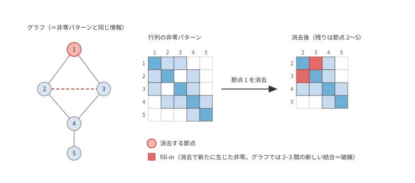

fill-in は因子のメモリと演算量をそのまま増やすので、どの順番で消去するか
（**オーダリング**）が直接法の性能をほぼ決める。

### セパレータとネステッドディセクション

fill-in を抑える代表的な並べ替えがネステッドディセクションである。メッシュを小さな
境界節点集合（**セパレータ**）で 2 つの領域に切り、「領域 A → 領域 B → セパレータ S」の
順に消去する。A と B の間に直接の結合はないから、両者は互いに fill-in を生じさせず
独立に消去でき、fill-in は各領域の内部、S との結合部、S 自身のブロックに閉じる。この
分割を各領域へ再帰的に適用したものがネステッドディセクションで、METIS 有効ビルドの
DIRECTmf が既定で使う METIS [3] はこれを計算するライブラリである。

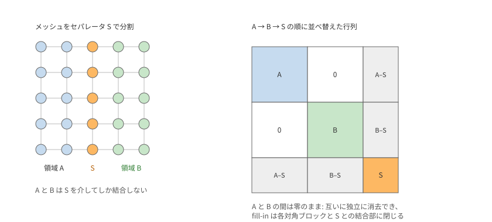

消去の後半に残る大きなセパレータどうしの結合は密なブロックになる。後述の BLR 圧縮は
主にこのセパレータ由来の密ブロックを狙う。

### 消去木とスーパーノード

以下、行列の列を消去する順に番号付けし、k 番目に消去する列を列 k と呼ぶ（実装で列が
節点と DOF〔自由度〕のどちらを指すかは「主要データ構造」参照）。
列 k の親 parent(k) を、因子の列 k で対角より下で最初に非零になる行 p と定める（下図の
列 1 は行 3 が最初の非零なので parent(1)=3）。因子の非零パターンは、値を使わず元の行列の
非零パターンだけから前もって求められる（「symbolic 分解と数値分解」）ので、消去木も分解の
前に作れる。p だけを記録すれば足りる理由は次のとおりである。列 k を消去すると、列 k に
非零を持つ行どうしがすべて互いに結合する（前節の fill-in）。とくに行 p と、それより下にある
列 k の非零行とが結合するので、それらの行は列 p にも非零として現れる。したがって
列 k の影響は列 p を経由して先へ伝わる。下図では、列 3 は行 4 と 6 に非零を持ち、
parent(3)=4 の列 4 も行 6 に非零を持つ。このような包含が一般に成り立つので、parent だけで
依存関係が尽くせる。この親子関係で列は木をなす（非連結のメッシュの
ように、行列が互いに結合のない部分に分かれるときは、根が複数ある森になる）。これを
**消去木**（elimination tree）[4] と呼ぶ。消去木は「どの列の計算がどの列より先に終わって
いなければならないか」という依存関係のすべてを表し、兄弟の部分木どうしは独立に
計算できる。本書に出てくる並列化の大枠（OpenMP のタスク分け、MPI の担当割り）は、
この木の形に従っている。

構造解析の言葉でいえば、ネステッドディセクションで作った消去木は、多段の部分構造法
（部分構造をさらに小さな部分構造に分け、内部を静的縮約して境界だけを上位へ渡す方法）の
階層にあたる。葉が最小の部分構造、内側の節がそれらをつなぐ境界（セパレータ）である。
これは直観のためのたとえで、消去木そのものはどのオーダリングに対しても定義される。

因子の列 k で、対角より下で非零になる行の集合を、列 k の**行構造**と呼ぶ。隣り合う
列 k と k+1 で、列 k の行構造から k+1 自身を除いたものが列 k+1 の行構造に一致する
（つまり対角より下では同じ行に非零が並ぶ）とき、両者の行構造は揃っているという。この関係が続く限り連続する
列をひとまとめにしたものが**スーパーノード**である（下図では列 4・5・6）。まとめた列は
1 つの密ブロックとして扱え、BLAS レベル 3（行列どうしの積などの密行列演算）で
高速に処理できる。スーパーノードを 1 つの節とみなして消去木を縮めたものを
**スーパーノード木**と呼ぶ。以降の「木」はたいていこちらを指す。

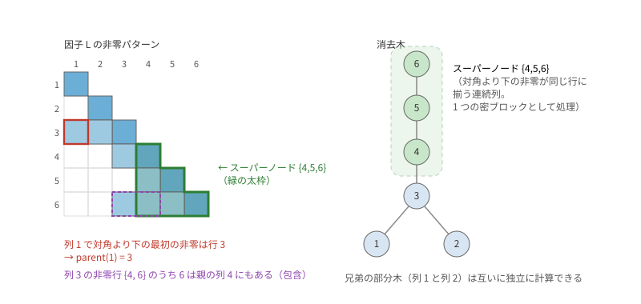

### フロンタル法からマルチフロンタル法へ

構造解析には、要素を 1 つずつアセンブリしながら、寄与がすべて集まり終えた自由度から
順に消去していく Irons の**フロンタル法** [5]（かつての FEM の標準的ソルバー）がある。
**マルチフロンタル法** [1][2] はその一般化で、1 本の「前線」を進める代わりに、
消去木の節（スーパーノード）ごとに小さな密行列（**フロンタル行列**。以下、単に
**フロント**とも呼ぶ）を組み立てて部分消去する。フロンタル行列の行・列（自由度）は
2 種類に分かれる。1 つは、関係する
要素と子の寄与がすべて合流し終えて、この時点で消去してよい自由度で、これを
**fully summed**（寄与が足し終わっている、の意）と呼ぶ。もう 1 つは、まだ別のフロンタル
行列からの寄与が残っていて消去できない自由度である。消去するのは fully summed な
行・列だけである。

消去し終えると、まだ消去できない行・列には「消去した自由度が残りの自由度に及ぼす影響」が
更新量として残る。この残った部分が **contribution block**（本書の図では cb と略す）で、
数学的には Schur 補元の更新項、構造解析の言葉では、部分構造の内部自由度を静的縮約した
ときに境界自由度の剛性に加わる項にあたる。ここで内部自由度 i は、そのフロントを根とする
部分木全体で消去される自由度で、そのフロントの自由度だけではない。境界自由度 b は、
その部分木と外をつなぐ自由度である。i を静的縮約して b だけを残したときの境界の剛性は
次の形で、

    K_bb − K_bi K_ii⁻¹ K_ib

contribution block は第 2 項 −K_bi K_ii⁻¹ K_ib だけである。つまりスーパーエレメントの
縮約剛性そのものではなく、そこから境界自由度どうしの元の剛性 K_bb を除いた更新分である。
K_bb は、b を消去する先祖のフロンタル行列で足される（遅延ピボットで持ち越される自由度
だけは例外で、次節で述べる）。

contribution block を親のフロンタル行列へ足し込む操作が **extend-add** である。
この extend-add は、要素剛性行列を全体剛性行列へ足し込む
アセンブリと同じ「行・列番号で対応付けた散布加算」である。違いは、足し込む先が
全体行列ではなく親の小さな密行列であること、足し込む中身が要素剛性ではなく
「消去済みの部分木が残りに及ぼす影響」であることだけである。

なお DIRECTmf は要素ではなくアセンブル済みの全体行列からフロンタル行列を組み立てる。
スーパーノードの列に当たる自由度を、本書では**自 DOF** と呼ぶ（DOF は自由度の略で、
本書では両方の語を同じ意味で使う）。各フロントに入る元の成分は、自 DOF の列に当たる
全体行列の列ブロックだけで、K_bb の部分は入らない（上述）。その列ブロックは、関係する
要素剛性のうち自 DOF の列に当たる部分の和である。FEM の言葉でいえば、要素剛性を丸ごと
足すのではなく、その自 DOF の列だけを足し込んで組み立てることにあたる。

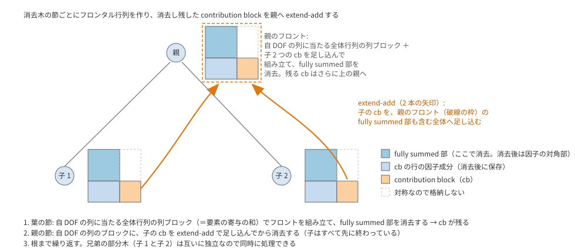

こうして疎行列の分解全体が、木に沿って子から親へ進む多数の小さな密行列処理に分解され、
兄弟の部分木どうしは互いに独立に処理できる。これがマルチフロンタル法が並列化・ブロック演算・
BLR 圧縮と相性のよい理由である。

### ピボッティングと遅延ピボット

消去では対角要素（ピボット）で割る。接触・MPC の Lagrange 乗数を含む鞍点系（剛性
ブロックと拘束の行・列を併せ持ち、対角に零ブロックが入る系）や固有値解析の
シフト付き行列では行列が不定値（正と負の固有値を併せ持つ）になり、消去の途中で絶対値の
小さい対角要素が現れて、そのまま割ると誤差が急拡大する。なお負の対角要素そのものは
LDLᵀ では問題にならず、後述のように固有値の符号の情報として使う（負で破綻するのは
Cholesky 分解である）。

小さい対角要素を避けるため、候補のピボットが「その列に残っている成分の最大値」に比べて
小さすぎないかを閾値 u で検査し、合格したものだけを使うのが**閾値ピボッティング**である。
言い換えると、因子 L の成分の絶対値を 1/u 以下に抑える条件である。検査に通らない候補は
そのまま使わず、まだ消去していない別の行・列と入れ替えて（**交換**。対称行列では対称性を
保つため、行と列を同時に入れ替える）、検査に通るピボットを対角に持ってくる。入れ替える
先の行・列を、本書では**交換の相手**と呼ぶ。

1 つの対角要素で割るピボットを **1×1 ピボット**、2 行 2 列の対角ブロックで割るピボットを
**2×2 ピボット**と呼ぶ。対称行列向けの Bunch–Kaufman 法 [6] は、1 自由度では安定に
消去できないとき別の自由度と 2×2 の組にして同時に消去する方法で、対称性（LDLᵀ の形）を
保ったまま不定値系を安定に分解できる。1×1 と 2×2 のどちらを使うかの DIRECTmf の判定規則は
「ピボッティング・カーネル」で述べる。

最小の例で見る。変位 1 自由度（剛性 κ）と、それを拘束する Lagrange 乗数 1 つからなる系の
行列 [[κ, 1], [1, 0]] を考える。乗数を先に消去しようとすると、対角が 0 なので 1×1 ピボット
にできない。変位を先にしても、κ が拘束式の係数（ここでは 1）に比べて小さい（たとえば
接触だけで支えられ、剛性がほぼ 0 の節点）と L の成分 1/κ が大きくなり、閾値の検査に落ちる。
2 つを組にした 2×2 ピボットは行列式が −1 で、安定に消去できる。このとき正と負のピボットが
1 つずつ出る（正・負のピボットの個数を inertia と呼び、ログに出す。「閾値・零ピボット
判定と統計」参照）。組の相手になる変位がそのフロントでまだ fully summed でなければ、
組にできず、乗数は次段落の遅延ピボットになる。

マルチフロンタル法では、ピボットの候補はそのフロントの fully summed 部に限られる。それ以外の
行・列には他のフロントからの寄与がまだ足し終わっておらず、値が確定していないためである
（DIRECTmf は候補をさらに絞る。「分解モードとピボッティング」参照）。
候補の範囲で閾値を満たすピボットが見つからない自由度は、その場で消去せず、contribution
block と一緒に親のフロンタル行列へ持ち越す。これを**遅延ピボット**という。親ではより多くの行の寄与が
合流しているため、受理できるピボットが見つかりやすくなる。代償として親のフロントは
見積もりより大きくなる。持ち越される列の見え方は、後掲の「主要データ構造」のフロンタル
行列の図（赤い縦帯）で示す。

持ち越される自由度は、前節で述べた contribution block の例外になる。その自由度は、この
フロントで元の剛性まで組み立て済みなので、contribution block のうちその自由度に当たる
部分は元の剛性を含む縮約剛性そのものになる。親はこれを足し込むだけで、元の値を改めて足すことはしない。

### 低ランク圧縮（BLR）

フロンタル行列をほぼ一定の大きさのブロック（**タイル**。詳細は「タイル構造のフロンタル
行列」参照）に区切ったとき、消去の後半に
現れる大きなフロントでは、多くのタイルが「互いに離れた節点群の間の結合」を表す。
セパレータ上の離れた節点どうしは、元の剛性行列では結合していなくても、間にある内部の
節点を消去（静的縮約）すると、縮約後の剛性で結合する（fill-in）。この縮約後の結合では、
離れた節点群どうしの影響はならされて情報量が少ない。構造解析の直観でいえば、ある節点群に
加わる力が、縮約された内部を通して離れた節点群に及ぼす影響は、力の分布の細部によらず、
合力・合モーメントのような少数の量でほぼ決まる（Saint-Venant の原理と同じ事情。直観の
ためのたとえである）。そのため
m×n のタイルを低ランクの積 U Vᵀ
（U は m×r、V は n×r、r が近似ランク）でよく近似できる。r が小さければ、格納量は m·n 個から
(m+n)·r 個の実数に減り、そのタイルを U Vᵀ のまま行列積に使えば演算も減る（DIRECTmf で
どのタイルを圧縮し何が減るかは「BLR 圧縮」の章の冒頭で述べる）。ただし近似の精度を上げる
ほど、合力・合モーメントに続く高次の量まで要るので、近似ランク r は大きくなる。
この近似で因子を格納するのが
**BLR**（block low-rank）圧縮 [7] である。近似にならない（または得にならない）タイルは
密のまま格納し、本書ではこれを **full-rank**（格納）と呼ぶ。分解が近似になるぶん、
反復改良（後述）と組み合わせて解の精度を回復する。

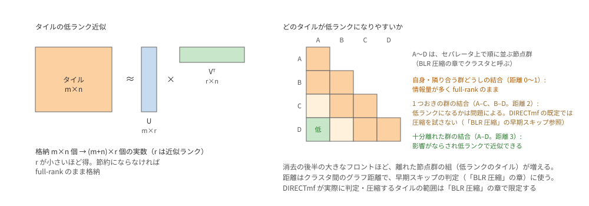

### symbolic 分解と数値分解

疎行列直接法の処理は 2 段に分かれる。**symbolic 分解**は、行列の非零
パターンだけから、値は読まずに、オーダリング・消去木・スーパーノード・因子の非零構造・
メモリ量と演算量の見積もりを決める。**数値分解**は、その構造の上で実際の値を使って因子を
計算する。両者を受け持つコードの層
（モジュールとそのデータ）を指すときだけ、**symbolic 段**・**数値段**と書く。構造は同じで値だけが変わる行列を繰り返し
解く非線形解析や時刻歴解析では、symbolic 分解を 1 回で済ませ、数値分解だけを繰り返せる。
求解（前進後退代入）と反復改良は数値分解の後に続く。ただし遅延ピボットが起きると、
実際のフロンタル行列はこの見積もりより大きくなる。DIRECTmf は symbolic 分解の結果を
書き換えず、そのずれを数値分解の側で吸収する（「symbolic 段と数値段の分離」参照）。

## 設計方針と理由

### 自前実装の動機と要件

マルチフロンタル法の直接法を FrontISTR に自前で組み込んだ動機は、DIRECTmf を提案した
issue #910 に次のように記録してある。

- 外部ライブラリに依存しない直接法は、HEC-MW に以前からある直接法（`METHOD=DIRECT`。
  以下**組込み DIRECT**。方式は「マルチフロンタル法」参照）だけで、その逐次版はスカラー
  実装にとどまり、MPI 並列版はプロセス数が 2ⁿ+1 に限られる。スレッド並列・MPI 並列・
  大規模問題・接触解析で実用になる直接法は MUMPS か MKL を有効にしたビルドが前提で、
  それらを用意できない環境では選択肢がない
- ソルバー内部の改良（ピボット戦略、低ランク圧縮、分散方式など）を FrontISTR の中で
  完結して行える直接法の土台がない

同じ issue は、SA-AMG（smoothed aggregation 代数的マルチグリッド）前処理の最粗レベルの
ソルバーとして使えることも要件に挙げている（「HEC-MW ソルバー枠組みとの接続」参照）。

### グローバル直接法

全体行列をそのまま分解するグローバル直接法とした。対になる選択肢は、各部分領域の行列だけを
直接法で分解し、部分領域どうしを外側の反復（CG など）で結ぶ領域分割（DDM）型である。
第一の要件は、解きにくい問題（大きな材料係数ジャンプ、薄板・シェル、ほぼ非圧縮、
接触・MPC 由来の Lagrange 乗数を含む鞍点系）に対する堅牢性である。すなわち
「反復が収束しない」という失敗モードを持たないことで、これがグローバル直接法を選んだ
理由である。DDM 型では外側の Krylov 部分空間反復（CG などの反復法の総称）の収束性に
悪条件が直接効く。
代償として、因子のメモリと演算量は DDM 型より速く増える。fill-in が大きなセパレータに
集中するためで、3 次元問題で顕著である。BLR 圧縮と MPI 分散は、これを緩和する手段として
併設した。
また、グローバル直接法の部分木構造は将来、領域分割型の前処理（BDDC〔balancing domain
decomposition by constraints〕など）の部分問題ソルバーへ転用できる。逆向きは難しい。
DDM 型の部分領域ソルバーは部分領域の内側だけを分解し、部分領域をまたぐ結合は外側の
反復に任せるので、全体を消去するためのセパレータの木を持たないからである。

### マルチフロンタル法

分解方式には、消去木に沿って密なフロンタル行列を組み立てて部分分解し、
残りの寄与（contribution block）を親に extend-add で渡すマルチフロンタル法 [1][2]
（前章参照）を採用した。対になる方式は**スーパーノーダル法**で、子の寄与をフロンタル行列に
集めて親へ渡す代わりに、因子の列ブロックをその格納場所で直接更新していく。代表的な
**left-looking 型**は、ある列ブロックを計算する直前に、先に消去した列からの更新をまとめて
取り込む。なお比較のため挙げると、組込み DIRECT（「自前実装の動機と要件」参照）は、
スーパーノードを持たず、因子 L を 1 行ずつ、先に計算した行を参照して求める LDLᵀ である。
マルチフロンタル法とスーパーノーダル法を比べた記録はない。マルチフロンタル法を採った
理由は次の 3 点である。

- 数値ピボッティング（閾値付きの 1×1/2×2 ピボット [1][6]、受理できない列の遅延ピボット）を
  フロンタル行列の中で完結でき、対称不定値系に堅牢である
- 子から親への更新伝搬が extend-add に局所化されるため、MPI 分散が規則的に書ける
- 構造対称・数値非対称系（摩擦接触、非関連塑性）へ、symbolic 構造を LDLᵀ と共有したまま
  LU として拡張できる（LU モードの併設。外部の汎用マルチフロンタルソルバー MUMPS の
  非対称モードと同じ設計）

### 閾値ピボッティングと遅延ピボット

ピボットは閾値 u で検査して受理し、受理できない列は親のフロントへ遅延する（「分解モードと
ピボッティング」）。この方式は不定値系（Lagrange 乗数を含む鞍点系など）も値を変えずに
分解でき、「グローバル直接法」で挙げた堅牢性の要件に沿う。代償は、遅延の分だけ親の
フロントが見積もりより大きくなることと、MPI 分散で遅延した列をランク間で受け渡す処理が
要ることである。小さすぎるピボットを摂動して受理し、遅延を起こさない静的ピボッティングは
採っておらず、両者を比べた記録はない（「既知の制限と拡張余地」）。MPI 分散では、交換なしの
試行を分散のまま行い、交換を伴う再試行だけを 1 つのランクに集める 2 段構えで、逐次と同じ
採否を再現する（「分散ピボッティング」。LAPACK を使うビルドでの前提は「決定性」参照）。

### 圧縮節点グラフ

symbolic 段は自由度（DOF）単位ではなく節点単位の圧縮グラフ（`hecmwST_mf_graph`）の上で動く。
各節点 i がブロックサイズ `ndof(i)` を持つ可変ブロック設計である（ndof 固定は可変ブロックの
特殊ケースにすぎない）。利点は次のとおり。

- symbolic 処理が軽くなる。隣接グラフの辺数は約 1/ndof² に、スーパーノードの行構造
  （`rlist`）などの添字（整数）配列は約 1/ndof になる
- オーダリング（METIS [3] など）を節点グラフに適用するため、同一節点の自由度が
  消去順で必ず連続に並び、スーパーノードの細分化が構造的に起きない
- シェル（6 DOF）、u-p 連成、Lagrange 乗数の擬似節点といった混在ブロックへの拡張余地を残す

ただし現状の数値段は、`hecMAT`（HEC-MW の分散疎行列型）の `NDOF` が全節点で同じ一様
ブロックであることを前提に値を読み、`hecmw_mf_numeric_factor` の冒頭でそれを検査する。
可変ブロックは現状、グラフ・symbolic 段だけが対応している。接触の消去なし経路は、この制約の下で
全系を NDOF=1 に展開して解いている（「接触・MPC との関係」参照）。

### symbolic 段と数値段の分離

symbolic 構造（`hecmwST_mf_symbolic`）は数値段からは読み取り専用で、変更しない。
非線形解析では symbolic 分解 1 回に対して数値分解が多数回走るため、この分離が再分解の速さに直結する。
遅延ピボットによるフロンタル行列の成長は、symbolic 構造を書き換えず数値段側のデータ
（因子レイアウトの毎回再構築）で吸収する。

### タイル構造のフロンタル行列

フロンタル行列は、節点境界に揃えたタイルに分割して保持・演算する。タイルは、1 つの
節点の DOF が複数のタイルにまたがらないよう、節点の切れ目で区切ったブロックで、既定の
タイルサイズは 256 DOF（`MF_TileSize`）である（子から遅延された DOF の部分だけは、節点と
関係なくタイルサイズごとに区切る）。節点の切れ目で区切るので、タイルごとに
幅が少しずつ異なる。そのためタイル (i,j) は、対角（i=j）では正方だが、非対角では行数と
列数が異なりうる。
分解の単位を**パネル**と呼ぶ。パネルは通常タイル列 1 本分（フロンタル行列の縦の帯）で、
分解はパネル単位で進む。遅延ピボットで列が入れ替わったときは、入れ替わった列だけからなる
幅の狭いパネルになる（「分解モードとピボッティング」参照。タイル格子の図は「主要データ構造」の
フロンタル行列の図を参照）。パネルの行の範囲とピボット候補の範囲は「分解モードと
ピボッティング」で述べる。
full-rank の分解もタイル単位のレイアウトと演算で構成しているのは、BLR 圧縮（タイル単位の
低ランク近似）を後付けできるようにするためである。
密カーネル層（`hecmw_mf_kernel`）は LDLᵀ と LU の 2 モード（本書では対称モード・LU モードと
呼ぶ。「分解モードとピボッティング」参照）を持ち、BLR も両モードで機能する。

### 並列化と決定性

並列性は消去木から得る。OpenMP は動的なタスク、MPI は実行前に担当を固定する静的な割り当て
（本書では写像と呼ぶ）で使う（理由とともに「並列化の戦略」で述べる）。結果の再現性も
設計目標である。演算の適用順を木構造と消去順で固定し、スレッド数によらずビット一致させる
（BLAS/LAPACK が、同じ入力値に対して、スレッド数やオペランドのメモリ上の配置によらず同じ
結果を返すとき。「決定性」参照）。プロセス数を
変えたときはビット一致を保証せず、加算順序の違いによる丸めの差が出る。差の大きさと条件は
「決定性」で述べる。

### 近似分解と反復改良の組み合わせ

BLR 圧縮は因子を近似で格納するので、分解だけでは解の精度が落ちる。そこで反復改良
（「反復改良」参照）を組み込み、BLR 有効時は既定で併用して精度を回復する。反復改良の
実装は BLR と独立で、full-rank 分解でも使える。

### 外部依存の範囲

外部に依存するのは、次に述べるオーダリングと密演算だけである。

オーダリングは、組込み DIRECT と共通の `hecmw_ordering_gen` を借りる。実体は `hecmw1/src/solver/solver_direct/hecmw_ordering.F90` で、
METIS、QMD（quotient minimum degree）、RCM（reverse Cuthill–McKee）を選べる。
密演算は BLAS/LAPACK に任せる。LAPACK なしのビルド（CMake の `WITH_LAPACK` を無効にした
ビルドで、BLAS もリンクしない）では素朴なループ実装に落ち、BLR は無効になる（BLR が無効に
なる理由は「BLR 圧縮」で述べる）。消去木・スーパーノード検出・
行構造・extend-add・ピボッティング・並列スケジューリング・BLR 圧縮カーネルは自前実装である。

## モジュール構成

| ファイル | モジュール | 役割 |
|:---------|:-----------|:-----|
| `hecmw_mf_graph.f90` | `hecmw_mf_graph` | 節点単位の圧縮グラフ。`hecMAT` の非零パターンから構築（値は読まない）。単一プロセスでは `hecMAT` の全節点（`NP` 個）を使い、MPI では収集した全体行列から作る |
| `hecmw_mf_symbolic.f90` | `hecmw_mf_symbolic` | symbolic 分解: 消去木・列ごとの因子非零数（column counts）・スーパーノード・行構造。BLR 用の節点クラスタリングと自己検査も持つ |
| `hecmw_mf_numeric.f90` | `hecmw_mf_numeric` | 数値分解（タイル化 LDLᵀ/LU、遅延ピボット、extend-add）と前進後退代入。逐次・OpenMP・MPI の各駆動を含む |
| `hecmw_mf_kernel.F90` | `hecmw_mf_kernel` | タイル・パネル単位の密カーネル（対称/非対称の 2 モード）と BLR 圧縮（打ち切り付き RRQR〔rank-revealing QR〕） |
| `hecmw_mf_dist.f90` | `hecmw_mf_dist` | MPI 分散層: スーパーノード→ランク写像（subtree-to-subcube。「MPI 分散」参照）、symbolic 構造のブロードキャスト、全体行列の部分保持と値の配送、上位フロント内のデータ分散の規則（分散数値分解・分散求解の本体は `hecmw_mf_numeric`） |
| `hecmw_solver_direct_mf.f90` | `hecmw_solver_direct_mf` | ドライバ: オプション解釈、symbolic 分解・数値分解・求解・反復改良の各段の呼び出し、ログ出力、組込み DIRECT との突き合わせ検査 |

表の「上位フロント」は、MPI 分散で複数ランクが共同処理するフロントで、「MPI 分散」で述べる。
下図の `Iarray(2)=106` は経路選択の番号で、次節で述べる。

依存は一方向である（下図）。なお kernel は numeric からだけでなく、ドライバからも
BLR の可否判定のために直接呼ばれる。

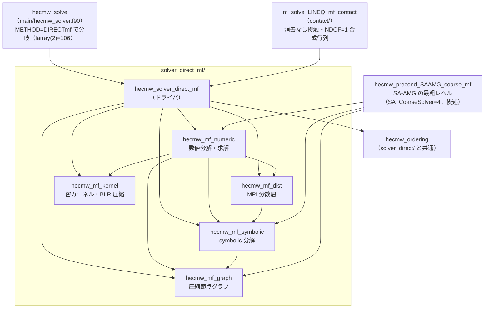

### HEC-MW ソルバー枠組みとの接続

本節はコードとの接点（配列番号・ファイル）をまとめたもので、設計の理解には読み飛ばしてよい。
以下の `Iarray`・`Rarray` は、`hecMAT` が持つ整数・実数のオプション配列（ソルバーの
選択・設定や再利用フラグを要素番号ごとに格納する）を指す。

- 経路選択: `hecmw1/src/solver/main/hecmw_solver.f90` の `hecmw_solve` が
  `hecMAT%Iarray(2) == 106` で `hecmw_solve_direct_mf` を呼ぶ
- オプション伝達: fistr1 側の `fstr_ctrl_common.f90`（`fstr_ctrl_get_SOLVER`）が
  `METHOD=DIRECTmf` のとき `!SOLVER` の 4 行目（整数 10 個）・5 行目（実数 8 個）を読む。
  `fstr_setup.f90` がそれを `Iarray(41:50)`・`Rarray(41:50)` に格納する。ドライバは、
  オーダリング・緩和併合幅・タイルサイズ・早期スキップ距離・クラスタリングの有無を symbolic
  分解のときに、残りの数値オプションを毎回の数値分解の前に読んで `hecmwST_mf_factor` に
  展開し、反復改良の設定を毎回の求解のときに読む（欄と要素番号の対応と、内部での参照は
  「キーワードと内部動作の対応」参照）
- 再利用フラグ: 組込み DIRECT と同じ約束で、`Iarray(98)=1` が symbolic 分解の（再）実行、
  `Iarray(97)=1` が数値分解の実行を要求する（「symbolic 段と数値段の分離」参照）
- ログ: `ITERLOG`（`Iarray(21)`）が残差、`TIMELOG`（`Iarray(22)`）が段階ごとの時間、
  `LOGLEVEL`（`Iarray(24)`）が診断情報を、それぞれ独立に制御する（ログ出力の分担を整理した
  issue #873 に従う）。残差の行は階層で分担する。求解後の最終の相対残差の行は、ドライバでは
  なく、ほかの直接法と共通の上位の手続きが出す。通常経路では `hecmw_solve` が、接触の消去なし
  経路では `hecmw_solver_contact.f90` の `solve_LINEQ_contact`（消去の有無と METHOD で直接法を
  振り分ける手続き）が出す（「接触・MPC との関係」参照）。ドライバと接触ラッパが `ITERLOG` で
  出すのは、それぞれの反復改良の各段の残差の行だけである。どの設定で何行出るかは、マニュアルの
  `!SOLVER` のキーワードリファレンス（`ITERLOG`）を参照。
  出力はランク 0 のみで行う。ただし残差の評価自体は全ランクが参加する通信
  （allreduce。全ランクの値を集約した結果を全ランクへ配る集団通信）を含むので、評価の
  経路は全ランクが通る
- 接触の消去なし経路: `hecmw1/src/solver/contact/hecmw_solver_contact.f90` が
  モジュール `m_solve_LINEQ_mf_contact` の手続き `solve_LINEQ_mf_contact` を呼ぶ
  （「接触・MPC との関係」参照。このモジュールが概要で述べた接触ラッパである）
- SA-AMG 前処理の最粗レベル:
  `hecmw1/src/solver/precond/saamg/hecmw_precond_SAAMG_coarse_mf.F90`
  （`SA_CoarseSolver=4`）が 3 モジュール（graph / symbolic / numeric）の API を直接使い、全ランクが
  同じ粗グリッド行列を重複して保持し、各自で分解する（冗長方式）
- 自己検査: `LOGLEVEL>=2` では、symbolic 分解のたびに `hecmw_mf_symbolic_check` が symbolic
  構造の整合を検査する（MPI ではランク 0）。逐次実行で BLR のクラスタリングをしていないときは、
  さらに `hecmw_mf_compare_builtin` が同一オーダリングの下で消去木と column counts を組込み
  DIRECT の symbolic 段と突き合わせる（組込み DIRECT を比較対象として使う）

## 主要データ構造

前提知識の章で導入した消去木・スーパーノード・フロンタル行列が、コード上では
どの型・配列に対応するかを示す。「列」の意味に注意されたい。symbolic 段の「列」は
消去順に並べた節点（自由度ブロック）を指し、数値段とフロンタル行列の「列」は DOF 1 本を
指す。以降、紛れるところでは「節点列」「DOF 列」と書き分ける。

### hecmwST_mf_graph（圧縮グラフ）

節点 i が `ndof(i)` 個の連続した DOF（`dofptr(i):dofptr(i+1)-1`）を所有し、
`xadj`/`adjncy` が自己ループなしの対称隣接（1 始まりの CSR〔compressed sparse row〕形式）を持つ。
`hecmw_ordering_gen` が期待する形式と同じである。

### hecmwST_mf_symbolic（symbolic 構造）

ここでの「列」は節点列（消去順に並べた節点）である。消去順は消去木のトポロジカル順（親が子より
後に来る順。`parent(k) > k`）であり、
各スーパーノードは連続した列範囲を所有し、スーパーノード番号はスーパーノード木の
postorder（子をすべて訪ねてから親を訪ねる順）で付く。主な配列は次のとおり。

- `perm`/`invp`: 消去順と元の節点番号の対応
- `parent`: 列単位の消去木（根は 0）、`colcnt`: 列 k の因子に現れる節点数（column counts。
  「処理の流れ」の symbolic 分解の手順 3 で述べる緩和併合を含まない正確な値）
- `sptr`/`sparent`: スーパーノードの列範囲とスーパーノード木
- `rptr`/`rlist`: スーパーノードの行構造。行番号は重複なしの昇順で、先頭に自スーパーノードの
  列、続いて contribution block の行が並ぶ。本書では、フロンタル行列のうち contribution
  block に当たる行（`rlist` の後半）を **contribution 行**と呼ぶ。前提知識の章の定義
  （対角より下）と異なり、`rlist` は自スーパーノードの列も含むことに注意
- `cmap_ptr`/`cmap`: 子の contribution 行を親の `rlist` 内の位置へ写す extend-add 用の対応表
- `max_front`・`factor_nnz`・`flops`: 遅延ピボットなしを仮定した見積もり（flops は
  浮動小数点演算の回数）

### フロンタル行列の構成（hecmwST_mf_factor と mf_snode）

`hecmwST_mf_factor` が数値段の全状態を持ち、スーパーノードごとの `mf_snode` が因子を持つ。
本節では設計として知っておくべきフロンタル行列の構成を述べ、配列名との対応は「配列との対応」の
表に分けてまとめる。

フロンタル行列の中の行・列の番地を、本書では「位置」と呼ぶ。位置は単なるスロットで、
そこにどの DOF が割り当てられているかは別の配列で引く。遅延ピボットや行交換が
あると DOF と位置の対応が変わるため、この区別が要る。まず 1 つのフロンタル行列の全体像を
図で示す。自 DOF が 1 タイル列、子から遅延された DOF が 1 タイル列、contribution 行が
2 タイル行の例である。

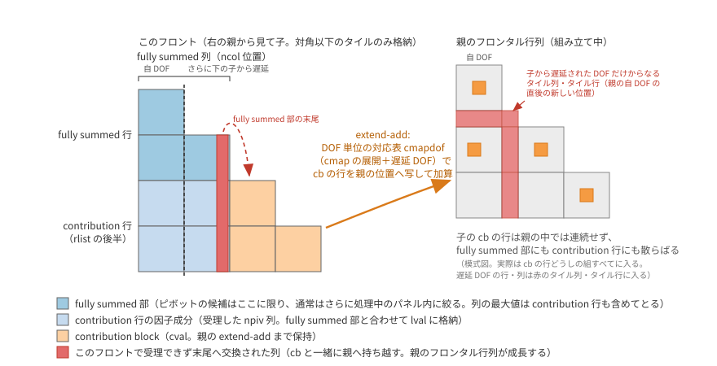

図の赤い縦帯は、このフロントで受理できずに fully summed 部の末尾へ寄せられた列で、
contribution block と一緒に親へ持ち越される。親のフロントではこれが「子から遅延されて
きた DOF」になり、図の右側のように、親の自 DOF の直後に、遅延 DOF だけからなるタイル列と
タイル行として加わる（図では幅の狭い 1 本。タイルの大きさを超える分は複数のタイルに分ける）。
構成の要点は次のとおり。

- 位置の並び: スーパーノードの自 DOF、子から遅延されてきた DOF（ここまでが fully summed な
  位置で、このスーパーノードで消去する候補。個数は `ncol`）、contribution 行の DOF
  （親へ持ち越す位置）の順
- 遅延 DOF の extend-add: 子から遅延された DOF は symbolic 構造に現れないので、親は数値段で
  子ごとに DOF 単位の対応表を作って写す（次節「遅延 DOF の extend-add」）
- タイル分割と格納: 自 DOF と contribution 行は節点境界に揃えて（子から遅延された DOF は
  タイルサイズごとに）タイル分割し、対角以下のタイルだけを
  タイル列単位（各タイルは列優先）で格納する
- ピボットの並び: 位置順に消去し、受理した列が先頭に、受理できない列が fully summed 部の末尾に
  集まる（遅延の仕組みは「分解モードとピボッティング」参照）
- 因子部: 受理した先頭の `npiv` 列（対角以下の全行）が、このフロントの因子として
  格納される部分で、本書ではこれを**因子部**と呼ぶ。先頭から複数のタイル列にまたがりうる
- 毎回の再構築: 遅延の有無は値で決まるため、フロンタル行列の寸法・タイル分割・因子レイアウトは
  毎回の数値分解で作り直される。ただし自 DOF を収めるタイル列（本書では**自タイル列**と
  呼ぶ）の境界は節点境界に揃えてあって変わらず、子から遅延された DOF は自タイル列の
  後ろに別のタイルとして付くだけである（遅延 DOF のタイルは、節点境界ではなくタイルの
  大きさごとに区切る）
- contribution block の寿命: 自スーパーノードの分解完了から親の extend-add までの
  間だけ生きるスタック的な寿命管理をする。postorder で処理すると、親の extend-add で
  使うのは直前に作られた子の contribution block なので、生きている contribution block の
  総量は後入れ先出しのスタックのように増減する。symbolic 分解のときのログの stack peak words
  は、遅延がないと仮定した postorder の処理でのこの総量の最大値（見積もり）である。数値分解の
  後のログの同名の値は、実際の分解で同時に保持した総量の最大値で、遅延と OpenMP で並行して
  処理した部分木の分を含む（MPI ではランクの和）。前進代入で親へ渡す寄与も同じ要領で持つ
- BLR 格納: 因子部のタイルごとに、低ランク格納（U と V の連結）か full-rank 格納かを
  持つ（圧縮の対象は contribution 行のタイルだけ。「BLR 圧縮」参照）

### 遅延 DOF の extend-add

symbolic 構造の extend-add 対応 `cmap` は節点単位で、遅延ピボットがない前提で作ってある。
子から遅延された DOF は symbolic 構造（行構造 `rlist` と対応表 `cmap`）に現れないので、
親は組み立てのたびに、子ごとの DOF 単位の対応表（`cmapdof`。子の contribution block の
行 → 親の位置）を次の手順で作る。

1. 子の contribution block の行は「遅延 DOF、続いて通常の contribution 行」の順に並んでいる
2. 子の遅延 DOF には、親の自 DOF の直後に新しい位置を割り当てる。子が複数あれば、
   子のスーパーノード番号の降順（extend-add で子の寄与を取り込むのと同じ順）に続けて割り当てる
3. 子の通常の contribution 行は、symbolic 構造の対応表（`cmap`。節点単位）を DOF に展開して、
   親での位置を引く。親の contribution 行の位置は、遅延 DOF の総数だけ後ろへずれる
4. 子の contribution block の成分 (i, j) を、親の (対応表(i), 対応表(j)) へ足し込む。
   対称モードで対角より上に写る成分は、転置位置に足す（LU モードでは、対角より上の部分を
   転置して持つ第 2 の格子へ足す。「LU モードの格納」参照）

行の並びを 1 本の表で写すので、遅延 DOF どうし・遅延 DOF と通常行の交差・通常行どうしを
区別せず、全成分を同じ規則で親に写せる（下図）。

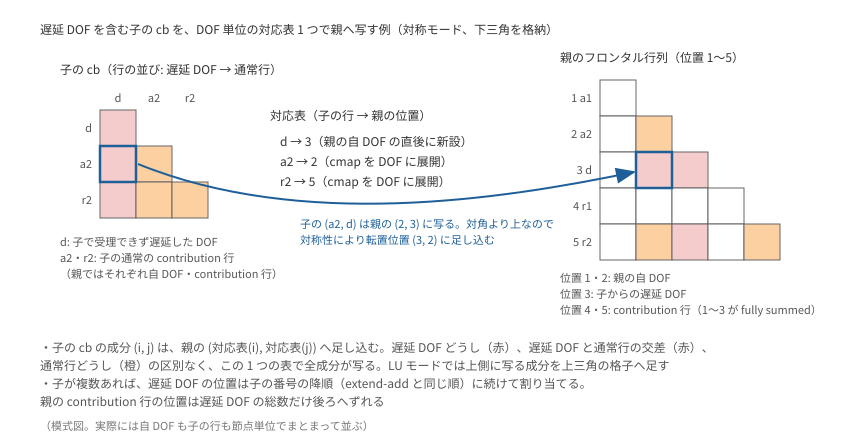

### 配列との対応

コードを読むときのための、「フロンタル行列の構成（hecmwST_mf_factor と mf_snode）」で述べた
構成と `hecmwST_mf_factor`・`mf_snode`・作業領域の配列との対応表である。

| 配列・成分 | 意味 | 寿命 |
|:-----------|:-----|:-----|
| `fsdof` / `frow` | 位置の列 DOF・行 DOF（LU モードの行交換で食い違いうる） | 因子と同じ（次の数値分解まで） |
| `ptype` / `dsub` | ピボット種別（1×1 / 2×2）と 2×2 ピボットの非対角成分。分散版の根フロントでは、master が最終パネルの位置の D の対角も `dfin` に持つ（タイル列の境目をまたぐ 2×2 ピボットのため。「根フロントの扱い」参照） | 因子と同じ |
| `tbnd` | タイル境界（位置） | 因子と同じ |
| `npiv` | 受理したピボットの個数。先頭の `npiv` 列（対角以下の全行）が因子部として `lval` に格納される | 因子と同じ |
| `lval`（LU モードでは `uval` も） | 因子部 | 因子と同じ |
| `bptr` / `brank` | BLR 時のタイルごとの格納位置と近似ランク。m×n の低ランクタイルは U（m×r）と V（n×r）を連結して格納し、`brank=-1` が full-rank 格納を表す。`brank=0` は近似ランク 0 で、更新と求解ではそのタイルを読まない | 因子と同じ |
| `rkfaces` | ランク再利用（「BLR 圧縮」参照）の可否の記録。`brank`（LU モードでは U 側の分も）が、直前の数値分解の BLR の格納で記録したランクを持つか | 因子と同じ |
| `cval` | contribution block | 自スーパーノードの分解完了から親の extend-add まで |
| `dval` | 前進代入で親へ渡す寄与 | 前進代入で親が取り込むまで |
| `cmapdof`（作業領域 `mf_work`） | 子ごとの DOF 単位の extend-add 対応表 | 親の組み立て中のみ |
| `mirror` / `mirroru` | `hecMAT` の下三角部 `AL` と上三角部 `AU` の転置対応。LU モードの値の読み込みと、非対称度のスキャンに使う。作るときに構造対称性を検査する | symbolic 分解の後の最初の数値分解で作り、次の symbolic 分解まで再利用する（非零の数が変われば作り直す） |
| `mode`・`blr`・`pivot_u` など | 数値オプション（「キーワードと内部動作の対応」参照） | 数値分解ごとにドライバが設定 |
| `n_pos` / `n_neg`、遅延数、語数、BLR 圧縮率など | 直前の分解の統計（`n_pos`/`n_neg` は正・負ピボットの個数〔inertia〕。2×2 ピボットは固有値の符号で 2 個分に数える）。`LOGLEVEL>=1` のログの出所 | 次の数値分解まで |

語数（words）は倍精度実数 1 個（8 バイト）を 1 語と数えるメモリ量で、ログの
factor words・stack peak words などに対応する。添字の整数配列は含まない。

### 作業領域（mf_grid / mf_work / mf_pool）

`mf_grid` は処理中のフロンタル行列のタイル格子、`mf_work` はフロンタル行列本体
（`fval`、LU モードでは上三角の転置 `fvalu`）とピボット探索用パネルなどの作業領域で、
同時に処理されるフロンタル行列 1 つにつき 1 インスタンスを使う（OpenMP では、小さなフロントは
スレッドごとの 1 個を使い回し、行数 `MF_PAR_ROWS`=512 以上でフロント内を並列化するフロントは
専用の 1 個を持つ。「OpenMP」参照）。`mf_pool` は MPI の非同期送信（isend）の送信バッファを、
その段の待ち合わせ（waitall）まで生かすためのプールで、fan-in（後述。子の寄与を、親のフロントの
データを持つランクへ送る通信）のほか、分散ピボッティングや分散求解の送信にも使う。

## 処理の流れ

全体の流れと再利用フラグ（`Iarray(98)`/`Iarray(97)`）の関係を次に示す。

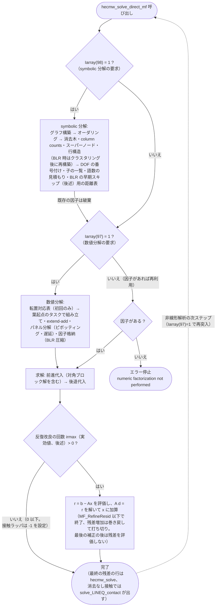

symbolic 分解のときに作って以後の数値分解で使い回すものと、数値分解のたびに作り直すものを
次にまとめる。非線形解析で構造が変わらなければ、繰り返し払うのは後者の費用だけである
（「symbolic 段と数値段の分離」参照）。

| データ | 作る時点 | 数値分解での扱い |
|:-------|:---------|:-----------------|
| 消去木・スーパーノード・行構造 `rlist`・extend-add 対応 `cmap` | symbolic 分解 | 読み取り専用で、変わらない |
| DOF の番号付け・子の一覧・語数の見積もり | symbolic 分解（`hecmw_mf_numeric_init`） | 変わらない（見積もりは遅延がないと仮定した値） |
| タイル分割 | 数値分解のたび（`mf_partition`） | 規則は symbolic 構造と遅延 DOF の数だけで決まるので、自タイル列と contribution 行の切れ目は遅延がないときと同じで、その間に遅延 DOF のタイルが入る（「フロンタル行列の構成（hecmwST_mf_factor と mf_snode）」参照） |
| BLR の早期スキップの距離表 | symbolic 分解 | 変わらない（「BLR 圧縮」参照） |
| MPI の写像と、値の配送の経路表 | symbolic 分解 | 変わらない（「MPI 分散」参照） |
| フロントの寸法・因子のレイアウト・DOF 単位の対応表 `cmapdof` | 数値分解のたび | 遅延に応じて変わる |
| 転置対応表 `mirror` | symbolic 分解の後の最初の数値分解 | 以後は再利用する（非零の数が変われば作り直す） |

### symbolic 分解

`Iarray(98)=1` のときに、次の順で行う。

1. `hecmw_mf_graph_from_hecmat`: 非零パターンから節点グラフを構築
2. `hecmw_ordering_gen`: オーダリング（`MF_Ordering`。選択肢は「キーワードと内部動作の対応」の
   表参照。組込み DIRECT と共通実装）
3. `hecmw_mf_symbolic_build`: 次の順に処理する
   - 消去木（Liu のアルゴリズム [4]）
   - postorder と再ラベル
   - column counts（列ごとの因子非零数、Gilbert–Ng–Peyton [8]）
   - スーパーノード検出と緩和併合（relaxed amalgamation [9]）。緩和併合は、小さなスーパーノードを、
     多少の fill-in 増を許して親と併合し、密ブロックを大きくする処理である。目標幅
     `MF_AmalgWidth` は DOF 列数で与え、既定 16 を節点数に換算して使う
   - 行構造 `rlist` と extend-add 対応 `cmap`
   - 語数・flops の見積もり
4. BLR 有効時は `hecmw_mf_symbolic_cluster` で、スーパーノードごとに自節点（そのスーパーノードの
   列に当たる節点）を並べ替え、symbolic 構造を作り直す。並べ替えは、自節点だけを残した節点
   グラフの部分グラフ（誘導部分グラフ）上の幅優先探索（BFS）の訪問順による。探索は連結成分
   ごとに、誘導部分グラフ内での次数（隣接節点数）が最小の節点から始める。
   並べ替えた順に節点境界でタイルに切れば、各タイルがまとまった節点群（後述のクラスタ）になる。
   幾何的に近いセパレータ節点を隣接列に集め、因子部の各タイルの近似ランクを下げるためである。
   ただし作り直しは手順 3（消去木・postorder・スーパーノード検出と緩和併合）をやり直すので、
   並べた順の一部が別の順に置き換わり、スーパーノードの切れ目も変わる（回帰テスト basic の
   A341_blr では、99 節点のうち 15 節点の位置が変わり、スーパーノードは 19 個から 20 個に
   なる）。その部分のタイルは、まとまった節点群にならないことがある
   （「既知の制限と拡張余地」参照）
5. `hecmw_mf_numeric_init`: DOF の番号付けと子の一覧、遅延がないと仮定したタイル分割から
   求めた語数の見積もり、BLR の早期スキップ判定に使うクラスタ間グラフ距離の表を構築する
   （「BLR 圧縮」参照）。タイル分割そのものは保持せず、数値分解のたびに作り直す

### 数値分解

`Iarray(97)=1` のときに行う。`hecmw_mf_numeric_factor`（MPI 版は `_factor_mpi`）が駆動する。

1. `mf_mirror`: AL と AU の転置対応表を作る（symbolic 分解の後の最初の数値分解だけ。以後は
   再利用する）。作るときに非零構造が対称でなければエラー。`mf_asymmetry`: `MF_Mode` と
   `hecMAT%symmetric` から分解モードを決める。`LOGLEVEL>=2` ではさらに数値非対称度を
   スキャンする（スキャン結果はログ専用）
2. スーパーノード木の葉からタスクを起こし（「並列化」参照）、各スーパーノードで
   - フロンタル行列の組み立て: 元行列のブロックを散布し、子の contribution block を
     `cmap` 経由で extend-add して解放する
   - パネル分解: フロンタル行列の中はタイル列単位のループで進み、「先頭のパネルを
     分解 → スケール済みパネル（分解済みパネルの L に D を掛けたもの。更新 L D Lᵀ の
     片側）で残りのタイルを更新（行列積）」を繰り返す。
     対称モードは閾値付きの 1×1/2×2 ピボット（交換の相手の 1×1 と 2×2 の選択に Bunch–Kaufman の規則 [6]）、
     LU モードは threshold partial pivoting [10] で、受理できない列は遅延して親に渡す。閾値・零ピボット判定・モード差の
     詳細は「分解モードとピボッティング」参照
   - 因子部の格納: BLR 有効時は contribution 行のタイルを、タイル列の分解直後に
     圧縮してから更新に使う（「BLR 圧縮」参照）
   - contribution block の格納（親の extend-add まで保持）
3. 統計（正・負ピボットの個数・遅延数・語数など）を集計し、`LOGLEVEL>=1` でログに出す

手順 2 のタイル列ごとのループ（パネルの分解 → BLR 時の圧縮 → 残りのタイルの更新）を、
タイル列 2 を処理する場面で次に示す。タイル (i,j) の更新が読むのは、同じタイル列 k の
タイル (i,k) と (j,k) だけである（対称モードでは加えて、対角タイル (k,k) にある D の成分も
使う）。

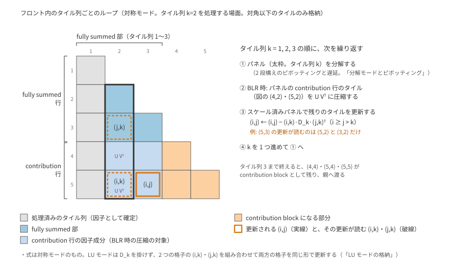

### 求解

`hecmw_mf_numeric_solve`（MPI 版は `_solve_mpi`）が次の順に進む。

1. 右辺を消去順に並べ替える
2. 前進代入: 分解と同じ葉起点のタスクで、木を postorder に登りながら L を適用する。
   対角ブロック解（D の 1×1 / 2×2 ブロックで割ること）も、独立の段ではなくこの中で行う。
   対称モードでは、フロントの各タイル列で、その列の解の成分を求めて下の行への寄与を差し引いた後、
   そのタイル列の成分を D で割る。ただし、根フロントの最終パネルでタイル列の境目をまたぐ
   2×2 ピボットの組（「根フロントの扱い」参照）は、どちらのタイル列でも割らずに残し、
   次のタイル列が組の 2 列目の成分で寄与を差し引き終えた後に、2 つの対角タイルにある D の
   対角成分と、組の非対角成分（`dsub`）で割る。LU モードでは L の対角は 1 なので割らず、
   U の対角による割り算は後退代入の中で行う
3. 後退代入: 根からタスクを子へ再帰的に生成し、木を逆順に下りながら Lᵀ（LU では U）を適用する
4. 解を元の並びに戻す

BLR 有効時は、求解でも圧縮したタイルを U Vᵀ のまま 2 回の積で適用し（前進代入では Vᵀ と
ベクトルの積に U を、後退代入では Uᵀ とベクトルの積に V を掛ける）、近似ランク 0 のタイルは
読まない。求解の OpenMP
並列化はタスクによる木並列だけで、数値分解と違ってフロントの中のタイル演算はスレッドに
分けない。

### 反復改良

反復改良は、残差 r = b − Ax を不釣り合い力（残差力）とみなして同じ因子でもう一度解き、得られた
補正 d を解に足す修正計算である。構造解析の言葉でいえば、修正 Newton 法（初期剛性法）で
剛性を更新せずに不釣り合い力を解き直すのと同じ形である。分解が丸めや BLR 近似で不正確でも、
残差の評価が正確なら解の精度を引き上げられる。求解後、ドライバが上限回数 irmax（`Iarray(44)`、
キーワード `MF_MaxRefine`）まで、残差を HEC-MW の分散残差評価ルーチン `hecmw_matresid` で
評価し、補正系 A d = r を解いて解に足すことを繰り返す。`MF_MaxRefine` の 0 は既定値
（BLR 有効時 5、無効時 0）を指定する。
相対残差が `MF_RefineResid`（既定 1.0e-8）以下で終了し、増加した場合は直前の解に戻して
警告の上打ち切る。`ITERLOG=YES` のとき、評価した各反復の残差を出力する。1 回の反復は
「残差の評価 → 終了・増加の判定 → 補正」の順なので、上限回数目の補正の後は残差を評価しない。
最後の補正は、終了・増加の判定と巻き戻しの対象外である（接触ラッパの反復改良も同じ）。
最後の補正の後の解の残差は、`hecmw_solve`（消去なし接触では `solve_LINEQ_contact`）が
irmax によらず出す最終の残差の行に現れる（「HEC-MW ソルバー枠組みとの接続」参照）。
実効の irmax が 0 以下（BLR 無効で既定のまま、または負値）なら、ドライバは残差を評価しない。
`MF_MaxRefine` の負値は BLR 有効時も反復改良をしない指定で、消去なし接触では接触ラッパの
反復改良も行わない。接触ラッパ自身は、ドライバに -1 を渡してドライバ側の反復改良を止める
（「接触・MPC との関係」参照）。

## 分解モードとピボッティング

LDLᵀ（主経路。本書では対称モードと呼ぶ）と LU（LU モード）の 2 モードを持つ。大半の
問題は対称であり、LDLᵀ は LU の約半分のメモリ・演算で済むため主経路として維持し、LU は数値非対称系（摩擦あり接触、
非関連塑性など。非零構造は対称のまま）のために併設する。
どちらのモードで分解するかは、既定（`MF_Mode=0`）では `hecMAT%symmetric` フラグに従う。
組み立て側が数値非対称になる経路でフラグを偽にする（このフラグ整備は、DIRECTmf より先に
FrontISTR に取り込まれた）。`MF_Mode=1/2` で強制でき、強制はログに明記される。

閾値ピボッティング・Bunch–Kaufman 法・遅延ピボットの考え方は前提知識の章で述べた。
DIRECTmf のピボッティングの全体方針は次の 3 点である。

1. ピボットの候補はパネル内に限る。パネルの行は対角以下のすべての行（fully summed 行と
   contribution 行）で、閾値判定に使う列の最大値はこの全行からとる。一方、候補（交換の
   相手）になるのは、パネルの列と同じ位置の行（パネルの対角ブロックの行）のうち、まだ
   パネルの末尾へ寄せていない列の行だけで、これは両モードで同じである
2. まず交換なしで試し、失敗したパネルだけを交換付きで分解し直す（「パネルごとの 2 段構え」）
3. それでも受理できない列は親へ遅延する。親がない根フロントでは遅延せず、残った列を
   まとめて分解し、それでも受理できなければエラーにする

以下、2 段構えの手順、交換を行うピボッティング・カーネル、LU モードの格納、閾値と
統計、根フロントの扱いの順に述べる。

### パネルごとの 2 段構え

どちらのモードも、パネルを次の 2 段構えで分解する。大半のパネルは交換なしで通るので、
相手探しと交換の費用を払わずに済む。後述の分散ピボッティングは、この 2 段構えを
そのまま分散化したものである。

1. 交換なしの 1×1 ピボットだけでパネルの全列を分解してみる。全列が閾値検査と
   零ピボット判定を通れば、そのまま受理して次のパネルへ進む
2. 1 列でも通らなければ、分解前の値からピボッティング・カーネル（交換を行う。次節）で
   パネルを分解し直す。カーネルは途中で止まらずにパネル全体を処理し、受理した列を
   パネルの前に、受理できない列をパネルの末尾に寄せる
3. 末尾に寄せた列を、fully summed 部の末尾の未処理の列と交換する（これが遅延）。
   交換した先の位置は、このフロントで消去する範囲から外れ、親へ持ち越す。パネルの後ろに
   未処理の列が残っていなければ、寄せた列はその位置のまま親へ持ち越す
4. 入れ替わって入ってきた列の位置を、幅の狭い新しいパネルとして 1 から繰り返す。入って
   きた列は、それより前のタイル列による更新をすでに受けている（タイル列を 1 本処理する
   たびに残りのタイル全体を更新するため）。同じタイル列で先に受理した列（下図の c1・c3）
   による更新は、新しいパネルを用意するときにその場で施す（内部手続き `fill_panel`）

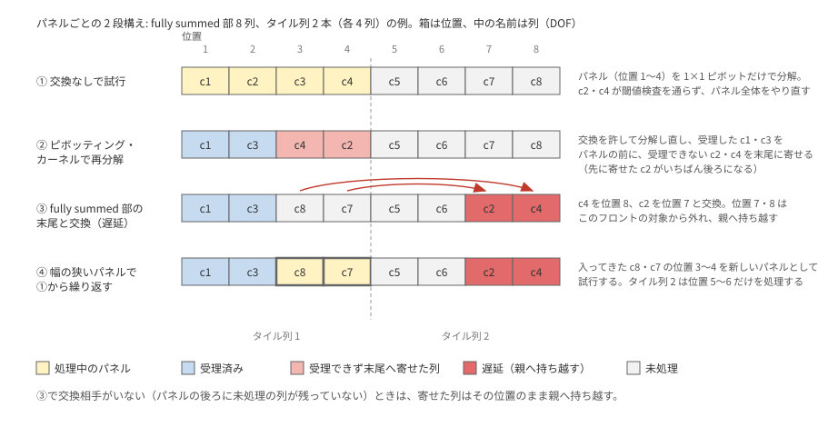

パネルを進めるうちに、遅延列は fully summed 部の末尾（「主要データ構造」のフロンタル
行列の図の赤い縦帯）に集まる。いったん末尾へ送った列は、同じフロントの中では再試行しない
（例外は根フロントの最終パネルで、「根フロントの扱い」で述べる）。再試行しない理由の記録は
なく、再試行する方式と比べた記録もない（「既知の制限と拡張余地」参照）。遅延はどちらの
モードでも DOF 列単位で起こる。

### ピボッティング・カーネル

2 段構えの第 2 段で使うカーネルは、パネル内の位置を左から順に処理する。処理中に列が
入れ替わるので、ある位置で処理する列は最初の並びの列とは限らない（列を末尾へ寄せたときは
未処理の範囲の末尾の列が列 k の位置へ移る。q の 1×1 を受理したときは列 k が、隣でない q と
2×2 を組んだときは k の次の位置の列が、q の元の位置へ移る。下記）。
以下で**節点ブロック**
とは、同じ節点に属する DOF の組をいう。自 DOF では節点ごとに 1 つの節点ブロックになり、
子から遅延された DOF は、元の節点によらずまとめて 1 つの節点ブロックとして扱う。
対称モードでは、列 k ごとに次の手順をとる。

1. 列 k を 1×1 ピボットとして閾値 u で検査し、通れば受理する
2. 通らなければ交換の相手 q を探す。まず、候補の行（パネルの対角ブロックの行で、列 k の対角より
   下のもの。すでに末尾へ寄せた列の行は除く）のうち列 k と同じ節点ブロックの行で、列 k の
   成分の絶対値が最大の行を相手 q とする
3. q の 1×1（行・列 q を列 k の位置へ交換し、q の対角成分を 1×1 ピボットにすること）を、
   定数 α による条件で検査する。q の対角成分の絶対値が、列 q に残る他の成分（パネルの全行）の
   絶対値の最大値の α 倍以上なら、q の 1×1 として受理する。このとき列 k は q の元の位置へ
   移り、後で列 k の番が来たときに手順 1 から試し直される。そうでなければ (k, q) の 2×2
   ピボットとし、L の成分の上界（2 つの列それぞれに残る成分の最大値から求める）が 1/u 以下の
   ときに受理する（α の値と、この選び分けの由来は下の段落で述べる）
4. 受理できなければ、他の節点ブロックの候補の行のうち列 k の成分の絶対値が最大の行を
   相手にして、3 を繰り返す
5. それでも受理できなければ、列 k をパネルの末尾に寄せる（2 段構えの手順 3 で遅延になる）

この判定の流れを次に示す。

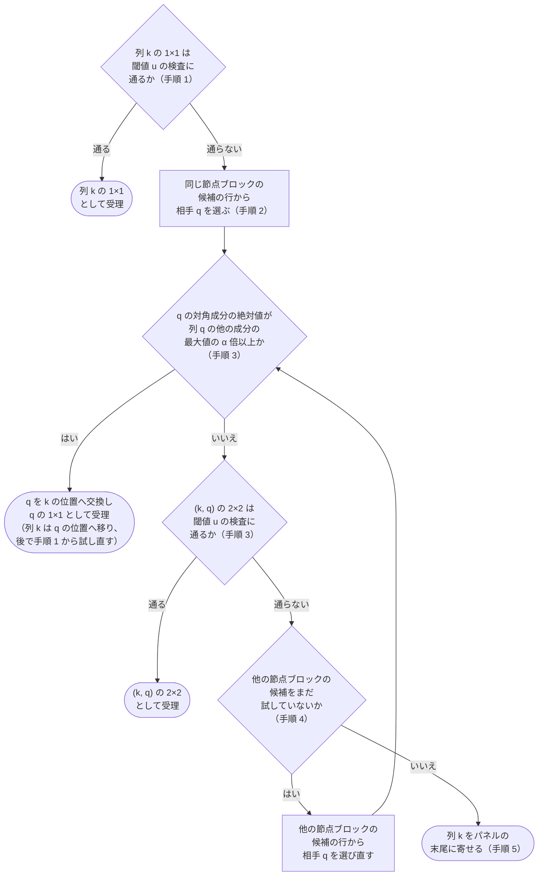

この判定は 2 つの規則を組み合わせたものである。原典の Bunch–Kaufman 法 [6] は固定の
定数 α で 1×1 と 2×2 を選び分ける。一方、マルチフロンタル法の Duff–Reid [1] は、1×1 も
2×2 も閾値 u で受理を判定する。DIRECTmf は、q の 1×1 と (k, q) の 2×2 の選び分けに
Bunch–Kaufman の規則（α=(1+√17)/8 ≈ 0.64、内部定数 `MF_PIVOT_ALPHA`）を使い、列 k 自身の
1×1 と 2×2 の受理は閾値 u で判定する。α > 0.5 ≥ u（u の有効範囲は (0, 0.5]。理由は
「閾値・零ピボット判定と統計」参照）なので、α の条件で受理した q の 1×1 は閾値 u の条件も
満たしている。原典の規則には列 k 自身を α で検査して 1×1 にする分岐もあるが、DIRECTmf は
それを使わず、手順 1 の u による検査で代える。列 k 自身の 1×1 を最初に u で検査するのは、
正定値行列でできるだけ交換を起こさないためである（開発時の記録による）。ただし正定値行列
でも、対角成分が列の他の成分の最大値の u 倍に満たない列では交換が起こりうる。交換の相手の
選び方と、q の 1×1 と (k, q) の 2×2 の選び分けに Bunch–Kaufman の規則を採った理由の記録は
ない。

列と行は同時に（対称性を保って）交換するので、列と行の並びは常に一致する
（`fsdof` = `frow`）。

LU モードでは、列ごとに、まず候補の行（対角の行を含む）のうち同じ節点ブロックの行で、
列の成分の絶対値が最大の行を、閾値を満たせばピボットに選ぶ。満たさなければ他の節点
ブロックの候補の行から同様に選ぶ。候補の範囲は対称モードと同じで、contribution 行は
候補にしない。ピボットを選ぶための交換は行だけで行い、列は動かさない。このため、行の
並びが列と食い違いうる（`frow` ≠ `fsdof`）。一方、受理できなかった列を遅延させるときは、
その列と同じ位置にある行を組にして、パネルの末尾へ移す。行交換の後なので、その位置の
行が列と同じ DOF とは限らない。

どちらのモードも、ピボットの候補をパネル内に限り、同じ節点ブロックの候補を優先する
（理由の記録なし。「既知の制限と拡張余地」参照）。

### LU モードの格納

symbolic 構造は非零構造だけで決まるため、両モードで完全に共有する（消去木・スーパー
ノード・`rlist`・`cmap` は同じ）。差分は数値段に閉じる。

- 格子: LU モードのフロンタル行列は 2 つのタイル格子を持つ。**第 1 格子**は対称モードと
  同じ対角以下のタイル格子（`fval`）で、L と U の対角を持つ。**第 2 格子**（`fvalu`）は
  対角より上の部分を転置して対角以下の形で持つタイル格子で、U の各行が第 2 格子の列に
  なる。U の行を列として扱えるので、対称モードと同じ列向きのタイルカーネルを両方の格子に
  使える。演算とメモリは
  対称モードの約 2 倍になる
- 行交換: 行の交換は、第 1 格子では行、第 2 格子では列の入れ替えとして働く。ただし
  行 x と行 y（x < y）を交換するとき、その間の列 x+1〜y では、行 x の成分は対角より上
  （第 2 格子）に、行 y の成分は対角以下（第 1 格子）にあるので、この部分は格子をまたいで
  入れ替える（下図の注記）
- 因子と BLR: 因子は `lval`（L 側）と `uval`（U 側）に格納する。BLR 有効時は、U 側の
  contribution 行に当たるタイルも L 側と同じく圧縮する
- 求解: 前進代入で L を、後退代入で U を適用する（対称モードは前進で L、後退で Lᵀ）。
  行交換で位置の行 DOF（`frow`）と列 DOF（`fsdof`）が食い違うので、前進代入は右辺を行 DOF で
  読み書きし、後退代入は解を列 DOF で書く（対称モードでは両者は一致する）

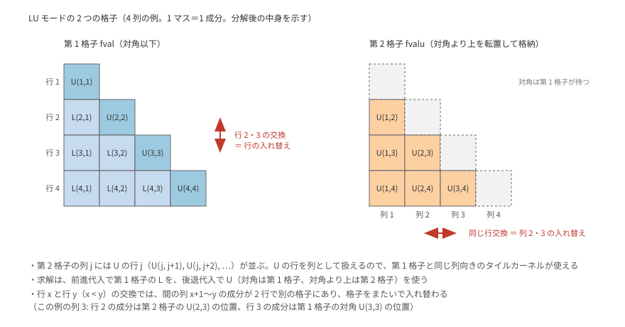

### 閾値・零ピボット判定と統計

- 閾値判定は、前提知識の章の条件を式で書くと「|ピボット| ≥ u × その列に残っている成分の
  最大値」で、これは「L の成分の絶対値 ≤ 1/u」と数学的に同値である。ただし丸めがあるので、
  閾値の付近では 2 つの形の判定が分かれうる。実装は段によって形を使い分ける。2 段構えの
  第 1 段（交換なしの試行）は、パネルを分解してから L の成分を 1/u と比べる
  （`hecmw_mf_kernel_panel_nopiv`）。交換なしの通常の分解をそのまま行い、その結果を後から
  検査する高速経路なので、L の形になる。第 2 段のピボッティング・カーネルは、ピボットの
  種類で形が異なる。対称モードでは、列 k 自身の 1×1 を u × 最大値と比べ、(k, q) の 2×2 は
  L の成分の上界を 1/u と比べる（q の 1×1 は α の条件で選ぶ。「ピボッティング・カーネル」
  参照）。LU モードのカーネルは u × 最大値と比べる。分散版も段ごとに同じ形を使う（第 2 段は
  逐次のカーネルそのものを使う）ので、同じ値に対しては逐次と同じ判定になる（LAPACK を使う
  ビルドでの前提は「決定性」参照）。第 1 段が
  L の形であることは、分散版で各ランクが自分の行だけで検査でき、列の最大値をランク間で
  集めずに済むという利点にもなる（「分散ピボッティング」参照）
- u を大きくすると L の成分が小さく抑えられて安定になるが、受理できない列が増えて遅延と
  フロントの成長が増える。既定の u=0.01（`MF_PivotThreshold`）は、Duff–Reid 系の対称
  不定値ソルバー MA57 [11] の既定値と同じである
- u の有効範囲は (0, 0.5] で、0.5 を超える指定は警告の上 0.5 に丸める。
  上限 0.5 は対称モードの 2×2 ピボットに由来する
  - 対称行列では、u ≤ 0.5 なら、どの対角成分も 1×1 の検査に通らなくても、行列全体で
    絶対値が最大の非対角成分を含む 2×2 ピボットは必ず検査に通る
  - その理由: その成分の絶対値を λ とすると、2×2 ブロックの行列式の絶対値は (1 − u²)λ²
    以上になり、L の成分は 1/(1 − u) 以下に収まる。1/(1 − u) ≤ 1/u となるのが u ≤ 0.5 である
  - u > 0.5 では、受理できるピボットが 1 つもない正則行列がある。例: u=0.6 のとき、
    対角成分がすべて 0.5、非対角成分が (1,2)=(1,3)=1・(2,3)=−1 の 3×3 対称行列
  - 現状は LU モードにも同じ上限を適用している（LU の行交換だけなら u は 1 まで意味を持つ）
- 零ピボット判定は行列最大成分との相対値（既定 1.0e-14、`MF_ZeroPivot`）である。係数 ×
  max|A| を zero とすると、比べる量はピボットの種類とモードで異なる。1×1 ピボット（第 1 段、
  対称モードの列自身と q の 1×1、LU モードの第 2 段）は |ピボット| > zero、2×2 ピボットは
  |行列式| > zero² を求める。LU モードの第 2 段は、列の最大値が zero を超えるときだけ
  ピボットを探す。対称モードの相手探しは列の最大値が zero を超えるときだけ行い、成分の
  絶対値が zero 以下の行は相手にしない（根フロントの最終パネルで残りの列をすべて相手として
  試す拡張は除く）
- 受理できるピボットがないときのエラーは根フロントでだけ起きる（「根フロントの扱い」参照）。
  入力の節点番号と、節点の中の自由度番号で報告する。ただし逐次で行列の行がメッシュの
  節点でない系（消去なし接触の合成行列）では、節点番号の代わりに行列のブロック行番号を出す。
  SA-AMG の最粗レベルはドライバを通らないので、独自の文言で粗格子の DOF 番号を出す
- 遅延ピボットで親のフロンタル行列が見積もりより成長するため、成長の最大値
  （`max_growth`）を統計に取る
- LDLᵀ では D の符号から正・負ピボットの個数（inertia）が得られ、ログに出す。
  1×1 ピボットはその符号で数え、2×2 ピボットはブロックの 2 つの固有値の符号で数える
  （行列式が負なら正 1・負 1、正なら対角和の符号で 2 つとも正か負）。
  Sylvester の慣性法則により、これは行列の正・負の固有値の個数に等しい。シフトした
  行列 A − σB を分解したときの負のピボットの個数は（B が正定値のとき）σ より小さい
  固有値の個数に等しいので、固有値解析の検算に使える。また非線形解析で接線剛性そのものを
  分解したときの負のピボットの個数は、座屈点（分岐点・極限点）を越えたかどうかの判定に
  使える情報である。ただし Lagrange 乗数を含む鞍点系（消去なし接触の合成行列）では、
  拘束の係数行列が行フルランクなら、負のピボットの個数は「拘束を満たす変位の範囲に限った
  剛性」の負の固有値の個数に拘束の数を足したものになる。座屈の判定にはその分を差し引いて使う

### 根フロントの扱い

消去木の根のフロントには親がないので、遅延先がない。そこで根では、
パネルを処理し終えた後に残った列（遅延列）をまとめて 1 枚の最終パネルにし、遅延を
許さない設定でピボッティング・カーネルを実行する。対称モードでは、上記の 2 つの候補
（同じ節点ブロックと他のブロックの最大成分の行）で受理できなければ、残っているすべての
列を相手として順に試す。LU モードにはこの拡張がない。LU の閾値検査は候補の成分の絶対値
だけで決まり、大きいほど通りやすいので、同じ節点ブロックと他のブロックでそれぞれ最大の行を
調べれば、候補の行すべてを調べたのと同じ結果になるからである。どちらのモードでも、最終
パネルは残った列すべてからなるので、残った fully summed 行すべてが候補になる。閾値 u は
緩めない。それでも処理中の列について受理できるピボットがなければ、行列が特異に近いと
みなしてエラーにし、節点番号で報告する（「閾値・零ピボット判定と統計」参照）。このとき、
他の列を閾値 u の条件で先に消去する順は試さない（先に消去するのは、q の 1×1 として α の
条件を満たす列だけ）。そのため、残った列が正則でもエラーになる場合がある（例: u=0.01 で、
最終パネルに残った 3 列が、この順で [[0, ε, 0], [ε, 0, 1], [0, 1, c]]、ε=0.005、c=0.1 に
なったとき、列 1 で受理できるピボットがなくエラーになる。列 3 は u の条件は満たすが α の
条件を満たさず、相手にならない。列 3 を先に消去すれば、残りの列もすべて受理できる）。
最終パネルは複数のタイル列にまたがることがあり、対称モードでは 2×2 ピボットの組が
タイル列の境目をまたぐこともある（組の 1 列目がタイル列の最後の位置に、2 列目が次の
タイル列の最初の位置に来る）。通常のパネルはタイル列 1 本の中に収まるので、こうした組が
できるのは最終パネルだけである。タイル列ごとに D を読む処理は、この組を別に扱う（「求解」
「分散ピボッティング」「分散求解」参照）。この最終パネルの処理は、分散版でも、そのフロントの
代表ランク master（MPI 分散で複数ランクが共同処理するフロントの取りまとめ役。
「写像の構築: 昇格と詰め込み」参照）に列を集めて、同じカーネルで行う（「分散ピボッティング」
参照）。

## BLR 圧縮

因子部のタイルを低ランク近似で格納する BLR 圧縮 [7]（原理は前提知識の章参照）を
`MF_BLR=1` で有効化できる。LAPACK を有効にしたビルドでのみ使える（無効なビルドでは
警告の上、full-rank で分解する）。圧縮カーネル（後述の RRQR）は自前実装だが、部品として
LAPACK の `dlarfg`・`dlamch` と BLAS の `dnrm2`・`dgemv`・`dger` を呼んでいる。LAPACK なしの
ビルドには、他の密演算と違ってこれらに代わるループ実装がないため、BLR が無効になる（代わりを
用意していない理由は記録なし）。また消去なし接触の経路では、ビルドによらず接触ラッパが BLR と
ランク再利用を無効にする（「接触・MPC との関係」参照）。何をどう圧縮するかを先にまとめる。

- 圧縮するのは、因子部のうち contribution 行に当たるタイル（自タイル列や子から
  遅延された DOF のタイル列 × contribution 行タイル）だけである。fully summed 行の
  タイルは、後のピボット交換で行が並べ替わりうるので圧縮しない。contribution block も
  圧縮しない（理由の記録なし。開発時の計画では、contribution block を低ランクのまま
  extend-add する方式を将来の候補としている）
- 圧縮はタイル列を分解した直後、そのタイル列で残りのタイルを更新する前に行い、更新の
  行列積は圧縮したタイルを U Vᵀ のまま使う。したがって効果は因子の格納量と更新の
  演算量の両方に及ぶ。圧縮は作業領域に写したタイルに対して行い、フロンタル行列には
  full-rank の値を残す。同じタイル列に残った遅延列の更新は、この full-rank の値を読む。
  ただし圧縮の試行そのものに費用がかかるので、得にならないタイルの試行を省く仕組み
  （早期スキップ・利得上限・ランク再利用。後述）を併せ持つ
- 主に消去後半のセパレータ由来の大きなフロントで効く

BLR が効くには、1 つのタイルの行・列がそれぞれ幾何的にまとまった節点群に対応して
いなければならない（離れた節点群の間の結合だけが低ランクになる）。そのため BLR 有効時は
symbolic 分解でスーパーノード内の節点を幅優先探索の順に並べ替え、タイルを節点のかたまりに
揃える（「symbolic 分解」の手順 4。作り直しで並びの一部が崩れる点も同じ手順で述べる）。
symbolic 構造は並べ替えた順から作り直され、行構造 `rlist` の行番号は作り直した後の消去順の
昇順に並ぶ。contribution 行は先祖のスーパーノードの自節点なので、行の側も先祖の消去順に
並ぶ。contribution 行も自 DOF と同じく、タイルの大きさを超えない範囲で節点境界に揃えて
区切るので、並べた順が保たれた部分では、行の側のタイルも節点のかたまりになる。

**早期スキップ**とは、圧縮しても得にならない「近似ランクが高いと見込まれるタイル」を、圧縮を
試す前に選り分けて full-rank 格納に回す仕組みである。判定には、次に定義するクラスタ間の
グラフ距離と、距離の閾値 η（`MF_BLRSkipDist`、既定 2）を使う。**クラスタ**とは 1 つの
タイルに属する節点の集合をいう（自タイル列と contribution 行のタイルは節点境界に揃うので、
それぞれ節点集合に対応する。子から遅延された DOF のタイルはタイルの大きさごとに区切り、
節点境界に揃えない）。2 つのクラスタの**グラフ距離**とは、節点グラフ上で一方のクラスタの
どれかの節点から他方のどれかの節点へ達する最短の辺数をいう。距離が小さいほど両者は
幾何的に近く、タイルの近似ランクは高くなりやすい（下図）。

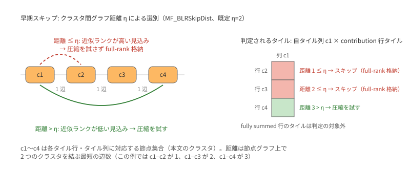

実装の要点は次のとおり。

- 圧縮カーネル `hecmw_mf_kernel_compress` は、打ち切り付き RRQR（列ピボット付き QR 分解を
  途中で止めるもの）の自前実装である。停止条件は |R(k,k)| ≤ ε|R(1,1)| か近似ランクの上限
  （後述の利得上限 β·rlim）のどちらか早い方で、ε は `MF_BLREps`（既定 1.0e-8）で与える。
  コストは O(m·n·r)（r は近似ランク）で、完全分解を行う LAPACK の `dgeqp3` と違い、full-rank 判定に
  終わるタイルで途中で打ち切れる。
  実装は LAPACK の `dlaqp2`・`dorg2r` を移植したもので（ノルム再計算の安全策は
  LAPACK Working Note 176 [12] に従う）、出典とライセンス表示はソースの当該ルーチンに
  付してある。列のノルムに NaN か Inf が現れたタイルは圧縮せず、full-rank で格納する
  （打ち切りの判定は、NaN・Inf の列を無視できる列と読んで因子から落としてしまうため）
- 早期スキップの対象と判定: 判定するのは圧縮の対象のうち自タイル列のタイル
  （自タイル列 × contribution 行タイル）で、クラスタ間グラフ距離が η 以下なら圧縮を
  試行せず full-rank 格納する。子から遅延された DOF のタイル列は距離による判定をせず、
  圧縮を試す（ランク再利用によるスキップは受ける）。遅延 DOF は symbolic 構造に現れず、
  距離表（次項）に載っていないためである
- 早期スキップの距離表: 距離は symbolic 構造ごとに 1 回、タイル列ごとの幅優先探索を距離 η で
  打ち切り、届かないクラスタは η+1 として表にしておき、「遅延のない分割」のタイル番号で引く。
  η と距離表は symbolic 分解のときに決まり、数値分解だけを繰り返す間に `MF_BLRSkipDist` を
  変えても効かない。`MF_BLR` も、symbolic 分解のときに 0 なら、後で有効にしてもクラスタリングと
  距離表のない（早期スキップのない）BLR になる。遅延ピボットが起きても
  自タイル列の境界は動かず、遅延 DOF は別タイルとして後ろに付くだけ（「フロンタル行列の
  構成（hecmwST_mf_factor と mf_snode）」の、毎回の再構築の項参照）なので、表は数値分解の
  たびに作り直す必要がない。ただし表は位置（タイル番号）で引くので、遅延の交換で後ろの
  タイル列から入ってきた DOF については、距離は近似になる。判定は圧縮を試すかどうかを
  決めるだけなので、近似でも精度には影響しない
- 早期スキップの効果と限界: 「圧縮を試みて full-rank 判定に終わる」浪費を除く。開発時の
  測定（ベンチマークモデル hinge の 1 プロセス（1 スレッドと 8 スレッド）と、Mold の
  4 プロセス×2 スレッド。規模は「内部定数の決め方」参照）では、早期スキップを入れる前の
  BLR は、数値分解の時間が full-rank 分解より 6〜12% 長かった。早期スキップを入れた後は
  full-rank 分解より 3〜6% 短くなった（同時に入れた、圧縮用の作業領域をフロントの開始時に
  まとめて確保する改善の効果を含む）。格納量の削減率の低下は、スキップなしと比べて
  0.5 ポイント以内だった。逆効果になる行列と無効化（負値の指定）は「既知の制限と拡張余地」参照
- 利得上限（`MF_BLRGainCap` β）: 近似ランクの上限を min(rlim, ⌊β·rlim⌋) とし、これを超えた
  時点で打ち切り full-rank 格納にする。rlim は格納量の削減が生じる最大の近似ランクで、m×n の
  タイルでは rlim = ⌊(m·n − 1)/(m+n)⌋ ≈ m·n/(m+n) である。β が上限を下げるのは 0 < β < 1 の
  ときだけで、1 以上は 1 と同じになる。既定 β=1 は「得にならなくなった時点で止める」自然な
  上限で、早期スキップをすり抜けた近似ランクが高いタイルで圧縮計算を無駄に最後まで続けない
  ための安全網である
- ランク再利用（`MF_BLRRankReuse`。前回の圧縮結果の再利用。このランクは近似ランクを指す）:
  再分解のとき、フロントごとに、前回もそのフロントを BLR で格納し（LU モードでは U 側の
  タイルのランクも読むので、前回も LU モード）、タイル分割が前回と一致し（子から受け取る
  遅延 DOF の数が同じ）、前回そのフロントで遅延が出なかったなら、前回 full-rank 判定に
  終わったタイルの圧縮試行をスキップする。スキップしたタイルも full-rank として記録される
  ので、一度 full-rank になったタイルは、この条件が続く限り試されない。前回低ランクに
  圧縮できたタイルは毎回圧縮し直し、前回の近似ランクは使わない。非線形解析の再分解向け
- BLR 有効時は反復改良が既定で有効になる（「反復改良」参照）

## 並列化

### 並列化の戦略

並列性の源泉は消去木である（前提知識の章参照）。兄弟の部分木は互いに独立なので、
木の下側では多数の小さいフロンタル行列を同時に処理できる（木並列）。根に近づくと
独立な仕事は減っていくが、代わりに 1 つのフロンタル行列が大きくなるので、その中を
タイル単位で並列化する（フロント内並列）。この 2 つの相補的な並列性を、OpenMP は
スレッドで、MPI はランクで使う。

両者の違いもここから出る。OpenMP は全スレッドが同じメモリを見るので、仕事の
割り当ては「空いたスレッドが次の仕事を取る」動的なやり方でよい。MPI ではデータの
置き場所を決めなければならず、割り当ては実行前に静的に決める（subtree-to-subcube 写像）。
割り当てが静的なら、送る側も受ける側も通信相手を前もって知っているので、「誰が何を
持っているか」を問い合わせる調整の通信が要らない。

### OpenMP

**戦略**: 木並列を OpenMP タスクで実現する。消去木の形と各フロントの仕事量は
問題依存で不規則なうえ、遅延ピボットで実行時にも変わるため、スレッドが空き次第
たまっているタスクを取る動的スケジューリングが負荷分散に向くからである。木の
上側でタスクの数が足りなくなる分は、フロント内のタイル演算の分配で補う（数値分解だけ。
求解はフロントの中をスレッドに分けない）。

実装の要点は次のとおり。

- スーパーノード木の葉（子を持たない節）だけをタスクとして起こす。各タスクは自分のフロンタル行列を分解した後、
  自分が親の最後の未完了の子だったときは、新しいタスクを作らず同じタスクのまま親へ
  「登る」。タスクの生成・待ち合わせの費用を省き、子の contribution block がキャッシュに
  残っているうちに親の extend-add を済ませるためである
- 「親はすべての子が終わってから」という依存は、木の節（スーパーノード）ごとに残り子数の整数
  （`left` 配列）を置き、子が終わるたびに減らして、0 にした子が親へ進む、という形で
  明示的に数える。OpenMP のタスク依存指定（`depend` 節）とタスク化ループ構文
  （`taskloop`）は、主要コンパイラ（gfortran・ifx・nvfortran）にそれぞれ不具合や非対応が
  あるため使わず、タスクの中のループ並列もすべて明示的に起こしたタスクで書く。
  コンパイラごとの事情は `hecmw_mf_numeric` の冒頭コメントと当該箇所のコメントに記してある
- 大きなフロンタル行列（内部定数 `MF_PAR_ROWS`=512 行以上）は、フロンタル行列内でも
  並列化する。そのフロントを処理しているタスクが、演算のループごとに、ループの 1 回分
  （更新・スケーリング・圧縮ではタイル 1 つ、組み立てと格納ではタイル列 1 本か自節点 8 個）の
  子タスクを起こして待ち合わせ（`taskgroup`）、空いているスレッドがそれを拾う。木並列の
  タスクが残っている間はそれらと同時に走り、残っていなければチームの全スレッドが参加する。
  木並列とフロント内並列を組み合わせるこの考え方は、MPI でも同様である（「分散数値分解の
  2 段階」参照）
- 作業領域はスレッドごと（`wrks(0:nthreads-1)`）に持ち、小さなフロントはこれを使う。
  小さなフロントも大きなフロントと同じ手続きを通るので、子タスクの構文と `taskgroup` を
  含む。ただし子タスクは if 節で undeferred の指定になる（起こしたタスクは、子タスクが
  終わるまで先へ進まない）ので、待ち合わせの時点で残っている子タスクはない
- これらの構文の位置は、OpenMP の仕様上はタスクスケジューリング点（そこで同じスレッドが
  別のタスクを差し込んで実行しうる地点。タスクの生成の直後、`taskwait`、`taskgroup` の
  終わりなど）である。それでも別のタスクが割り込まないのは、タスクが tied（既定）だから
  である。tied タスクのスケジューリング制約により、スレッドがスケジューリング点で新しく
  始められるのは、実行中のタスクの子孫だけになる。小さなフロントには未実行の子孫がないので、
  同じスレッドで別の部分木のタスクが始まって作業領域を上書きすることはない。スレッド番号は
  タスクの開始時に 1 回だけ取得し、親へ登る間も使い回すので、タスクを untied にしてはならない
- 大きなフロントは、スレッドごとの作業領域ではなく自前の作業領域を確保する。待ち合わせの
  間に同じスレッドが始められるのは、上の制約によりそのフロントの子タスクだけなので、別の
  部分木のタスクが作業領域を上書きすることは仕様上は起こらない。自前の作業領域は、この
  制約に頼らないための措置にあたる（ソースのコメントは、別のタスクが同じスレッドの作業領域を
  使いうることを理由に挙げている。制約との関係を検討した記録はない）
- 求解の後退代入のタスクは子のタスクを生成するが、自分の処理を終えてから生成し、スレッド
  ごとの作業領域も使わない

葉から起こしたタスクが親へ登る様子を、子を 3 つ持つ親 P の例で示す。

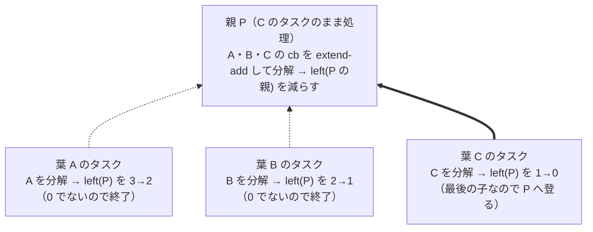

A・B・C のどれが最後に終わるかは実行ごとに変わるが、P の組み立てで子の contribution block
を足し込む順は木構造で固定してあるので、スレッド数を変えても結果はビット一致する
（BLAS/LAPACK が、同じ入力値に対して、スレッド数やオペランドのメモリ上の配置によらず同じ
結果を返すとき。大きなフロントは、スレッド数が 1 か 2 以上かで、行列積に渡す作業領域の
位置が変わる。「決定性」参照）。

### MPI 分散

MPI 分散の**戦略**は 3 つの方針からなる。

1. **通信を木の上側に限定する**。フロントの大部分を含む木の下側は、部分木を丸ごと
   1 つのランクに割り当てて通信なしで処理し、ランクをまたぐ通信は上側の少数の
   大きなフロント（上位フロント）に集中させる。オーダリングがネステッド
   ディセクションのとき、部分木はネステッドディセクションが切り出した部分領域
   （入力の分散メッシュの領域とは別物。下記の流れの手順 4 参照）に、上位フロントは領域間の
   境界（セパレータ）にほぼ対応するので、これは「内部は各担当が独立に処理し、
   境界だけを共同で処理する」という領域分割の発想と同じである。ただし境界も反復ではなく
   直接法で消去する点が、「グローバル直接法」で退けた DDM 型と異なる
2. **割り当ては実行前に静的に決める**。どのスーパーノードをどのランクが持つかは、
   symbolic 構造の重み見積もりから全ランクが通信なしで同一に計算する
   （subtree-to-subcube 写像）。動的な振り分けにしない理由は「並列化の戦略」で述べた
   調整の通信の省略と、決定性（後述）である。部分木を丸ごと 1 ランクに割り当てる点は
   subtree-to-subcube 写像の原型 [13] と同じだが、原型が兄弟の部分木を互いに素なランクの
   部分集合へ再帰的に分けるのに対し、DIRECTmf は根が 1 つなら上位フロントを兄弟で分けずに
   全ランクで処理する（理由は「分散数値分解の 2 段階」参照）
3. **数値段のメモリを分散する**。行列の値も因子も各ランクは自分が処理する分だけを保持し、
   全ランクへの複製はしない。例外は、求解の右辺と解のベクトル（全ランクが全体の長さで
   複製して持つ。「分散求解」参照）と、行列の対角ブロックの配列と添字配列（全体の長さで
   持ち、担当外の成分を 0 にする）である。ただし symbolic 分解（オーダリングを含む）は、
   全体行列の非零構造を全ランクに集めたうえでランク 0 だけで行い、その結果の symbolic 構造は
   全ランクにブロードキャストして、各ランクが全体を複製して持つ。オーダリング（`hecmw_ordering_gen`）が
   組込み DIRECT と共通の逐次実装であることと、symbolic 分解のコストが数値分解より十分小さい
   ことから、初期実装では分散しなかった。これは既知の制限である（「既知の制限と拡張余地」参照）

MPI 分散のうち、写像の構築・symbolic 構造の配布・行列値の配送と、上位フロント内のデータ
分散の規則は `hecmw_mf_dist` にある。分散数値分解と分散求解の手続き（以下に出る
`mf_super_factor_dist`・`exchange_band`・`fwd_dist` など）は `hecmw_mf_numeric` にある。
以下では、あるデータ（タイル・行バンド・部分木など）を持ち、それに対する処理を行うランクを、
そのデータの**所有ランク**（所有者）と呼ぶ。これはメッシュの節点の所有（メッシュ分割で
どのランクの領域に属するか）とは別の意味である。「担当」は、どのスーパーノードをどのランクが
受け持つかの割り当て（後述の写像）にだけ使う。

3 つの方針が消去木の上でどう現れるかを、次の見取り図に示す。木は「写像の構築: 昇格と
詰め込み」の例と同じである。木の下側（部分木）は各ランクが単独で通信なしに処理し、
上側（上位フロント）は全ランクが共同で処理する。両者をつなぐのが fan-in である。以降の
小節の図は、この見取り図の一部を拡大したものにあたる。図中の `uplist`（処理順リスト）・
ロックステップ・2D 格子・行バンド・master は、以降の小節で定義する。

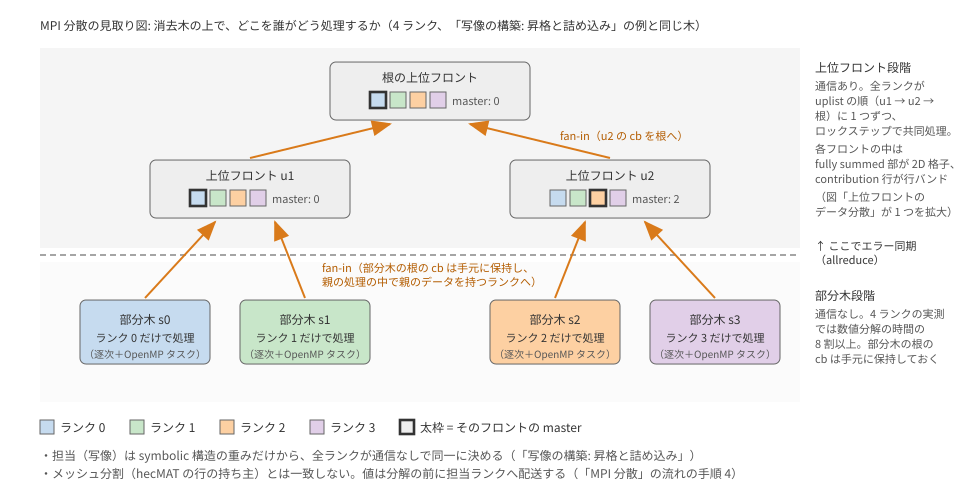

この戦略の下で、MPI 実行は分散メッシュのまま次の流れで全体系を直接分解する。
プロセス数に制約はない（組込み DIRECT 並列版の 2ⁿ+1 制約のようなものはない）。

1. 全体行列の構造の収集（`hecmw_mf_dist_gmat_build`）: 各ランクの内部節点の行を集めて
   全体番号を付ける。内部節点は、メッシュ分割でそのランクの領域に属する節点で、隣のランクの
   領域に属し通信のために重ねて持つ外部節点は含まない。番号はメッシュの `global_node_ID` の
   昇順で、プロセス数によらずモデルだけから決まる（「決定性」参照）。全体行列の非零構造
   （行ごとの列番号の並び）は allgatherv で全ランクに集める。各ランクはこれを手順 4 の
   経路表の計算に使い、そこで解放する。ランク 0 はこれに加えて、オーダリングと symbolic
   分解が読む行列の形式に組み直し、手順 2 で使ったのち手順 4 の初めに解放する
2. ランク 0 が symbolic 分解を実行し、構造をブロードキャスト（`hecmw_mf_dist_symbolic_bcast`）。
   BLR（クラスタリングあり、η>0）のときは、早期スキップの距離表もランク 0 だけが作り、
   手順 4 の後に `hecmw_mf_numeric_admis_bcast` で別に配る
3. 写像の構築（`hecmw_mf_dist_map_build`）: symbolic 構造の重み見積もりから、全ランクが
   通信なしで同一に、各スーパーノードの担当ランク（集合）を決める（subtree-to-subcube
   写像 [13]。手順は「写像の構築: 昇格と詰め込み」参照）
4. 行列の部分保持（`hecmw_mf_dist_gmat_part` / `_gmat_vals`）: メッシュ分割（各ランクが
   `hecMAT` として持つ行）と subtree-to-subcube 写像（分解で各ランクが担当する
   スーパーノード）は独立に決まり、一般に一致しない。そこで、全ランクが全体行列を
   複製するのではなく、各ランクは自分のスーパーノードが読むブロックだけを保持し、
   メッシュ分割上の持ち主から取り寄せる（下図）。送受信の経路表は symbolic 分解のとき
   （写像の構築の直後、`_gmat_part`）に一度だけ、各ランクが手順 1 で集めた構造と写像から
   通信なしで作る。以後は毎回の数値分解の前に、同じ経路で値だけを流す（`_gmat_vals`）

   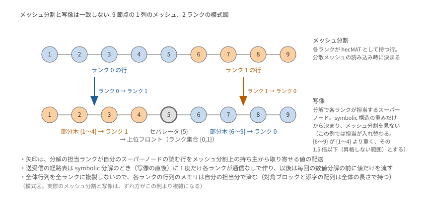

5. 数値分解（`hecmw_mf_numeric_factor_mpi`）: 部分木段階と上位フロント段階の 2 段階
   （以下の各項で詳述）
6. 求解（`hecmw_mf_numeric_solve_mpi`）: 分散した因子のまま前進後退代入を行う
   （「分散求解」参照）

この 6 手順を、各ランクが何をし、どちら向きに通信するかで並べ直したのが次の図である。
図では手順 4 を、経路表の作成（4a）と値の配送（4b）に分けて描いた。手順 1〜3 と 4a は
symbolic 分解のときだけ、4b と数値分解は数値分解のたび、求解は求解のたびに行う。非線形
解析で構造が変わらなければ、繰り返し払うのは 1 本目の破線より下（4b から）の部分だけである。
数値分解の中のメッセージのやりとりは、「時系列とデッドロック回避」のシーケンス図で示す。

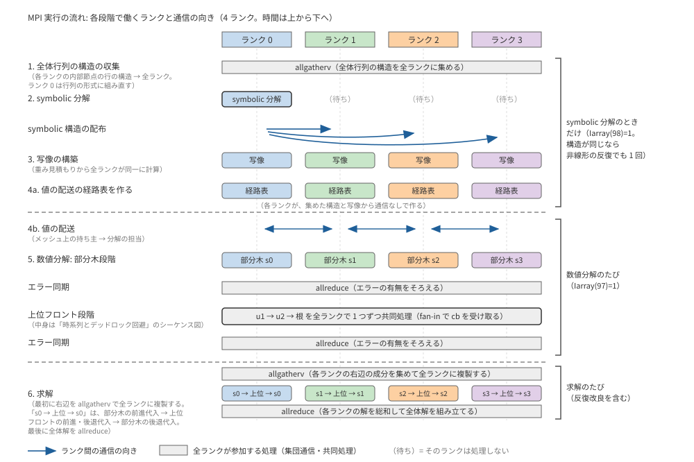

#### 写像の構築: 昇格と詰め込み

subtree-to-subcube 写像（名前はハイパーキューブ型計算機の部分キューブに由来し、本書では
単にランクの部分集合の意）は、各部分木の重みをもとに次の 3 段で決める。重みは flops
見積もりに語数のペナルティ（組み立て・格納のメモリ律速の費用）を加えたものである。
ペナルティは因子 1 語当たり 2500 flops 相当（内部定数 `MF_MAP_WPF`）とする。以下で
**ランク集合**とは、1 つのフロント（または部分木）を受け持つランクの集合をいう。

1. **根ごとのランク集合**: 根が 1 つなら全ランクをそのランク集合とする。根が複数なら、
   全ランクを根ごとの部分木の重みに比例して分け、以下の 2 段を根ごとのランク集合で
   独立に行う（分け方は後述）
2. **昇格**: ランク集合の中で重すぎる部分木の根を、複数ランクで共同処理する上位フロントに
   昇格させる
3. **詰め込み**: 昇格しなかった部分木を、それぞれ丸ごと 1 つのランクに割り当てる

**昇格の手順**: 判定に使う量を先に定義する。w_avg は候補全体の重みをそのランク集合の
ランク数で割った値（1 ランク当たりの平均負荷）、c は昇格の係数で、通常 1.2（内部定数
`MF_MAP_PROMOTE`）である。ランク集合が 2 ランク以上の根は、昇格の判定によらず上位
フロントになる。その根の直下の部分木を候補とし、次を繰り返す。

- 候補の部分木 T の重み w(T) が w_avg × c を超えたら、T の根を上位フロントに昇格させる。
  重い部分木では c を 0.5 に下げ、より積極的に昇格させる。重いとは、w(T) が平均との比に
  よらない絶対閾値 5×10¹¹ 以上のことをいう（重みの単位は上記の flops 相当。閾値と係数は
  内部定数 `MF_MAP_PROMOTE_ABS`・`MF_MAP_PROMOTE_HEAVY`）。重い部分木では、上位フロントが
  増えて集団通信の固定費用が増えても、並列度が上がる利得のほうが大きいからである
- 昇格した根のランク集合は親と同じ（根が 1 つなら全ランク）である。昇格させた T は候補から
  外し、代わりに T の子の部分木を候補に加えて、w_avg を計算し直す（実装は 1 つ昇格させる
  たびに計算し直すが、次の段落の理由から、超えた候補をまとめて昇格させても結果は同じである）
- 閾値を超える候補がなくなるまで繰り返す

候補を調べる順は最終結果に影響しない。昇格のたびに w_avg は増えることがないので、一度
閾値を超えた候補は、最後まで閾値を超えたままだからである。

**詰め込みの手順**: 候補に残った部分木を重い順に、そのとき最も負荷の軽いランクへ 1 つずつ
割り当てる（longest-processing-time-first の貪欲法）。重みが同じ部分木は番号（postorder の
スーパーノード番号）の小さい順に、負荷が同じランクは番号の小さい順に選ぶ。

**master**: 各上位フロントには代表ランク **master** を 1 つ定める。master は最も重い子の
部分木を持つランクで、ランク集合の中で番号が最小のランクとは限らない。その子が 1 ランクの
部分木ならその所有ランクを、上位フロントならその master を継ぐ（重さが同じなら番号の
小さい子、子がなければランク集合の中で番号が最小のランク）。最も重い子の寄与を送る側と
受ける側を同じランクにして、fan-in の通信を局所に留めるためである。master は、ピボット
採否の決定と、交換による DOF の入れ替えの記録と、親への遅延列の受け渡しを受け持つ
（フロントのメタデータそのものはランク集合の全ランクが作る。「上位フロント 1 つの処理手順」
参照。上位フロントの中での master の位置は「上位フロントのデータ分散」参照）。

写像の例を次に示す（4 ランク、根が 1 つ）。重みは簡単な数で表し、いずれも絶対閾値
`MF_MAP_PROMOTE_ABS` より十分小さい（したがって係数は c=1.2）とする。u1 と u2 自身の
フロントをそれぞれ 20 と 10、その下の部分木を s0=36、s1=34、s2=30、s3=25 とする。
部分木の重みは根からその下全体の和なので、u1 の部分木は 90、u2 の部分木は 65 である。

1. 根の直下の候補は u1（90）と u2（65）で、この並び順とする。合計 155、w_avg = 155/4 =
   38.75、閾値は 1.2 × 38.75 = 46.5。先に調べる u1（90）が超えるので昇格し、候補は
   u2・s0・s1（合計 135）になる
2. w_avg = 135/4 = 33.75、閾値は 40.5。u2（65）が超えるので昇格し、候補は s0〜s3
   （合計 125）になる
3. w_avg = 125/4 = 31.25、閾値は 37.5。s0〜s3 はどれも超えないので昇格は止まる
4. 詰め込み: 負荷が 0 のランクが番号順に選ばれるので、s0〜s3 は重い順にランク 0〜3 に入る

各上位フロントの master は最も重い子から継ぐので、u1 は s0 のランク 0、u2 は s2 の
ランク 2、根は u1（部分木 90 が u2 の 65 より重い）を継いでランク 0 になる。上位フロントの
中のデータの分け方は「上位フロントのデータ分散」で述べる。

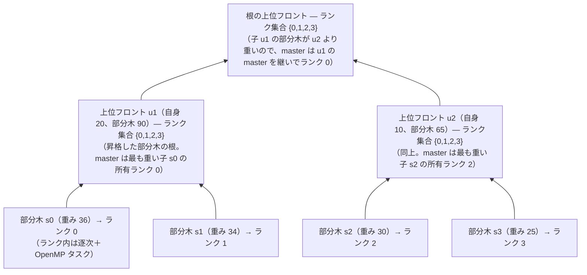

**根が複数のときの分け方**: 根の部分木の重みを並び順に積み上げ、累積の割合にランク数を
掛けた値を四捨五入して境界とする。境界が a と b の根はランク a〜b−1 を受け持つ。どの根にも
最低 1 ランクを割り当てるので、四捨五入した境界が一致して取り分がなくなった根（a = b。
根の数がランク数より多いときなど）は、ランク a だけを受け持ち（a がランク数に等しいときは
a−1）、隣の根とそのランクを共有する。取り分が 1 ランクに満たなくても、その根自身の境界が
一致しなければ、取り分のない根にはならない（4 ランクで重み 1:7 なら、根 1 の取り分は
0.5 ランクだが、境界は 0 と 1 で、根 1 がランク 0 を単独で持つ）。たとえば 4 ランクで根が
3 つ、部分木の重みが並び順に 1:7:8 なら、各根の境界（累積の割合 × 4）は根 1 が 0 と
0.25、根 2 が 0.25 と 2、根 3 が 2 と 4 で、四捨五入すると 0 と 0、0 と 2、2 と 4 になる。
したがって根 2 は {0,1}、根 3 は {2,3} である。根 1 は取り分がない（a = b = 0）ので {0} を
受け持ち、ランク 0 を根 2 と共有する。

ランク集合が 1 ランクの根（この例の根 1）は上位フロントにならず、部分木ごとそのランクに
割り当てられて部分木段階で処理される。上位フロントになるのは、ランク集合が 2 ランク以上の
フロントだけである。また、この境界の決め方では、2 ランク以上を受け持つ根どうしがランクを
共有することはない。共有が起きるのは、1 ランクだけを受け持つ根との間に限られる。

したがって根が 1 つなら上位フロントはすべて全ランクで共同処理し、ランク集合が全体の
部分集合になるのは根が複数あるときだけである。

#### 分散数値分解の 2 段階

数値分解は性格の異なる 2 つの段階からなる。通信を伴うのは上位フロント段階だけで、
部分木段階には通信がない。開発時の単一ノード（計算機 1 台）での測定（4 ランク×2 スレッド。
ベンチマークモデル hinge・Mold。規模は「内部定数の決め方」参照）では、数値分解の時間の
8 割以上を部分木段階が占めた（上位フロント段階は 7〜19%）。ただしランク数を
増やすと上位フロントが増え、上位フロント段階の比重は増す（多ノードは未評価。「既知の制限と
拡張余地」参照）。

並列性の使い方も段階で切り替わる。部分木段階は木並列（部分木ごとに別ランク）を、
上位フロント段階はフロント内並列（1 つのフロントをランク集合で分担）を使う。根が 1 つの
とき上位フロントはすべて全ランクで、上位フロントの**処理順リスト**（`uplist`。後述）の
順に 1 つずつ処理され、兄弟の上位フロントを別のランク集合が同時に処理することはない
（木並列を使わない）。理由は次の 2 つである。

- ネステッドディセクションでは上位フロントの数が少なく 1 つ 1 つが大きいため、フロント内
  並列で十分な並列度が得られる
- 全ランクが同じ処理順リストを同じ順でたどる構成は、通信相手の事前決定とプロトコルを
  単純にし、決定性（後述）の保証を容易にする

根が複数ある場合（非連結のメッシュなど）だけは、根ごとのランク集合がそれぞれの根の
下の上位フロントを同時に処理する。各ランクは処理順リストを順にたどり、自分がランク集合に
入るフロントだけに参加する（根ごとのランク集合の分け方は「写像の構築: 昇格と詰め込み」
参照）。兄弟の上位フロントをランク集合で分ける拡張は「既知の制限と拡張余地」に挙げる。

**部分木段階**: 写像で 1 つのランクに割り当てられた部分木を、所有ランクが逐次版と同じ OpenMP タスク
（葉から起こして親へ登る）で処理する。登りは上位フロントの直下で止まる。

部分木の根の contribution block は、**fan-in** で親へ送る。fan-in とは、更新する側が
寄与を計算して更新される側へ送り、複数の子からの寄与を親側に集める通信方式である [14]
（分解済みの因子列を配って受け手に更新を計算させる fan-out と対になる語）。部分木の根の
contribution block は、この段階では送らずに所有ランクの手元に保持しておき、上位フロント
段階で親を処理するとき（「上位フロント 1 つの処理手順」の手順 4）に、親のデータを持つ
ランクたちへ送る。fan-in を採るのは、子の contribution block を親のデータを持つランクへ
1 回送るだけで済むからである。これは、更新の伝搬が extend-add に局所化する
というマルチフロンタル法の構造（「設計方針と理由」のマルチフロンタル法採用理由の 2 点目）
とそのまま一致する。また、どの成分をどのランクへ送るかは、送る側も受ける側も
symbolic 構造と、子のヘッダ（遅延した列の数・行番号などのメタデータ。親の処理の初めに
子の contribution block とは別のメッセージで送る）だけから同一に導けるため、調整のための
往復通信はない。

**上位フロント段階**: 写像が列挙する上位フロントを、処理順リストの順にたどる。この順は
スーパーノード番号（postorder で付けた番号）の昇順で、子が親より先に来る。各フロントは、
そのランク集合の全ランクがロックステップで進む通信プロトコル
（`mf_super_factor_dist`。全ランクが同じ手順を同じ順で踏み、要所で待ち合わせる
進め方。ただしパネルの分解と格納の手順は、それに関わるランクだけが踏む）で処理する
（1 つのフロントの中の手順は「上位フロント 1 つの処理手順」参照）。
2 つの段階の時系列と、デッドロックを起こさないための約束は、1 つのフロントの処理手順と
分散ピボッティングを述べた後の「時系列とデッドロック回避」で示す。

上位フロント段階でも各ランクは、自分の所有部分への元行列の散布と、所有するタイルの圧縮・
スケーリング・更新を OpenMP の並列ループ（`omp parallel do`、動的スケジュール）でスレッド
並列化する。交換（ピボッティングの行・列の入れ替えと、タイルの送受信の詰め替え）は並列化して
いない。この段階はタスクの外で動くので、「OpenMP」の節で述べた「ループ並列も明示的な
タスクで書く」という制約には当たらない。MPI 呼び出しは並列領域の外で、OpenMP の
マスタースレッド（並列領域を起動したスレッド。上位フロントの master とは無関係）だけが行う。

#### 上位フロントのデータ分散

上位フロント 1 つの中では、データは 2 通りに分散される（下図）。

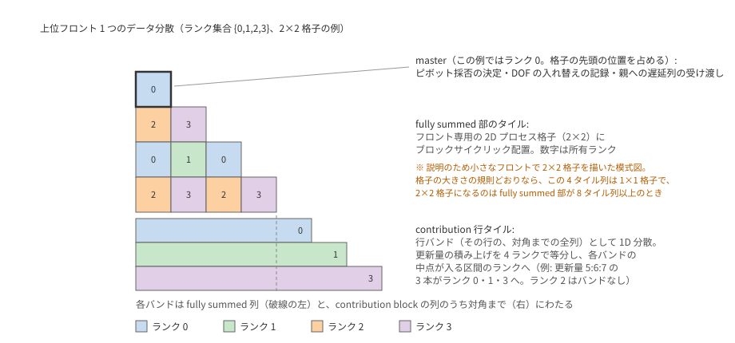

- **fully summed 部のタイル**: フロントごとに作る 2D プロセス格子にブロック
  サイクリック配置する。タイルを碁盤の目のように巡回で割り振る配置で、隣り合う
  タイルが別のランクに行く（格子が 1 列の 2×1・3×1 では、同じタイル行のタイルは同じ
  ランクになり、縦に隣り合うタイルだけが別のランクに行く）ため、消去が進んで残りの仕事が
  右下の一角に縮んでいく間も負荷が特定のランクに偏らない。規則は次の 3 つからなる。
  - 格子の形: 格子の目安のランク数 ng は、fully summed 部の対角以下のタイル数
    ntc(ntc+1)/2（ntc はタイル列の数）を `MF_2D_FSTPR`（=8）で割って切り捨てた値とし、
    最小 1、最大はランク集合のランク数とする。つまり 1 ランク当たり約 8 タイルを目安にする。
    格子の列数 pc は pc² ≤ ng を満たす最大の整数、行数 pr は ng ÷ pc の切り捨てで、
    pr ≥ pc となる（ng=3 なら 3×1、ng=4 なら 2×2）。格子に入るのは pr×pc 個のランクで、
    ng より少ないことがある（ng=5 なら 2×2 の 4 ランク）。格子を縦長（pr ≥ pc）にした
    理由の記録はない
  - 格子の形の例: ランク集合が 4 ランク以上なら、ntc が 5 以下では ng=1 で 1×1、ntc=6 では
    ng=2 で 2×1、ntc=7 では ng=3 で 3×1、ntc が 8 以上では ng ≥ 4 で 2×2 以上になる
    （ランク集合が 2〜3 ランクなら、ng はそのランク数で頭打ちになり、格子は 2×1 か 3×1 に
    とどまる）。1×1 の格子は master 1 ランクだけで、小さなフロントに分散のプロトコル費用を
    払わせない。1×1 格子でも、ランク集合と、次項の contribution 行の行バンドへの分散は
    変わらない
  - タイルの割り当て: タイル (i,j)（1 始まり）は、格子の位置 ((i−1) mod pr, (j−1) mod pc) の
    ランクが持つ。格子の位置は行優先に並べ（2×2 なら (0,0)、(0,1)、(1,0)、(1,1) の順）、
    先頭の位置に master を、残りの位置にランク集合のうち master 以外のランクを番号の小さい
    順に置く。図は master がランク 0 の例で、(0,0)=0、(0,1)=1、(1,0)=2、(1,1)=3 である。
    見取り図の u2 のように master がランク 2 なら、(0,0)=2、(0,1)=0、(1,0)=1、(1,1)=3 になる
- **contribution 行タイル**: タイル行を行バンド（その行の、対角までの全列）として
  ランク集合に 1D 分散する。割り当ては巡回ではなく、連続したブロックで配る。行バンドを
  タイル行の昇順に並べて更新量（行数×対角までの列数）を先頭から積み上げ、総量をランク数で等分した
  区間をランク集合の先頭から順に対応させる。各バンドは、積み上げの中で自分が占める範囲の
  中点が入る区間のランクに割り当てる。バンドは分割しないので、バンドの本数や更新量の偏りに
  よっては、バンドを持たないランクが途中にも生じる（図の例では、更新量 5:6:7 の 3 本が
  ランク 0・1・3 に入り、ランク 2 は持たない）。連続ブロックにするのは、後退代入で右辺の
  断片が行バンドを昇順にたどるとき、所有者の切り替わりが 1 ランクにつき 1 回で済むように
  するためである。これは効率だけでなく正しさの前提でもある。後退代入では、行バンドの
  所有ランクが 1 回の受け取りで自分の行バンドをすべて差し引くので、割り当てが連続でないと
  同じランクを 2 回訪れて二重に差し引いてしまう（「分散求解」参照）

2 つの部分で分散の方式が違うのは、開発の経緯による。最初の実装は fully summed 部を
master 1 つに置き、contribution 行タイルだけを行バンドで分散する 1D 方式（外部ソルバー
MUMPS が type 2 と呼ぶ木の節の処理方式に相当。fully summed 部を 1 ランク、更新行を
複数ランクで分担する）だった。大規模モデルでの測定で master に集まる fully
summed 部の演算が律速になったため、fully summed 部だけを 2D に移した。contribution 行の
大きな更新は 1D の時点ですでに分散できていたので、2D への変更の対象にしなかった。
contribution 行を 2D にした場合との比較は行っていない（「既知の制限と拡張余地」参照）。

各ランクは自分が所有する部分だけを組み立て・更新・格納する。master（選び方と役割は
「写像の構築: 昇格と詰め込み」参照）は、上記のとおりプロセス格子の先頭の位置を占める。

タイル (i,j)（タイル行 i・タイル列 j）を処理済みのタイル列 k で更新するのに要るのは、
同じタイル列のタイル (i,k) と (j,k) だけである（「数値分解」の図）。ただし対称モードでは
加えて D_k が要る。そこで、タイル列を処理し終えると次の 2 つを送る。

- 対角タイルの所有ランクが、パネルの分解に関わる全ランクへ送る。送るのは、対称モードでは
  このタイル列のピボットの種類・対角成分・2×2 ピボットの非対角成分、両モードではタイル列に
  残った遅延列の更新ベクトルである
- 各所有ランクが、自分のタイルを、それを読む更新がまだ残っている所有ランクへだけ送って
  共有する。行バンドのタイルは `exchange_band` で、fully summed 部のタイルは
  `fs_elim_exchange` で送る

BLR 圧縮は行バンドのタイルごとにその場で行うが、格納スロットは事前に確保してあり、格納
レイアウトが通信スケジュールに依存しない（`compress_band`）。各ランクは自分のタイルを
逐次版と同じ順に並べて格納し、タイル 1 枚の中の配置も逐次版と同じにする。こうして格納配置が
メッセージの到着順によらずに決まり、決定性（後述）を格納の面でも保つ。各ランクは
フロントの開始時に、自分の行バンドのタイルについて、圧縮の結果によらず収まる大きさの
スロットをまとめて確保する。

LU モードでは、第 2 格子（「LU モードの格納」参照）も第 1 格子と同じ規則で分散する。
第 2 格子のタイルと行バンドは、第 1 格子で同じ位置にあるタイルと行バンドの所有ランクが
持つ。したがって fully summed 部のタイル (i,j) の所有ランクは L 側と U 側の両方を持ち、
行バンドの所有ランクは、自分の contribution 行に加えて、同じ位置の第 2 格子の部分（U の
contribution 列を転置したもの）を持つ。以降の手順は、メッセージが両格子の分を運ぶことを
除いて、対称モードと同じである。

#### 上位フロント 1 つの処理手順

上位フロント 1 つの処理（`mf_super_factor_dist`）を、組み立てから親への受け渡しまで
通して示す。手順 1〜4 はランク集合の全ランクが、手順 5・6 は master と、fully summed 部の
タイルか行バンドを持つランク（以下、パネルの分解に関わるランク）だけが、同じ順で踏む。
格子と行バンドの割り当てによっては、どちらも持たないランクがあり、そのランクは手順 4 で
このフロントを終える。

1. 子のヘッダの共有: 各子を保持するランク（部分木の根なら所有ランク、上位フロントなら
   その master）が、子のヘッダ（遅延した列の数など）をランク集合へ送る。これで全ランクが、
   遅延による成長を含むフロントの形（寸法・タイル分割・contribution 行タイルの所有者・
   子の各行が親のどの位置に写るか）を通信なしで同一に決める
2. 保持領域の確保: 各ランクが自分の fully summed タイルと行バンドを零で確保し、フロントの
   メタデータ（位置と DOF の対応など）を逐次の組み立てと同じ形で作る。以後、ピボッティングに
   よる DOF の入れ替えを追うのは master だけで、ピボットの種類と 2×2 の組はパネルの分解に
   関わる全ランクが同じものを持つ
3. 元行列の散布: 「MPI 分散」の流れの手順 4 で取り寄せた全体行列のブロックを、各ランクが
   自分の所有部分に散布する
4. extend-add: 子の contribution block を保持する各ランクが、その中身を「親のどの位置を
   どのランクが持つか」（fully summed 部の成分はタイル、contribution 行の成分は行バンドで
   決まる）で切り分けたスライスにし、宛先ランクごとに 1 メッセージで送る
   （下図）。受け手は子ごとのスライスを、逐次版が子の寄与を取り込むのと同じ順に足し込む
   （自分が保持する分は手元から直接足し込む）。部分木の根の contribution block は所有
   ランク 1 つが丸ごと持つので、そのランクがすべてのスライスを送る（これが「分散数値分解の
   2 段階」で述べた fan-in メッセージである）。子が上位フロントなら contribution block は
   行バンドの所有ランクと master（遅延列どうしの正方ブロック）に分かれて保持されているので、
   保持する各ランクが自分の分のスライスを同じ規則で送る。すなわち上位フロントから親の上位フロントへの
   受け渡しも、部分木の根からの fan-in と同じ機構である

   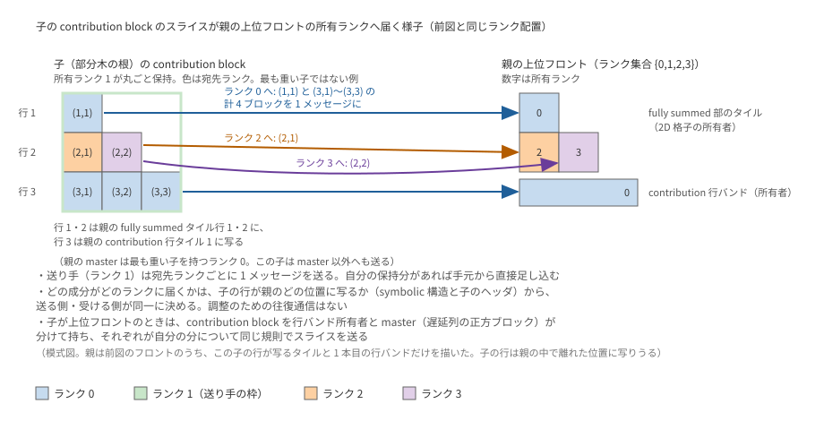

5. タイル列ごとの分解: fully summed 部のタイル列を左から順に、次の 4 段で処理する
   - パネルの試行と採否: 「分散ピボッティング」の 2 段構え（交換なしの試行
     `panel_attempt` → 採否 → 却下なら master での逐次ピボッティング `panel_piv_dist`）。
     遅延した列があれば、入れ替わった列の位置を幅の狭い新しいパネルとして、交換なしの試行から
     処理する
   - 圧縮（BLR 時）: 行バンドの所有ランクが、このタイル列の自分の contribution 行タイルを圧縮する
     （`compress_band`）
   - パネルの共有: 分解済みのタイル列を、それを読む更新がまだ残っている所有ランクへ送る
     （行バンドのタイルは `exchange_band`、fully summed 部のタイルは `fs_elim_exchange`。
     対称モードの D_k などは対角タイルの所有ランクが配る。「上位フロントのデータ分散」参照）。
     受け手が自分のタイルの更新を計算するので、フロント間の受け渡し（fan-in）と違い、
     fan-out 型の通信にあたる
   - 残りのタイルの更新: 各ランクが自分が所有するタイル（fully summed 部と行バンド）を更新する
6. 格納と親への持ち越し: 各ランクが自分の因子タイルを格納する。遅延した列どうしの正方
   ブロックは master に集め、contribution 行の分は行バンドの所有ランクが持ったまま、このフロントの
   contribution block とする。それらは親の上位フロントの手順 4 で送られる。根フロント
   （持ち越し先がない）では、残った列を master に集めて分解し終える（「分散ピボッティング」
   参照）

#### 分散ピボッティング

ピボットの採否は「候補と、その列に残っている成分の最大値を比べる」という列全体を
見る判定なので、列が複数ランクに分かれている上位フロントでは、分解の中で最も
分散しにくい処理になる。そこで、分散のまま逐次と同一の採否判定を再現することを
設計の要点に置いた（後述の決定性の基盤）。

分散版は逐次版の 2 段構え（「分解モードとピボッティング」参照）をそのまま写し、分散化に
固有の工夫は段ごとの置き場所だけである。第 1 段（交換なしの試行）は、列が複数ランクに
分かれていても各ランクが自分の行を検査するだけで済むので、分散のまま実行する。交換を伴う
第 2 段だけを master に集めて逐次のカーネルで実行する。どちらの段も逐次版と同じ判定を
するので、同じ値からは逐次と同じ**ピボット系列**（どの自由度をどの順で、1×1 / 2×2 の
どの種別で受理したかの並び）が得られる（LAPACK を使うビルドでの前提は「決定性」参照）。
大半のパネルは第 1 段で通るので、
master への収集はまれにしか起きない。

本節では語を次のように使い分ける。各ランクが自分の行を検査した結果は**合否**（合格・
不合格）、パネルの扱いは**採否**（採用・却下）と書く。採否は、対角タイルの所有ランクの
不合格か、master の判定で決まる。個々のピボットを使うことは、逐次版と同じく**受理**と書く。

第 1 段で各ランクが自分の行を検査するには、対角タイルにしかない量を受け取る必要がある。
パネルの行のうち、対角タイル以外の行を持つ各ランクを**検査役**と呼ぶ。contribution 行の
行バンドを持つランクも含む。対角タイルの所有ランク自身も、同じタイル列で対角タイルより
下のタイルを持っていれば、その行については検査役として振る舞う。検査役が自分の行 i について
パネル内の列 j の L の成分 L(i,j) = (a(i,j) − Σ_k L(i,k)·d_k L(j,k)) / d_j を計算するとする。
a(i,j) はこのタイル列の処理を始めた時点の値で、前のタイル列による更新は済んでいる。
そのため和は、同じタイル列で列 j より前に受理したピボット k にわたり、k によって 2 つに
分かれる。

- 同じタイル列で、このパネルより前に受理したピボット k の分: 検査役は自分の行の L(i,k) を
  持っているが、d_k L(j,k) は対角タイルにしかない。この d_k L(j,k) をパネル内の列 j ごとに
  並べたものを**更新ベクトル**と呼ぶ。逐次版がパネル分解の中でその場で計算する量にあたり、
  対角タイルの所有ランクが対角タイルの分解済みの部分から取り出して配る（下図）。試行の
  合否によらず使う。前のパネルは交換付きで分解し直されていることがあり、そこで受理した
  2×2 ピボットの 2 列の組については、d_k を 2×2 の対角ブロックに読み替え、更新ベクトルも
  2 列まとめてそのブロックとの積で作る
- このパネルの中の列 k（k < j）の分: 対角タイルの所有ランクがパネルを交換なしで分解した
  結果（分解済み対角ブロック）を受け取り、検査役が自分の行について解いて求める。試行が
  合格したときだけ使う

1 つ目の分（更新ベクトル）が中身を持つのは、同じタイル列で前のパネルが却下されて遅延が
起き、入れ替わった列を幅の狭いパネルとして分解し直すとき（「パネルごとの 2 段構え」の
手順 4）だけである。遅延がなければパネルはタイル列 1 本分で、このパネルより前に受理した
ピボットがないので、和は空になる。下図は、その幅の狭いパネルを試す場面である。

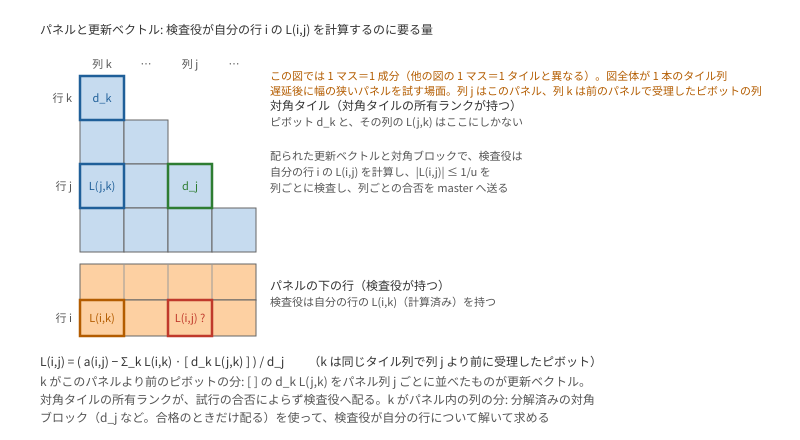

手順は次のとおり。

1. まずパネルを交換なしで試す（`panel_attempt`）
   - 対角タイルの所有ランクが、自分の行を 1×1 ピボットのみ・交換なしで分解する。この
     カーネルは自分の行についても同じ閾値検査と零ピボット判定を行い、1 列でも通らなければ
     その時点で不合格として、検査役の検査には進まない。2×2 ピボットはこの試行では使わず、
     必要になる列は却下経路の逐次カーネルが選ぶ
   - 自分の行の合否を、パネルの分解に関わる全ランク（master、fully summed 部のタイルの
     所有ランク、行バンドの所有ランク）へ送る。不合格なら、全ランクがそのまま却下経路へ進む
   - 検査役へは、あわせて次の 2 つを送る
     - 更新ベクトル: 合否によらず送る。却下経路でも、検査役はこの更新を自分の行に施して
       から master へ送るからである
     - 分解済み対角ブロック: 合格のときだけ送る
   - 検査役は、受け取った対角ブロックで自分の持つ行の L の成分（候補ピボットで割った値）を
     計算し、その絶対値が 1/u を超えないかを列ごとに検査して、列ごとの合否を master に送る
     （すべて合格でも送る）
   - master は全検査役の合否を 1 回集めて採否を決め、採用・却下のどちらの場合も、
     上と同じ全ランクに知らせる。採用ならそのまま書き戻して次のパネルへ進む
2. 却下されたパネルだけ、master にパネル全体を集めて逐次のピボッティング・カーネルを
   そのまま実行し、置換・交換・ピボット種別を、パネルの分解に関わる全ランクへ
   マルチキャストする（`panel_piv_dist`。2×2 ピボットの非対角成分は対角タイルの所有ランクにだけ送る）。
   各ランクは自分の所有部分に交換を適用し、消去済みの列は所有ランクへ散布して戻す
   - 交換は、入れ替わる 2 つの成分の組ごとに扱う（DIRECTmf の内部手続き `dswap`。BLAS の
     同名ルーチンとは別）
   - タイル列 1 本の中のパネルでの交換では、組の 2 成分を同じランクが持つので、そのランクが
     その場で入れ替える。根フロントの最終パネルは複数のタイル列にまたがりうるので、そこでの
     交換は次項と同じく扱う
   - 遅延した列と fully summed 部の末尾の未処理列との交換のようにタイル列をまたぐ交換では、
     組の 2 成分が別々のランクにありうるので、master が両方を集めて入れ替え、それぞれの
     所有ランクへ返す
   - 遅延した列の扱いは逐次版と同じで、fully summed 部の末尾の未処理列と交換し、入れ替わった
     列の位置を幅の狭い新しいパネルとして、1 の交換なしの試行からやり直す

LU モードも同じ手順で進む。違いは、対角タイルの所有ランクが L 側に加えて U 側の
分解済み対角ブロックも送ることと、更新ベクトルを 2 組送ることである。検査役は L(i,j) の
計算に、上記の d_k L(j,k) の代わりに U の成分 U(k,j) の組を使い、自分の行の U 側の更新に
もう 1 組の L(j,k) を使う（2 組とも却下経路でも使う）。交換も同じく成分の組ごとに扱う。
LU モードの行交換で格子をまたいで入れ替わる組（「LU モードの格納」の列 x+1〜y）も、2 成分の所有ランクが
同じならその場で、違えば master を経由して入れ替える。第 2 格子の成分の所有ランクは
第 1 格子と同じ規則で決まる（「上位フロントのデータ分散」参照）ので、格子をまたいでも
扱いは変わらない。

採用と却下の 2 経路の流れを次に示す（対角タイルの所有ランクと master は同じランクのこともある）。
図では、パネルの行を持たない fully summed 部のタイルの所有ランクを省いた。これらのランクも
合否と採否を受け取る。

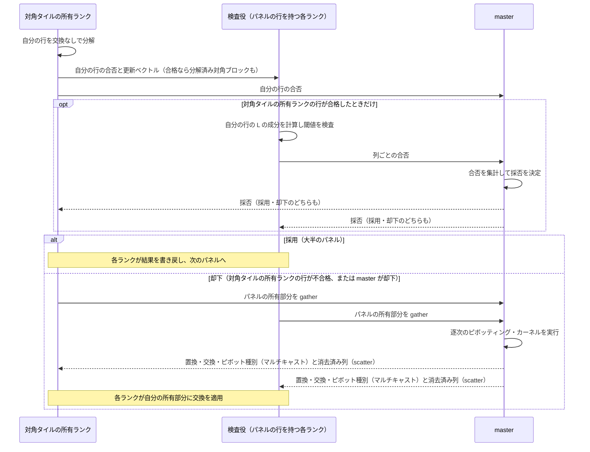

受理できず遅延した列は、逐次と同じく contribution block と一緒に親へ持ち越す。
contribution 行を持たない根フロント（消去木の根）では遅延列の持ち越し先がないので、
最後に残った列を master に集め、逐次の最終パネル処理で分解し終える。対称モードでは、
master はこのとき最終パネルの D の対角を手元に残す（`dfin`）。最終パネルでは 2×2 ピボットの
組がタイル列の境目をまたぎうる（「根フロントの扱い」参照）ので、最終パネルの分の正・負
ピボットの個数は master が数え、それより前の位置は各対角タイルの所有ランクが数えて足し合わせる。
境目をまたぐ組の前進代入での割り算（対角ブロック解）も master が受け持つ（「分散求解」参照）。

第 1 段の閾値検査は、上記のとおり各ランクが自分の行の L の成分について |L| ≤ 1/u の形で
行うので、列の最大値をランク間で集める必要はない。第 2 段は master がパネル全体を集めて
逐次のカーネルで行うので、列の最大値も master の手元で求まる。一方、零ピボット判定の基準に
なる行列最大成分 max|A| は、厳密な max の allreduce（全ランクの値を集約した結果を全ランク
へ配る集団通信）で全ランク一致させている。

これらにより、同じ値に対しては逐次とビット単位で同じ判定になる（LAPACK を使うビルドでの
前提は「決定性」参照）。値そのものがプロセス数に
よって丸めの範囲で変わりうる点は「決定性」で述べる。

この構成の追加費用は「却下されたパネルの gather/scatter」（master への収集と各ランクへの
再配布）だけで、ピボッティングが順調な大半のパネルは対角タイルの所有ランクの分解＋合否の収集
1 回で進む。

#### 時系列とデッドロック回避

MPI 分散でもっとも壊しやすいのは、デッドロックを起こさないための次の 2 点の約束である。
上位フロント段階に手を入れるときは、この 2 点を崩さないこと。

- 全ランクが同じ処理順リストを同じ順にたどる。そのため、あるフロントのメッセージを待つ
  相手は、必ず同じフロントを処理中である
- 1 つのフロントのメッセージは、そのフロントの処理の中で送り、受け切る。送信は非同期
  （isend）で、送信バッファは完了まで `mf_pool` が保持する

この約束の下での全体の時系列を次に示す。以下の「手順 4」は、「上位フロント 1 つの処理
手順」のうち、子の contribution block をスライス（宛先ランクごとに切り分けた断片）にして
送り、受け取る段を指す。

1. 部分木段階: 各ランクが自分の部分木を通信なしで処理する。部分木の根の contribution
   block は手元に保持する
2. エラー同期: 全ランクがエラー（ランク集合が 1 ランクの根でのピボット破綻など）の有無を
   allreduce でそろえ、どこかのランクでエラーがあれば全ランクがそろって中断する。エラーを
   起こしたランクは残りの部分木を飛ばしているので、そのまま上位フロントの集団交換に
   参加させるとデッドロックするからである
3. 上位フロント段階: 各ランクが処理順リストを先頭から順にたどり、自分がランク集合に入る
   フロントだけを処理する。子の contribution block（部分木の根の分も、子の上位フロントの
   分も）は、親のフロントの手順 4 で送り、同じ手順の中で受け切る
4. 最後にもう一度、エラーの有無を allreduce でそろえる

見取り図と同じ木（4 ランク。u1 の子は s0・s1、u2 の子は s2・s3、u1 と u2 の親が根）での
時系列を次に示す。メッセージは代表的なものだけを描く。上位フロントのタイルと行バンドは
全ランクが分け持つので、子のスライスは全ランクへ届きうる（u1 の段の s1 の送り先は、
「上位フロント 1 つの処理手順」の手順 4 の図と同じである）。各フロントの送受信は、
そのフロントの処理の中で始まり、その中で終わる。u1 の contribution block は u2 を処理する
間も所有ランクの手元に残り、親である根の手順 4 で送られる。

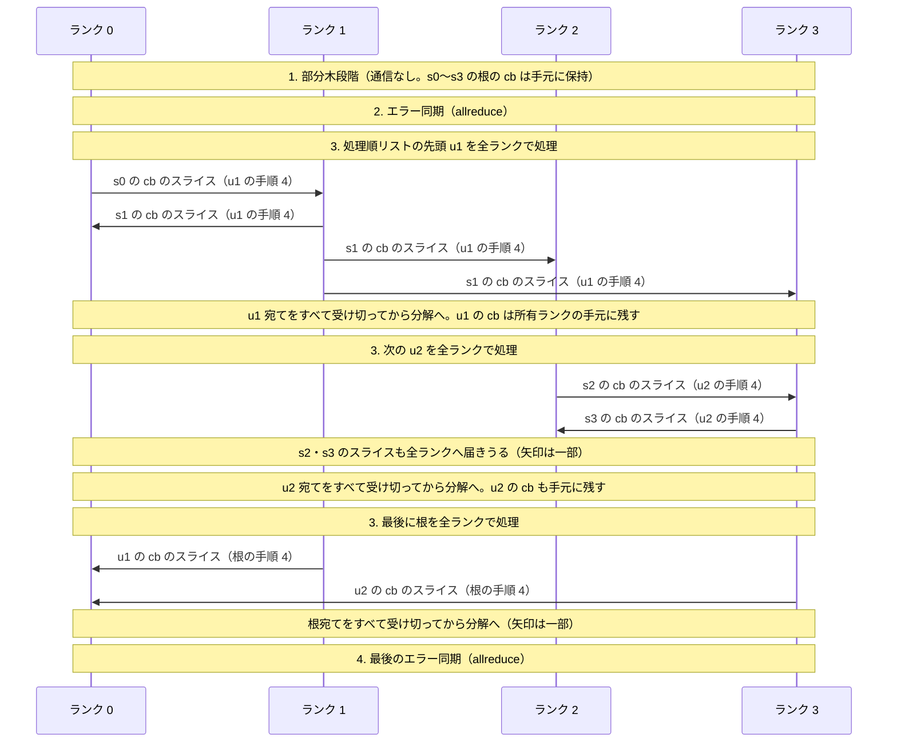

上位フロント段階の途中で起きたエラーも、冒頭の 2 点を崩さずに扱う。現状の実装で上位フロント
段階のエラーの発生源は、根フロントの最終パネルで受理できるピボットがない場合だけである。
エラーは必ず送るメッセージに載せて運び、エラー専用のメッセージは足さない。経路は次の
2 つである。

- 制御メッセージ: master は、最終パネルの結果を知らせる制御メッセージにエラーを載せて、
  最終パネルに関わる全ランクへ送る。それらのランクはそろってそのフロントの処理を打ち切る
- 子のヘッダ（予備の経路）: エラーを持ったランクは、その後のフロントで子のヘッダ
  （「上位フロント 1 つの処理手順」の手順 1）を送るときにエラーを載せる。親のランク集合の
  全ランクは同じヘッダを受け取るので、値のやりとりをせずにそろってそのフロントを飛ばし、
  エラーを載せたヘッダを親へ送り継ぐ。現状のエラーの発生源では、この経路でエラーが運ばれる
  ことはない。2 ランク以上を受け持つ根どうしはランクを共有しない（「写像の構築: 昇格と
  詰め込み」参照）ので、根でエラーを起こしたランクには、後に処理する上位フロントがない
  からである。根以外の上位フロントにエラーの発生源を足したときに、この経路が働く

いずれの場合も各ランクは処理順リストを最後までたどり、上の時系列の 4（最後のエラー同期）の
allreduce で全ランクがエラーをそろえる。

#### 分散求解

分散求解は次の順で進む。

1. 右辺と解は、全ランクが全体の長さで複製して持つベクトルとしてやりとりする。右辺は、
   各ランクの内部節点の成分を allgatherv で集めて全ランクに複製する（反復改良の補正の
   右辺も毎回同じように集める）。この方式にした理由の記録はなく、多ノード規模ではメモリと
   通信量の制限になりうる（「既知の制限と拡張余地」参照）
2. 前進代入: 各ランクが自分の部分木を逐次版と同じタスクで、通信なしで処理した後、
   上位フロントを処理順リストの順に、それぞれのランク集合で処理する
3. 後退代入: 上位フロントを処理順リストの逆順に処理した後、各ランクが自分の部分木を処理する
4. 全体解の組み立て: 部分木のピボットの解はその所有ランクが、上位フロントのピボットの解は
   その master が、全体の長さのベクトルの該当成分に書く（他の成分は 0）。全ランクの
   ベクトルを総和の allreduce で足し合わせて全体解とする。各成分に値を書くのは 1 つの
   ランクだけなので、この和は加算順序によらず正確で、丸めの差を生まない

以下では、上位フロントの中の進め方を述べる。前進代入は「上の成分から順に解を確定し、
その寄与を下の行の右辺から差し引いていく」処理である。上位フロントでは因子が複数ランクに
分かれているので、右辺の断片（セグメント）が因子を持つランクを渡り歩きながら寄与を
取り込んでいく形になる。セグメントの持ち方の規則は 1 つで、
**セグメントはどの時点でも 1 つのランクだけが持ち、逐次版と同じ順にランクを順送りされる**。
1 つのセグメントはタイル行 1 つに対応し、寄与を持つランクを渡りながら、各ランクで寄与を
差し引かれる（部分和を複数ランクが持って最後に足し合わせる方式ではない）。渡る向きは前進と後退で転置の関係になる。前進では
セグメント b_i が行 i に沿って列 1, 2, … のタイル所有者を渡り、確定した解は列方向へ
マルチキャスト（複数の相手への同報送信）される。後退ではセグメント b_j が列 j に沿って
下のタイル所有者を渡り、確定した解は行方向へマルチキャストされる。この規則にしたのは、
寄与の差し引き順を逐次版と同一に固定するためである（「決定性」参照）。なお、行バンドを
たどる間の所有者の切り替わりが 1 ランクにつき 1 回で済むのは、この規則ではなく、行バンドを
連続ブロックで割り当てていることによる（「上位フロントのデータ分散」参照）。後退代入では
行バンドの所有ランクが 1 回の受け取りで自分の行バンドをすべて差し引くので、連続ブロックの
割り当ては正しさの前提でもある。

前進（`fwd_dist`）では、まず子からの寄与（右辺のセグメント）が届く。届き先は行の種類で
分かれ、fully summed 行に当たるセグメントは master に届き、master がそれぞれを最初の
受け手（列 1 のタイルを持つランク）へ配る。contribution 行に当たるセグメントは、その
行バンドの所有ランクへ直接届く。その後、上位フロント 1 つについて次の順で進む
（下図の ①〜④）。

1. ピボットを含むタイル列を、左から最後のピボット列まで順に処理する。対角タイルの
   所有ランクが、その列に対応する解の成分を確定し、同じ列のタイルを持つランクと、行バンドの
   所有ランクへマルチキャストする。最後のピボット列の対角タイルに親へ持ち越した DOF の行が
   あれば、その行からの差し引きも対角タイルの所有ランクが行う。対称モードでは、送り出した後に
   同じランクがその場で D の 1×1 / 2×2 ブロックで割る（逐次版と同じく、対角ブロック解は
   前進代入の中で行う）。根フロントの最終パネルでタイル列の境目をまたぐ 2×2 ピボットの組
   だけは、どちらの対角タイルの所有ランクも割らずに残し、master が全セグメントを集めた後に、
   手元に残した D の対角（`dfin`）と組の非対角成分（`dsub`）で割る
2. 各タイル所有ランクは、受け取った解の成分の寄与を手元のセグメントから差し引き、
   そのセグメントを次のタイル列で同じ行のタイルを持つランクへ渡す。行バンドの
   所有ランクも、自分の contribution 行のセグメントから同じ寄与を差し引く
3. 次のタイル列の対角タイルの所有ランクへ進み、1 に戻る
4. 最後のピボット列まで処理し終えたら、contribution 行のセグメントを親の上位フロントへ
   渡し、fully summed 部のセグメントは master に戻す。このうち親へ持ち越した DOF の行の分は、
   解ではなく親への寄与である。最後のピボット列より後ろのタイル行のセグメントは、その列の
   タイルの所有ランクが持ったまま掃引の後に master へ送る。master はこの寄与を保持し、親の
   前進代入で親の master へ渡す

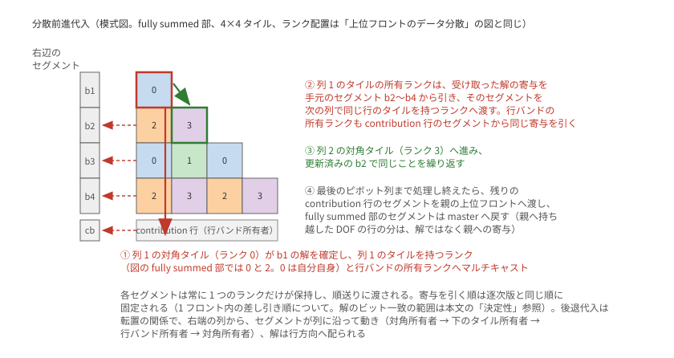

後退（`bwd_dist`）は右から左へタイル列をたどる。前進との違いは、解の確定が各列の処理の
先頭ではなく末尾に来ることと、セグメントが行ではなく列に沿って渡ることである。
セグメントは前進と同じく 1 つのランクだけが保持し、順送りに渡す。上位フロント 1 つに
ついて次の順で進む（下図の ①〜④）。

1. master が親の上位フロントから、このフロントの contribution 行に対応する確定済みの解を
   受け取り、行バンドの所有ランクへその行の分を配る
2. 前進の終わりに master へ戻っていた fully summed 行のセグメント b_j（タイル行 j の分）を、
   master がフロントの処理開始時に一括で、各列 j の対角タイルの所有ランクへ配る。
   このフロントで受理できずに親へ持ち越した DOF（fully summed 部の末尾）の解は、親ですでに
   確定している。最後のピボット列の対角タイルに入るものは、b_j と一緒に対角タイルの所有
   ランクへ送り、所有ランクは x_j を確定する前に対角タイルの中でその寄与を差し引く。
   最後のピボット列より後ろのタイル行に入るものは、このフロントでは消去しないので、起点に
   なる対角タイルがない。そこで master は、この DOF の確定済みの解を、その行を含むタイル
   （どのタイル列のものでも）の所有ランクすべてへ配る
3. ピボットを含む右端のタイル列（最後のピボット列）から順に処理する。列 j の対角タイルの
   所有ランクを起点に、b_j を列 j の対角より下のタイルを持つ所有ランク（タイル行の昇順）、
   続いて行バンドの所有ランクへ順送りし、各ランクは自分の持つ行の因子と確定済みの解との積を
   差し引いてから次へ渡す。最後に受け取ったランクは b_j を対角タイルの所有ランクへ戻す
4. 対角タイルの所有ランクが対角ブロックで列 j の解 x_j を確定し、それを必要とするランク
   （行 j のタイルを持つランク）と master へマルチキャストする。左隣の列へ進み、3 に戻る

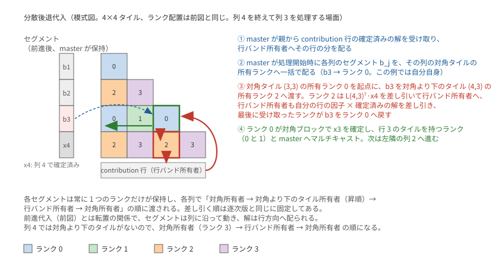

LU モードの後退代入は、対称モードの Lᵀ の代わりに U を使う。差し引く因子と対角ブロックの
解き方が変わるだけで、セグメントの渡り方は対称モードと同じである。

どちらも、1 つのフロントの中での寄与の適用順を逐次と同じに保つ。

### 決定性

OpenMP・MPI に共通する、結果の再現性の保証は 2 段階である。

- (a) **同一プロセス数・同一入力なら、スレッド数によらず結果はビット一致する**
  （プロセス数 1 なら逐次実行と一致する）
- (b) **プロセス数を変えたときは、ビット一致は保証しない**。オーダリングとピボット系列が
  同じなら、差は浮動小数点の加算順序の違い（丸め）に由来し、解の相対的な差の目安は行列の
  条件数 × 機械イプシロンである。オーダリングやピボット系列が変わると、差はさらに大きく
  なりうる（オーダリングが一致する条件は下で述べる）

プロセス数によらず固定されるものと、プロセス数で変わりうるものは次のとおりである。本書の
各所で「逐次版と同じ順」と書くのは、表の「固定」の行のうち、1 つのフロントの中で寄与を
適用する単位の順序を指す。どの子の contribution block を何番目に足すか、どのピボットによる
更新を何番目に施すか、セグメントからどのタイルの寄与を何番目に差し引くか、である。
個々の浮動小数点の加算の順序までは含まない（そこは表の「変わりうる」の行のとおり、
プロセス数で変わりうる）。

| 区分 | 内容 |
|:-----|:-----|
| プロセス数によらず固定 | 1 つの上位フロントの中で子の寄与を取り込む順、分散求解で寄与を差し引く順、BLR のタイル 1 枚の中の格納配置、ピボットの判定手順 |
| 条件付きで固定 | オーダリング（プロセス数 2 以上の間では常に同一。単一プロセスとの一致は条件付きで、条件は表の下の説明参照） |
| プロセス数で変わりうる | どのスーパーノードを上位フロントとして複数ランクで処理するか（写像）、プロセス格子・行バンドの切り方、それに伴う浮動小数点の加算の順。どの加算が実際に結果を変えているかは特定していない |

(a) は設計によって成り立つ性質である。OpenMP タスクの数や順序が変わっても、
更新と足し込み（extend-add）の適用順を木構造と固定の消去順で定めているため、演算の順序が変わらない。
ただし、密演算に使う BLAS/LAPACK 自体が、同じ入力値に対して、スレッド数やオペランドの
メモリ上の配置によらず同じ結果を返すことを前提とする（大きなフロントは、スレッド数が 1 か
2 以上かで行列積に渡す作業領域の位置が変わる。「OpenMP」参照）。マルチスレッド版の BLAS を
使う構成でビット一致を確かめた記録はない。
(b) で、オーダリングとピボット系列が同じなら差の出どころが加算順序だけになるのも設計による。
プロセス数を変えても、表の「固定」の行が変わらないからである。MPI 実行ではオーダリングの入力を、
大域行を `global_node_ID` 昇順で番号付けして作るので、モデルだけから決まり、プロセス数
2 以上の間では常に同一である。単一プロセスは分割前メッシュの節点順（`hecMAT` の局所番号）で
グラフを作るため、プロセス数 2 以上と一致するのは、分割前メッシュの節点が ID 昇順に並んで
いる場合（通常のメッシュ）である。ピボットの採否は、分散ピボッティングが逐次と同じ 2 段構えで
同じ判定を踏むことと、零ピボット判定の基準 max|A| を全ランクでそろえること
（「分散ピボッティング」参照）で、同じ値に対しては逐次と同じになる。ただし LAPACK を使う
ビルドでは、第 1 段の L のうちパネルの対角ブロックより下の行の分を、逐次版はその全行に
ついて、分散版は各ランクが自分の行について、BLAS の dtrsm で計算する。各行の結果が、
一緒に渡す行の数によらないことを前提にしており、これを確かめた記録はない。

一方、値そのものは加算順序の違いによってプロセス数で変わりうる（上の表の「変わりうる」の
行）。実際、DIRECTmf を FrontISTR に取り込んだ MR !674 のレビューでの追試（巻末の「関連
issue / MR」参照）では、1 プロセスの解と比べると、2 プロセスではビット一致したが、
3・4 プロセスでは、行列と右辺がビット一致していても解の最下位桁が変わった（モデル cube_s で
12,675 成分中 9,020 成分、相対 5e-16 程度）。2 プロセスで一致し 3・4 プロセスで一致しなかった
理由を調べた記録はない。同じレビューの過程で、回帰テストのモデル A341
（`tests/solver/DIRECTmf/basic`）では 1・2・4 プロセスの解がビット一致したが、これは
モデルによる。値が変わるので、候補ピボットが閾値ちょうど付近にある列では採否が変わり、
ピボット系列そのものがプロセス数で変わる可能性も排除できない。したがってテストの
突き合わせは、スレッド数を振った比較はビット一致、プロセス数を振った比較は許容差比較と
して扱う。ただし fistr1 経由の回帰テストの参照解との比較は、どの実行形態（serial・openmp・
mpi・hybrid）でも許容差比較（1e-4）である。単体テスト（「テスト」参照）は、同じ実行形態の中で、
繰り返した分解と求解の結果や全ランクの解がビット一致することを確かめ、1 プロセスでは分散版の
手続きで解いた解が逐次版とビット一致することも確かめる（1 プロセスでは上位フロントができない
ので、上位フロントの分散処理はこの比較に入らない）が、スレッド数を振った突き合わせはしない。
スレッド数を振ったビット一致の確認は自動化していない。

## 接触・MPC との関係

接触解析（Lagrange 乗数法、`SLAGRANGE`）の経路は接触自由度の消去あり/なしで分かれる。

- **消去あり**（`CONTACT_ELIM=1`）: 拘束式を使って接触自由度と Lagrange 乗数を消去してから
  （行列は、拘束式から作る変換行列 T を使った Tᵀ K T の形になる。MPC の消去法と同じ扱い）
  通常の `hecmw_solve` に入るため、DIRECTmf は通常経路のまま使われ、MPI 並列も効く
- **消去なし**（直接法の既定）: 消去なしを既定とするのは DIRECTmf の選択ではなく、FrontISTR の
  直接法に共通の既存の既定に従ったものである。
  - 経路: `hecmw_solver_contact.f90` が接触ラッパの手続き `solve_LINEQ_mf_contact`
    （`hecmw1/src/solver/contact/solve_LINEQ_mf_contact.f90`）を呼ぶ
  - 合成行列への展開とその理由: 接触ラッパは剛性行列と Lagrange 乗数行からなる鞍点系を
    **NDOF=1 の合成行列**（`mfMAT`、全自由度 = NP×NDOF + num_lagrange）に展開して DIRECTmf に
    渡す。数値段が一様 NDOF ブロックでしか値を読めず、スカラーの Lagrange 行が節点ブロックに
    入らないための措置である。摩擦ありでは `symmetric` フラグが偽になり LU モードで分解される。
    代償として、この経路では各 DOF が 1 つの節点になるので、節点単位の圧縮グラフの利点
    （「圧縮節点グラフ」）が効かない。性能への影響を測った記録はない
  - 制約: この経路は**単一プロセス限定**で、複数プロセスでは入口で明示エラーを出し
    `CONTACT_ELIM=1`、または外部直接法を呼ぶ既存の METHOD（MUMPS / DIRECTmkl）を案内する。
    ただし、まだどこにも Lagrange 乗数がない段階（接触の活性化前など）の求解は、鞍点系に
    ならないので、複数プロセスでも消去あり経路で解く。また MPC は `MPCMETHOD=1`（ペナルティ）
    のみ受け付ける
  - BLR: この経路では接触ラッパが BLR とランク再利用を常に無効にする（`MF_BLR` を指定して
    いれば、無効にしたことを通知する）

通常経路（接触なし、または消去あり）の MPC 処理は `hecmw_solve` 側の前処理
（消去またはペナルティ）に任せており、DIRECTmf 固有の扱いはない。

**消去なし経路の反復改良**: 反復改良の本体はドライバ（`hecmw_solver_direct_mf.f90`）に
あり、通常経路はこれを使う。消去なし経路だけは例外で、接触ラッパが
自前の反復改良を持つ。ドライバの残差評価（`hecmw_matresid`）はメッシュの節点と通信テーブルに
基づいて A x を計算するため、メッシュ上に節点を持たない Lagrange 乗数行を含む合成行列には
使えないからである。接触ラッパは、利用者の `MF_MaxRefine`（元の行列 `hecMAT` の
`Iarray(44)`）を読んで自前の反復改良の上限回数に使い、ドライバへ渡す合成行列 `mfMAT` の
`Iarray(44)` には -1 を設定してドライバ側の反復改良を止める。そのうえで、合成行列の
系の残差（`mf_contact_resid`）で自分の反復改良を回す。上限回数の既定（`MF_MaxRefine`=0
のとき）は 5 回である。通常経路では反復改良の既定は BLR 有効時だけだが、この経路は BLR を
使えないのに既定で有効にしている。接触状態が変わった
直後の分解では、残差が 1e-8 近くまで落ちないことがあるためである。これは観測された現象で、
原因（遅延の多発、悪条件など）を切り分けた記録はない。
この「呼び出し側反復改良」は過渡的な配置で、HEC-MW のソルバーの引数形式が改まれば、
ドライバ側の反復改良に一本化する見込みである（「既知の制限と拡張余地」参照）。
求解後の最終の残差の行は、DIRECTmf を含むどの直接法（MUMPS・DIRECTmkl・逐次の組込み
DIRECT）でも、消去なし経路では `solve_LINEQ_contact`（`hecmw_solver_contact.f90`）が同じ手続き
（private 関数 `rel_resid_lagrange`）で求めて出す。値は Lagrange 乗数の行を含む系の相対残差で、
DIRECTmf では、合成行列 `mfMAT` ではなく、その元になる `hecMAT`（接触の寄与を含む）と
`hecMAT%lagmat` から求める。接触ラッパが `ITERLOG` で
出すのは、自分の反復改良の各段の残差の行だけである（「HEC-MW ソルバー枠組みとの接続」参照）。

## キーワードと内部動作の対応

`!SOLVER METHOD=DIRECTmf` のオプション行（4 行目=整数、5 行目=実数）の各欄と内部動作の
対応を示す。使い方・推奨値はマニュアルのキーワードリファレンスを参照。

- 既定値: 0 は「既定値を使う」の意味で、既定値の定義はドライバと
  `hecmw_mf_numeric` の parameter 定数にある（例外は、消去なし接触の反復改良の既定
  `MFC_IR_STEPS`・`MFC_IR_TOL` が接触ラッパに、β の 1.0 がドライバ内のリテラルに、
  オーダリングの既定が `hecmw_ordering_gen` にあること）
- 負値: MF_MaxRefine と MF_BLRSkipDist は負値に別の意味を持つ（表参照）。MF_BLR と
  MF_BLRRankReuse は 0 以外（負値を含む）で有効になる。MF_Ordering は 0〜3 以外で
  エラー停止し、MF_Mode は 0〜2 以外を警告の上 0 として扱う。その他のキーワードは負値も
  0 と同じ扱い
- 未使用欄: 表にない欄（整数の 9〜10 個目、実数の 6〜8 個目）は将来の拡張用で、現状の
  ドライバは読まない。`Rarray(49:50)` は入力行に対応する欄がなく常に 0

表の `FCT` は、ドライバが持つ `hecmwST_mf_factor` の実体である。

| キーワード | 格納先 | 内部での参照 | 既定値 |
|:-----------|:-------|:-------------|:-------------|
| MF_Ordering | Iarray(41) | `hecmw_ordering_gen` の方式選択（組込み DIRECT と共通。0=既定、1=QMD、2=METIS、3=RCM） | 0（METIS 有効ビルドは METIS、無効は QMD） |
| MF_Mode | Iarray(42) | `FCT%mode`（0=symmetric フラグに従う、1=LDLᵀ 強制、2=LU 強制） | 0 |
| MF_BLR | Iarray(43) | `FCT%blr`＋symbolic 段のクラスタリング有効化（クラスタリングは symbolic 分解のときの値で決まる。消去なし接触の経路では常に無効） | 0（無効） |
| MF_MaxRefine | Iarray(44) | 反復改良の上限回数 irmax（負値=反復改良をしない。BLR 有効時の既定も、消去なし接触の接触ラッパの既定も使わない。接触ラッパはドライバに -1 を渡す） | BLR 有効時 5、無効時 0（消去なし接触は表の下の注記参照） |
| MF_TileSize | Iarray(45) | タイルサイズ（DOF 数）`MF_TILE` | 256 |
| MF_AmalgWidth | Iarray(46) | 緩和併合の目標幅（DOF 列数）`MF_RELAX_COLS` | 16 |
| MF_BLRSkipDist | Iarray(47) | 早期スキップ距離 `FCT%blr_eta`（負値=スキップ無効。symbolic 分解のときに読み、距離表と一緒に固定する） | 2（`MF_BLR_ETA`） |
| MF_BLRRankReuse | Iarray(48) | `FCT%blr_reuse`（消去なし接触の経路では常に無効） | 0（無効） |
| MF_BLREps | Rarray(41) | 圧縮打ち切り閾値 `FCT%eps` | 1.0e-8（`MF_BLR_EPS`） |
| MF_RefineResid | Rarray(42) | 反復改良の打ち切り相対残差 irtol | 1.0e-8（`MF_IR_TOL`） |
| MF_PivotThreshold | Rarray(43) | ピボット閾値 `FCT%pivot_u`（有効範囲 (0, 0.5]） | 0.01（`MF_PIVOT_U`） |
| MF_ZeroPivot | Rarray(44) | 零ピボット判定係数 `FCT%pivot_zero`（×max\|A\|） | 1.0e-14（`MF_PIVOT_ZERO`） |
| MF_BLRGainCap | Rarray(45) | 圧縮利得上限 `FCT%blr_beta` | 1.0（ドライバ内の定数。格納量の削減が生じる最大の近似ランク rlim を超えたら打ち切る。1 を超える値も 1 と同じ） |

`MF_MaxRefine` の注記: 接触の消去なし経路では、接触ラッパが自前の反復改良を既定 5 回で
回す（この経路は BLR を使えないが、反復改良は既定で有効。`MF_MaxRefine` で変更可。
「接触・MPC との関係」参照）。

このほか共通キーワードの `ITERLOG`/`TIMELOG`/`LOGLEVEL`（`Iarray(21)/(22)/(24)`）が
ログ出力を制御する（「HEC-MW ソルバー枠組みとの接続」参照）。

### 内部定数の決め方

キーワードで変えられない内部定数と、キーワードの既定値のうち性能に効くものについて、
開発時の記録に残る決め方を示す。測定はすべて単一ノード（計算機 1 台）によるもので、
多ノードでの再評価は済んでいない（「既知の制限と拡張余地」参照）。使ったベンチマーク
モデルは次の 4 つである。

- hinge: 約 8.4 万節点・約 25 万 DOF（プロファイル用）と、細分した約 14.5 万節点の版（写像の調整用）
- Mold: 約 100 万節点・約 300 万 DOF
- drill: 約 170 万節点・約 510 万 DOF（線形四面体）
- v6engine: 約 6.8 万節点・約 20 万 DOF（線形四面体）

| 定数 | 値 | 決め方 |
|:-----|:---|:-------|
| `MF_TILE`（`MF_TileSize` の既定） | 256 DOF | 計画段階で 128〜512 の範囲を定め、その中の値を採った。値を振った比較の記録はない |
| `MF_RELAX_COLS`（`MF_AmalgWidth` の既定） | 16 DOF 列 | 計画段階の目安（8〜16 列相当）の上限を採った。値を振った比較の記録はない |
| `MF_PAR_ROWS` | 512 行 | hinge（約 25 万 DOF）の木のプロファイルで、行数 512 以上のフロント（457 個）が数値分解時間の 75% を占めたことから、フロント内並列の対象をここに置いた。閾値を振った比較の記録はない |
| `MF_MAP_PROMOTE` | 1.2 | Mold・hinge の 4 プロセス×2 スレッドで 1.0/1.2/1.5/2.0 を比較した。1.5 が最速だったが、大きくすると 1 ランクが部分木を持たなくなる退化が起きる（2.0 で悪化）ため、余裕をとって 1.2 とした |
| `MF_MAP_PROMOTE_HEAVY` / `MF_MAP_PROMOTE_ABS` | 0.5 / 5×10¹¹ | 係数 0.5 は大規模な drill（4 プロセス×2 スレッド）で、数値分解と求解の時間を係数 1.2 のときより 16% 短くしたが、小規模な hinge・v6engine では 6〜14% 長くなった。そこで重い部分木だけに 0.5 を適用する。境目の 5×10¹¹ は、係数 0.5 で積極的に昇格させると損をするモデル（最上位の部分木の重み約 10¹¹ 以下）と得をするモデル（10¹² 以上）の間に置いた |
| `MF_MAP_WPF` | 2500 | Mold（約 100 万節点）で、ランクごとの時間が保持する因子の語数にほぼ線形に比例した。その当てはめから、1 語の組み立て・格納を消去演算 2500 flops 相当とみなした |
| `MF_2D_FSTPR` | 8 | 初期値の根拠の記録はない。v6engine で 8/16/32 を比べて有意差がなかった |

## テスト

`tests/solver/DIRECTmf/` に fistr1 経由の回帰テストがある（basic・plasticity・eigen・
MPC の消去/ペナルティ・接触の消去あり/なし系）。参照解との比較は、どの実行形態でも
許容差比較（1e-4）である。スレッド数・プロセス数を振った結果の突き合わせ方（前者は
ビット一致、後者は許容差）は「決定性」参照。スレッド数を振ったビット一致の確認は、下の
単体テストを含めて自動化していない。
`LOGLEVEL>=2` の自己検査（symbolic 構造の整合検査と組込み DIRECT との突き合わせ。条件は
「HEC-MW ソルバー枠組みとの接続」参照）も検証手段である。回帰テスト basic のモデル A341 は
このログ行（違反数・不一致数が 0 であること）を、A341_blr・A341_precond は BLR の圧縮と
オプション行の読み込みのログ行を、contact_slag_mpc_pena のモデル 3box_hex_fric_mpc は
接触ラッパが出す反復改良の初回の残差の行と、`solve_LINEQ_contact` が出す最終の残差の行を
検査しているので、ログの文言を変えるとテストが落ちる。
SA-AMG の最粗レベルでの利用（`SA_CoarseSolver=4`）は、`tests/solver/saamg/`
の回帰テスト A361mf・hexfricmf が、この経路が選ばれたことをログ行で確かめている。SA-AMG の
単体テスト（`tests/unit/saamg/`）は HEC-MW なしで SA-AMG の本体だけをビルドし、最粗レベルの
DIRECTmf の呼び出しを、呼ぶと中止する手続きに置き換えるので、DIRECTmf を通らない。

`tests/unit/directmf/` の単体テストは、fistr1 とドライバ（`hecmw_solve_direct_mf`）を
通さずに、各モジュールの API を直接呼ぶ。行列は格子のグラフ（1 次元の鎖と、2 次元では
四辺形 1 次要素、3 次元では六面体 1 次要素のメッシュと同じ隣接）の上にテストの中で組み立て、
ケースごとに節点あたりの自由度、オーダリング（番号順のまま・逆順・乱数・`hecmw_ordering_gen`
の既定。既定は METIS ありのビルドでは METIS、なしでは QMD）、緩和併合の有無、タイルサイズを
変える。プログラムごとの対象と、確かめていることは次のとおりである。

- `test_mf_symbolic`: symbolic 分解。`hecmw_mf_symbolic_check` で構造の整合を検査し、
  消去木と column counts を、テストの中に別に実装した symbolic 分解と突き合わせる。因子の
  大きさは、緩和併合なしのケースでは一致を、ありのケースでは小さくならないことを確かめる。
  節点あたりの自由度が一様なケースでは、さらに `hecmw_mf_compare_builtin`（「HEC-MW ソルバー
  枠組みとの接続」の自己検査と同じ手続き）で、消去木と column counts を組込み DIRECT とも
  突き合わせる。このときのオーダリングはケースのものでなく、組込み DIRECT が既定で選んだ
  もので、緩和併合なしで作り直した構造と比べる
- `test_mf_numeric`: 正定値行列の、対称モードの数値分解と求解。相対残差と、数値段の初期化が
  タイルの配置から数えた因子の成分の数が、symbolic 段の見積りと一致することを確かめる
- `test_mf_pivot`: 対称モードのピボッティング。対角の符号を乱数で反転した行列、対角ブロックが
  零の節点（Lagrange 乗数の擬似節点を模したもの）を足した鞍点系、固有値の範囲の内側の値で
  シフトした行列、対角成分がすべて零の行列で、相対残差と、正・負ピボットの個数が LAPACK の
  dsytrf から求めた値と一致することを確かめる。正定値行列では、交換・遅延・2×2 ピボットが
  起きず、格納した因子の語数が見積りと一致することも確かめる
- `test_mf_lu`: LU モード。値を非対称にした構造対称の行列（小さな摂動、対角の小さいもの、
  上と同じ擬似節点を足したもの、対角成分がすべて零のもの）で、相対残差と、対称フラグに従って
  LU モードが選ばれることを確かめる（作った行列が数値的に非対称であることも、ログ用の数値
  非対称度の計測を有効にして確かめる）。対称な行列は、対称モードと
  LU モードの両方で解き、解の差が相対 1e-10 以内であることと、LU モードで交換・遅延が
  起きず、格納した因子の語数が見積り（L か U の片側の分）の 2 倍であることを確かめる
- `test_mf_blr`: BLR 圧縮。低ランクのブロックからなる行列（対称・非対称、擬似節点あり・なし）
  と乱数の行列で、打ち切りの閾値をごく小さく（1e-30）したときに解が full-rank 分解の解と
  合うこと（圧縮されたのが近似ランク 0 のタイルだけならビット単位で、それ以外は残差が full-rank
  分解の残差の 10 倍以内）、閾値を振ったときの残差が、閾値の定数倍と full-rank 分解の残差の
  10 倍の大きいほう以下に収まること、低ランクのブロックの行列では最大の閾値で圧縮が起きる
  こと、選ばれた分解モード、BLR の因子で求解を繰り返すテストの中の反復改良が収束すること、
  分解と求解を繰り返した
  とき（ランク再利用を含む）にビット単位で再現することを確かめる。別に、タイル 1 枚の圧縮
  （`hecmw_mf_kernel_compress`）が閾値に従うことを直接確かめる。閾値をごく小さくしたとき、
  厳密に低ランクのタイルが正の近似ランクで圧縮されるかは BLAS のカーネルによって変わり、
  解の比較だけでは閾値の扱いの誤りを見分けられないためである
- `test_mf_mpi`: MPI 分散の数値分解と求解（対称モードと LU モード、BLR あり・なし）。
  ドライバと同じく symbolic 段をランク 0 で行って配る。分散数値分解には、全ランクが同じ行列を
  持ったうえで `hecmw_mf_dist_gmat_extract` が作る、各ランクの部分保持の行列を渡す（ドライバ
  は分散メッシュから `hecmw_mf_dist_gmat_build` で全体行列の構造を集め、`_part`・`_vals` で
  部分保持を作るので、これらはテストを通らない）。
  相対残差、繰り返したときのビット単位の再現性、解が全ランクでビット単位で一致すること、
  ランクごとの因子の語数と正・負ピボットの個数の和が逐次と一致すること、上位フロントの因子の
  語数の和が逐次と一致し、contribution 行を持つ上位フロントがあれば上位フロントの因子を
  2 ランク以上が持つこと、対角ブロックがすべて零のケースで遅延ピボットが起きること、BLR の
  因子で求解を繰り返すテストの中の反復改良が収束することを確かめる。和の逐次との完全な
  一致は、テストの行列ではピボット系列と近似ランクがプロセス数で変わらないことを前提に
  している（「決定性」の (b) 参照）。同じ symbolic 構造での逐次の分解との、解の
  ビット単位の一致は、1 プロセスでは必須とし（このとき上位フロントはできない）、2 プロセス
  以上では結果を表示するだけである（「決定性」の (a)・(b) 参照）。別に、ランク再利用に
  ついて、BLR なしの分散数値分解を挟んでも次の BLR の分解で低ランクのタイルの数が初回と
  同じになることと、逐次で対称モードの直後に LU モードで分解し直しても残差が 1e-6 以下に
  なること（どちらも「BLR 圧縮」のランク再利用の条件に関わる）を確かめ、NaN・Inf を含む
  タイルが圧縮されないことも確かめる

symbolic・numeric・pivot・lu・blr は 1 プロセスで動くプログラムで、実行形態 serial と、
OpenMP ありのビルドでは openmp に登録する。mpi は、MPI ありで mpiexec が見つかったビルドでだけ
作り、すべての実行形態に登録する（1 プロセスの形態では mpiexec を通さずに起動する）。実行形態
mpi では、4 プロセスで動かす mpi_np4 も登録する。fully summed 部を 2 列のプロセス格子に
載せるのは、ランク集合が 4 ランク以上で、fully summed 部のタイル列が 8 本以上
（`MF_2D_FSTPR`=8 から決まる）のフロントだけだからである（「上位フロントのデータ分散」参照）。
ラベルは `unit/directmf` と実行形態で、LAPACK あり（`WITH_LAPACK`）の、Windows 向けでない
ビルドだけに登録する。

単体テストは、テストの中で組み立てた小さな行列で、残差だけでは見えない内部の約束（因子の
大きさ、正・負ピボットの個数、ランクごとの値の和、ビット単位の再現性）を機能ごとに確かめる。
因子の型 `hecmwST_mf_factor` の成分（統計、BLR の設定、分解モードなど）を直接読み書きし、
圧縮グラフ・symbolic 構造・写像の成分も直接読むので、これらを変えるときは単体テストも直す。

テストを通る経路は、種類によって次のように分かれる（「既知の制限と拡張余地」参照）。

- fistr1 経由の回帰テストだけが通る: `hecMAT` の非零パターンからのグラフの構築
  （`hecmw_mf_graph_from_hecmat`）、分散メッシュからの全体行列の構造の収集と行列の部分保持、
  右辺の収集と解の書き戻し、ドライバのオプションの解釈と反復改良、接触ラッパと SA-AMG の
  最粗レベルからの呼び出し
- 単体テストだけが通る: BLR の早期スキップを有効にした（η > 0 の）分解。BLR を使う回帰テスト
  A341_blr・A341_precond は、`MF_BLRSkipDist` を負にして早期スキップを無効にしている。また、
  対称モードで、行数 `MF_PAR_ROWS`（=512）以上のフロントをフロント内でも並列に処理する経路
  （「OpenMP」参照）。この大きさに届くのは `test_mf_mpi` の、対角ブロックがすべて零の 3 次元の
  ケースのフロントだけで、通るのは 2 スレッドの実行形態（openmp・hybrid）のときだけである。
  回帰テストのモデルのフロントは、この大きさに届かない
- どのテストも通らない: 早期スキップの距離表の配布（`hecmw_mf_numeric_admis_bcast`）、LU
  モードでのフロント内並列（単体テストの LU モードのフロントも、上の大きさに届かない）、分解の
  失敗（受け入れられるピボットがないときなど）の扱い、消去なし接触を複数プロセスで呼んだときに
  止める検査。LAPACK なしのビルドで使う密演算のループ実装（「外部依存の範囲」参照）も、単体
  テストは LAPACK ありのビルドだけに登録し、CI には LAPACK なしのビルドがないので、日常的には
  確かめていない

## 保守時に守る約束

コードに手を入れるときに崩してはならない約束を、本文の各所から集めて示す。理由と詳細は、
括弧内の節で述べている。

- symbolic 構造は数値段からは読み取り専用とし、遅延によるフロントの成長は数値段のデータで
  吸収する（「symbolic 段と数値段の分離」）
- 子から遅延された DOF は自タイル列の後ろに別のタイルとして付け、自タイル列の境界を
  動かさない。BLR の早期スキップの距離表は、これを前提に作り直さずに使っている（「フロンタル
  行列の構成（hecmwST_mf_factor と mf_snode）」「BLR 圧縮」）
- スレッドごとの作業領域（`wrks`）を使うタスクには、遅延実行される子タスクを残さない
  （子タスクは if 節で undeferred にする）。子タスクを遅延実行させる大きなフロントは、この
  作業領域を使わず、自前の作業領域を確保する。分解のタスクは tied のまま使い、untied に
  しない（スレッド番号をタスクの開始時に 1 回だけ取って使い回すため。「OpenMP」）
- 子の contribution block を親へ足し込む順は木構造で固定し、タスクの実行順に依存させない
  （「OpenMP」「決定性」）
- BLR で圧縮するのは contribution 行のタイルだけとする。fully summed 行のタイルは、後の
  ピボット交換で行が並べ替わりうる（「BLR 圧縮」）
- BLR の格納配置を、メッセージの到着順に依存させない。各ランクは自分のタイルを逐次版と同じ
  順に並べる（「上位フロントのデータ分散」）
- 上位フロントの行バンドは、ランク集合に連続ブロックで割り当てる。分散後退代入は、行バンドの
  所有ランクを 1 回ずつ訪れて差し引くので、連続でないと二重に差し引く（「上位フロントのデータ
  分散」「分散求解」）
- 上位フロント段階では、全ランクが同じ処理順リスト（`uplist`）を同じ順にたどり、1 つの
  フロントのメッセージはそのフロントの処理の中で送り、受け切る（「時系列とデッドロック回避」）
- 上位フロント段階の MPI 呼び出しは、OpenMP の並列領域の外で、マスタースレッドだけが行う
  （「分散数値分解の 2 段階」）
- エラーは集団交換に入る前に allreduce でそろえる。上位フロント段階のエラーは、必ず送る
  制御メッセージと子のヘッダに載せて運び、エラー専用のメッセージを足さない。フロントの
  打ち切りや飛ばしは、同じメッセージを受け取ったランク集合の全ランクがそろって行う
  （「時系列とデッドロック回避」）
- 分散版のピボットの判定は、段ごとに逐次版と同じ形で行い、零ピボット判定の基準 max|A| を
  全ランクで厳密にそろえる（「閾値・零ピボット判定と統計」「分散ピボッティング」）
- 根フロントの最終パネルでは、2×2 ピボットの組がタイル列の境目をまたぎうる。タイル列ごとに
  D を読む処理（求解の対角ブロック解、分散版の正・負ピボットの集計）は、この組を別に扱う
  （「根フロントの扱い」「分散ピボッティング」「分散求解」）
- 本書が説明する挙動を変えるときは、同じ MR で本書を直し、冒頭の時点の記述も更新する（「概要」）

## 既知の制限と拡張余地

- **消去なし接触の MPI 非対応**: 「接触・MPC との関係」のとおり単一プロセス限定。分散鞍点系の設計
  （Lagrange 行の分散方式、外部節点の行に接触の寄与の持ち分を持つ剛性行列 `hecMAT` が分散したままの
  残差計算・通信）が必要で、可変ブロック（Lagrange 乗数の擬似節点）設計の再検討を含む。
  分散したままの残差計算には、消去なし経路の最終の残差の行のための `rel_resid_lagrange`
  （`hecmw_solver_contact.f90`）が前例になる。ほかの直接法の複数プロセスの経路で、分散した
  `hecMAT`・`hecMAT%lagmat` から相対残差を求める。内部節点の行は通常の行列ベクトル積で求め、
  外部節点の行と乗数の列の寄与は、外部節点の行の分を所有ランクへ足し込む。
  ただし返すのはノルムだけで、反復改良の補正の右辺にする残差ベクトルは返さない
- **接触ラッパの呼び出し側反復改良（過渡的な配置）**: HEC-MW のソルバーが受け取る引数が、
  現在の（メッシュ, 行列）から（通信テーブル, 行列）の形に改まり、ノルムと残差の計算が
  メッシュではなく通信テーブルを基準に行えるようになれば、ドライバ側の反復改良に一本化し、
  `mf_contact_resid` と、irmax に -1 を設定する合図（`Iarray(44)=-1`）を廃止する見込みである
  （「接触・MPC との関係」参照）
- **数値段の一様 NDOF 制約**: 可変 `ndof(i)` はグラフ・symbolic 段までの設計で、
  数値段の値読み込みが未対応。上記の消去なし接触の自然な解法でもあり、将来課題
- **symbolic 分解のランク 0 集中**: 分散対象は数値段のみ。symbolic 分解はランク 0 が行い、
  その結果の symbolic 構造は全ランクが複製して持つ。また symbolic 分解の間は、全体行列の
  非零構造（行ごとの列番号の並び）を全ランクが一時的に持つ（「MPI 分散」の流れの手順 1）。
  多ノード規模の問題でメモリ・時間の両面から顕在化しうる
- **求解の全体長ベクトルの複製**: 求解の右辺と解は全ランクが全体の長さで複製して持つ。
  右辺は allgatherv で全ランクに集め、最後に全体解を allreduce で組み立てる（「分散求解」
  参照）。この方式にした理由の記録はなく、
  多ノード規模ではメモリと通信量の制限になりうる
- **数値分解のカーネルの効率**: 単一ノードの対 MUMPS 比較で、symbolic 分解（MUMPS の用語
  では analysis）は速いが、数値分解（同じく factorization）のカーネル単体では劣る。タイル
  カーネルの最適化余地が残る
- **BLR 早期スキップの逆効果ケース**: 多数の節点が互いに直接結合し、結合の強さが節点間の距離に応じて
  なだらかに変わる行列（境界要素法の行列が典型）では、早期スキップが逆効果になる。
  早期スキップは「グラフ距離が近いタイルは近似ランクが高い」という前提に立つが、こうした行列では
  近いタイルも低ランクで近似できるため、試行を省いた分だけ圧縮率が下がる
  （`MF_BLRSkipDist` を負値にして回避）。有限要素行列でも、薄板の深絞りモデル press
  （約 1.3 万節点、LU モード、1 プロセス×8 スレッド）で該当した。ほぼすべてのタイルが近似ランク
  0〜2 に圧縮でき、格納量の削減率はスキップなしの 54% からスキップありの 4% に下がった。
  ただし数値分解の時間はスキップありが最短で、失ったのは格納量の削減だけだった。自動判別はない
- **BLR と悪条件問題**: 悪条件問題では、既定の打ち切り閾値 ε で反復改良が停滞しうる
  （ε=1.0e-10 への引き締めをマニュアルで推奨）。自動調整はない
- **BLR のクラスタリングの並びの崩れ**: クラスタリングの後の symbolic 構造の作り直しで、
  並べた順の一部が崩れる（「symbolic 分解」の手順 4 参照）。ベンチマークモデル hinge
  （MF_BLR=1）では 84,056 節点のうち 10,459 節点の位置が変わり、そのときの BLR の格納量の
  削減率は 11.7% だった。スーパーノードの切れ目と親子関係を保ったまま中の順だけを入れ替える
  作り直しで、削減率と時間がどう変わるかは測っていない（issue #981）
- **反復改良の丸め下限**: 成分の桁が大きく異なる（スケーリングの悪い）行列では相対残差の
  倍精度評価の下限が閾値を上回り、上限回数まで反復するか、残差が増えた時点で直前の解に
  戻して警告を出して止まることがある（実害は時間と警告のみ）
- **SA-AMG 最粗レベルの冗長保持**: `SA_CoarseSolver=4` は粗グリッド演算子を全ランクに
  gather する冗長方式。分散 DIRECTmf による gather レス化は未着手
- **BLR 圧縮カーネルの LAPACK 追随**: 打ち切り付き RRQR は LAPACK 3.12 の `dgeqp3rk` で
  置き換えられる可能性があるが、最低要件（CI の Ubuntu 22.04 は 3.10）と停止規準の差が
  あるため自前実装を維持している
- **多ノード性能評価の未実施**: 実測は単一ノードのみ。MPI での数値分解のスケーリングと
  symbolic 分散の要否判断は多ノード実測待ち
- **上位フロントの木並列の未実装**: 兄弟の上位フロントを別のランク集合で同時に処理する
  分割（[13] の本来の subcube 分割）は行わず、根が 1 つなら上位フロントを全ランクで
  1 つずつ処理する（理由は「分散数値分解の 2 段階」参照）。多ノードで上位フロント段階が
  律速になれば拡張の候補になる
- **contribution 行の分散方式の未評価**: 上位フロントの contribution 行は 1D の行バンドの
  まま（「上位フロントのデータ分散」参照）で、2D 分散との比較は行っていない。多ノードで
  行バンドの更新が律速になれば検討の対象になる
- **LU モードのピボット閾値の上限**: u の上限 0.5 は対称モードの 2×2 ピボットに由来する
  条件だが、LU モードにも同じ上限を適用している（「分解モードとピボッティング」参照）
- **ピボット候補の範囲と再試行**: ピボットの候補はパネル内に限り、同じ節点ブロックの
  候補を優先し、末尾へ送った列は同じフロントの中で再試行しない（「パネルごとの 2 段構え」
  「ピボッティング・カーネル」参照）。いずれも理由の記録はなく、候補をフロント全体に
  広げる方式や再試行する方式との比較の記録もない。遅延が多いモデルでは検討の対象になる
- **静的ピボッティングの不採用**: 小さすぎるピボットを一定の大きさに置き換えて（摂動して）
  そのまま受理し、遅延を起こさない静的ピボッティングは採用していない。この方式では遅延に
  よるフロントの成長がない代わりに分解が近似になり、反復改良で精度を補う。閾値ピボッティングと
  遅延ピボットによる現方式との比較の記録はない
- **理由や確認の記録がないその他の判断**: 上の各項のほかに、本文で理由や確認の記録がないと
  書いた判断は次のとおりである。いずれも設計を見直すときの検討の候補になる
  - マルチフロンタル法を、スーパーノーダル法と比べずに採ったこと（「マルチフロンタル法」）
  - 交換の相手の選び方と、q の 1×1 と (k, q) の 2×2 の選び分けに Bunch–Kaufman の規則を
    採ったこと（「ピボッティング・カーネル」）
  - LAPACK なしのビルドで、BLR の圧縮カーネルの部品に代わるループ実装を用意せず、BLR を
    無効にしていること（「BLR 圧縮」）
  - contribution block を圧縮しないこと（「BLR 圧縮」）
  - 上位フロントの 2D プロセス格子を縦長（pr ≥ pc）にしたこと（「上位フロントのデータ分散」）
  - LAPACK を使うビルドで、BLAS の dtrsm の各行の結果が一緒に渡す行の数によらないことを
    確かめていないこと（分散ピボッティングの第 1 段の判定が逐次と一致する前提。「決定性」）
  - マルチスレッド版の BLAS を使う構成で、スレッド数によらないビット一致を確かめていないこと
    （「決定性」）
  - 消去なし接触で NDOF=1 に展開したことによる性能への影響を測っていないこと（「接触・MPC
    との関係」）
  - 消去なし接触で、BLR を使えない経路なのに反復改良を既定 5 回で有効にしたこと。根拠にした、残差が
    下がりきらない現象の原因は切り分けていない（「接触・MPC との関係」）
- **内部定数の評価範囲**: 写像や並列化の内部定数は単一ノードのベンチマークで決めたもので
  （「内部定数の決め方」参照）、タイルサイズなど値を振った比較の記録がないものもある
- **テストの範囲**: 単体テスト（「テスト」参照）はモジュールの API をテストの中で組み立てた
  小さな行列で確かめるもので、ドライバが通す経路（`hecMAT` の非零パターンからのグラフの構築、
  分散メッシュからの全体行列の構造の収集と行列の部分保持、右辺の収集と解の書き戻し、
  オプションの解釈、反復改良）と、接触ラッパ・SA-AMG の最粗レベルからの呼び出しは、fistr1
  経由の回帰テスト（参照解との許容差比較と、一部のモデルでのログ行の検査）でしか確かめて
  いない。早期スキップの距離表の配布、LU モードでのフロント内並列、分解の失敗の扱い、
  消去なし接触を複数プロセスで呼んだときに止める検査はどのテストも通らず、LAPACK なしの
  ビルドで使う密演算のループ実装も日常的には確かめていない（「テスト」参照）。また、スレッド数
  によらないビット一致（「決定性」の (a)）を、スレッド数を振って突き合わせるテストはない
  （たとえば単体テストの中で、スレッド数を変えて分解し直し、解を比べる形が考えられる）

## 用語集

表記の約束（フロント、cb、数値分解と数値段、ランク、列）は本文の初出箇所で述べ、
以下の表にも項目として含める。用語は本文の章立てに沿って 5 つに分け、各表の中は
おおむね本文での初出順に並べる。記号は最後の表にまとめる。

### 表記と基礎概念の用語

| 用語 | 意味 |
|:-----|:-----|
| LDLᵀ / LU | 対称行列の分解 A = L D Lᵀ（L は単位下三角、D は 1×1・2×2 ブロックの対角）/ 一般の正方行列の分解 A = L U。DIRECTmf の対称モード（LDLᵀ）と LU モード |
| 構造対称・数値非対称 | 非零パターンは対称だが値は非対称な行列（摩擦接触、非関連塑性など）。LU モードで分解する |
| ランク | 本書では MPI のプロセス（番号は 0 始まり）。行列のランク・低ランク近似の近似ランク r とは別語 |
| 因子 | 分解で得られる L と D（LU 分解では L と U） |
| fill-in | 消去によって、元の行列では零だった位置に生まれる因子の非零成分 |
| オーダリング | fill-in を減らすための消去順（節点の並べ替え）。METIS・QMD・RCM など |
| セパレータ | メッシュを互いに独立な領域に切り分ける小さな節点集合。ネステッドディセクションの境界 |
| ネステッドディセクション | セパレータで領域を 2 つに切り、領域 → セパレータの順に消去する並べ替えを再帰的に適用するオーダリング。METIS が計算する |
| 消去木 | 列の依存関係を表す木。parent(k) = 因子の列 k で対角より下で最初に非零になる行 [4] |
| 行構造 | 因子の列 k で対角より下で非零になる行の集合（symbolic 段の `rlist` は自スーパーノードの列も含む） |
| スーパーノード | 行構造が揃った連続列をまとめた単位。密ブロックとして BLAS レベル 3 で処理できる |
| BLAS レベル 3 | 行列どうしの積などの密行列演算の標準ライブラリ水準。スーパーノードやタイルの演算に使う |
| スーパーノード木 | スーパーノードを 1 つの節とみなして消去木を縮めた木。`sparent` が表す |
| フロンタル法 | 要素を順にアセンブリしながら、寄与がすべて集まり終えた自由度から消去していく Irons の方法 [5] |
| マルチフロンタル法 | 消去木の節ごとにフロンタル行列を組み立てて部分消去し、contribution block を親へ extend-add で渡す方法 [1][2] |
| フロンタル行列（フロント） | スーパーノードの消去のために組み立てる小さな密行列 |
| fully summed | フロンタル行列のうち、寄与がすべて合流し終えて消去してよい行・列 |
| contribution block（cb） | フロンタル行列の消去し残した部分。消去した自由度が残りに及ぼす影響（Schur 補元の更新項。静的縮約で境界自由度の剛性に加わる項に相当し、遅延 DOF の部分を除いて境界自由度どうしの元の剛性は含まない）を保持し、親へ extend-add で渡す |
| Schur 補元 | ブロック行列 [[K_ii, K_ib], [K_bi, K_bb]] で i を消去したときに b に残る行列 K_bb − K_bi K_ii⁻¹ K_ib。静的縮約後の境界剛性にあたる |
| extend-add | contribution block を行・列番号で対応付けて親のフロンタル行列へ足し込む散布加算。要素アセンブリと同型 |
| 自 DOF / 自節点 / 自タイル列 | スーパーノード自身の列（消去する候補）に当たる DOF / その DOF を持つ節点 / 自 DOF を収めるタイル列。いずれも子から遅延された DOF は含まない |
| ピボット | 消去で割る対角要素（2×2 ピボットでは 2×2 の対角ブロック） |
| 不定値 | 正と負の固有値を併せ持つ対称行列の性質。鞍点系やシフト付き行列で生じ、ピボッティングを要する |
| 鞍点系 | 剛性行列のブロックと拘束条件（Lagrange 乗数）の行・列を併せ持ち、対角に零ブロックを含む不定値の連立方程式（摩擦なしでは対称、摩擦ありでは数値非対称）。接触・MPC の Lagrange 乗数法で生じる |
| 閾値ピボッティング | ピボット候補が列の残り成分の最大値に比べて小さすぎないかを閾値 u で検査し、合格したものだけを使うこと。LU モードでの行交換版を threshold partial pivoting [10] と呼ぶ |
| 交換 / 交換の相手 | 検査に通らない候補の代わりに、まだ消去していない別の行・列と入れ替えて、検査に通るピボットを対角に持ってくること（対称行列では行と列を同時に入れ替える）/ その入れ替える先の行・列 |
| Bunch–Kaufman 法 | 対称不定値行列向けのピボッティング。1 自由度で安定に消去できないとき別の自由度と 2×2 の組にして消去し、対称性を保つ [6]。DIRECTmf は、交換の相手の 1×1 と 2×2 の選択にこの規則（α=(1+√17)/8）を使う。相手の 1×1 は α の条件で受理し（α > 0.5 ≥ u なので u の条件も満たす）、2×2 と列自身の 1×1 は閾値 u で受理を判定する |
| 遅延ピボット | 閾値を満たすピボットがなく消去を見送った自由度を、contribution block と一緒に親へ持ち越すこと |
| タイル | フロンタル行列を節点境界に揃えて区切ったブロック（子から遅延された DOF の部分はタイルの大きさごとに区切る。既定 256 DOF。対角タイルは正方、非対角タイルは行数と列数が異なりうる）。格納・演算・BLR 圧縮の単位 |
| タイル列 / タイル行 | タイル格子の縦 1 列分 / 横 1 行分のタイルの並び |
| BLR | block low-rank。因子のタイルを U Vᵀ の低ランク積で近似する圧縮 [7] |
| full-rank（格納） | BLR の対で、タイルを圧縮せず密のまま格納すること |
| symbolic 分解 / 数値分解 | 非零パターンだけから構造（消去木・スーパーノード・因子の非零構造）を決める処理 / その構造の上で値を使って因子を計算する処理。それぞれを受け持つコードの層（モジュールとそのデータ）を指すときだけ symbolic 段・数値段と呼ぶ |
| 反復改良 | 残差 r = b − Ax を右辺にして同じ因子で解き直し、補正を解に足す修正計算 |

### 設計・データ構造・ピボッティングの用語

| 用語 | 意味 |
|:-----|:-----|
| 組込み DIRECT | HEC-MW に以前からある直接法（`METHOD=DIRECT`）。スーパーノードを持たず、因子 L を 1 行ずつ求める LDLᵀ。DIRECTmf とオーダリングを共有し、自己検査の比較対象にもなる |
| SA-AMG | smoothed aggregation 代数的マルチグリッド。HEC-MW の反復法の前処理の 1 つで、最粗レベルのソルバーに DIRECTmf を使える（`SA_CoarseSolver=4`） |
| DDM / Krylov 部分空間反復 | 領域分割法（各部分領域を解き、部分領域どうしを外側の反復で結ぶ方式）/ CG などの反復法の総称 |
| スーパーノーダル法 / left-looking 型 | マルチフロンタル法と対になる分解方式で、子の寄与をフロンタル行列に集める代わりに、因子の列ブロックをその格納場所で直接更新していく / その代表的な型で、ある列ブロックを計算する直前に、先に消去した列からの更新をまとめて取り込む |
| symbolic 構造 | symbolic 分解の結果（消去木・スーパーノード・行構造・extend-add の対応表など）をまとめたデータ（`hecmwST_mf_symbolic`）。数値段からは読み取り専用 |
| MUMPS | 外部の汎用マルチフロンタル直接法ソルバー。FrontISTR からは `METHOD=MUMPS` で呼べ、本書では設計と性能の比較対象として挙げる |
| 静的ピボッティング | 小さすぎるピボットを一定の大きさに置き換えて（摂動して）そのまま受理し、遅延を起こさない方式。分解は近似になり、反復改良で精度を補う。DIRECTmf は採っていない |
| 2 段構え | パネルを分解する手順。まず交換なしの 1×1 ピボットだけで分解してみて（第 1 段）、1 列でも閾値検査か零ピボット判定に通らなければ、分解前の値からピボッティング・カーネルで分解し直す（第 2 段） |
| 可変ブロック | 節点ごとに自由度数 `ndof(i)` が異なってよいブロック構造。現状はグラフ・symbolic 段だけが対応する |
| `hecMAT` / `NP` / `AL`・`AU` | HEC-MW の分散疎行列型 / その行列が持つ節点数（外部節点を含む）/ ブロック疎行列の下三角部・上三角部の値配列 |
| `Iarray` / `Rarray` | `hecMAT` が持つ整数・実数のオプション配列。ソルバーの選択・設定や再利用フラグを要素番号ごとに格納する |
| パネル | 分解の単位。通常はタイル列 1 本分（フロンタル行列の 1 タイル幅の縦の帯）で、遅延で列が入れ替わったときは、入れ替わった列だけからなる幅の狭いパネルになる |
| column counts | 因子の列ごとの構造的非零数。メモリ・flops 見積もりとスーパーノード検出に使う [8]。symbolic 段の `colcnt` は節点列ごとの節点数で数える |
| 列（節点列 / DOF 列） | symbolic 段の列は消去順に並べた節点（自由度ブロック）、数値段とフロンタル行列の列は DOF 1 本 |
| postorder | 子をすべて訪ねてから親を訪ねる木のたどり順。消去順・格納順・スタック管理の基礎 |
| contribution 行 | フロンタル行列のうち contribution block に当たる行（親へ持ち越す位置）。`rlist` の後半 |
| flops | 浮動小数点演算の回数。symbolic 分解の見積もりと写像の重みに使う |
| 位置 | フロンタル行列の中の行・列の番地（スロット）。どの DOF が割り当てられているかは `fsdof`/`frow` で引く |
| 因子部 | フロンタル行列のうち、受理した先頭の `npiv` 列（対角以下の全行）からなる、因子として格納される部分。先頭から複数のタイル列にまたがりうる |
| 正・負ピボットの個数（inertia） | D の正・負ピボットの個数 = 行列の正・負の固有値の個数（Sylvester の慣性法則）。2×2 ピボットはブロックの 2 つの固有値の符号で数える |
| 語数（words） | 倍精度実数 1 個（8 バイト）を 1 語と数えるメモリ量の単位 |
| 緩和併合（relaxed amalgamation） | 多少の fill-in 増を許してスーパーノードを大きくまとめ、ブロック効率を上げる併合 [9] |
| スケール済みパネル | 分解済みパネルの L に D を掛けたもの。残りのタイルの更新（L D Lᵀ の片側）に使う |
| irmax / irtol | 反復改良の上限回数（`MF_MaxRefine`）/ 打ち切りの相対残差（`MF_RefineResid`）。ドライバ内部の変数名 |
| 零ピボット判定 | ピボットが小さすぎて零とみなすかの判定。基準 zero は行列の最大成分 max\|A\| に係数（`MF_ZeroPivot`、既定 1.0e-14）を掛けた値。1×1 ピボットは \|ピボット\| を zero と、2×2 ピボットは \|行列式\| を zero² と比べる。LU モードの第 2 段は、加えて列の最大値も zero と比べる（「閾値・零ピボット判定と統計」参照） |
| 節点ブロック | ピボッティング・カーネルで、同じ節点に属する DOF の組。交換の相手は同じ節点ブロックの行を優先して探す。子から遅延された DOF は、元の節点によらずまとめて 1 つの節点ブロックとして扱う |
| 第 1 格子 / 第 2 格子 | LU モードのフロンタル行列が持つ 2 つのタイル格子。対角以下の部分（`fval`）/ 対角より上の部分を転置して対角以下の形で持つもの（`fvalu`） |
| 根フロント / 最終パネル | 消去木の根のフロント（親がなく遅延先がない）/ 根フロントで、残った遅延列をまとめて遅延を許さずに分解するパネル |

### BLR 圧縮の用語

| 用語 | 意味 |
|:-----|:-----|
| 誘導部分グラフ | グラフから節点の部分集合とその間の辺だけを取り出した部分グラフ。BLR のクラスタリングで使う |
| クラスタ / クラスタ間グラフ距離 | 1 つのタイルに属する節点の集合 / 節点グラフ上で 2 つのクラスタの間を結ぶ最短の辺数。BLR の早期スキップの判定に使う |
| 早期スキップ | 自タイル列のタイルのうち、クラスタ間グラフ距離が η（`MF_BLRSkipDist`）以下のもので BLR 圧縮の試行を省き、full-rank 格納する仕組み。子から遅延された DOF のタイル列は距離による判定をせず、圧縮を試す（ランク再利用によるスキップは受ける） |
| RRQR | rank-revealing QR。列ピボット付きの QR 分解で、R の対角の減衰から行列の数値的なランクを読み取る。BLR の圧縮カーネルは途中で打ち切る版を使う |
| 利得上限 | BLR 圧縮で、近似ランクが、格納量の削減が生じる最大の近似ランク rlim（≈ m·n/(m+n)）の β 倍（`MF_BLRGainCap`。β ≥ 1 は 1 と同じ）を超えたら打ち切って full-rank 格納にする安全網 |
| ランク再利用 | 再分解時に、前回 full-rank 判定に終わったタイルの圧縮試行を省くこと（`MF_BLRRankReuse`。このランクは近似ランクを指す）。フロントごとに、前回もそのフロントを BLR で格納し（LU モードでは前回も LU モード）、タイル分割が前回と一致し、前回そのフロントで遅延が出なかった再分解に限る。一度 full-rank になったタイルは、この条件が続く限り試されない。前回の近似ランクそのものは使わず、低ランクだったタイルは毎回圧縮し直す |

### 並列化の用語

| 用語 | 意味 |
|:-----|:-----|
| 木並列 / フロント内並列 | 兄弟の部分木を同時に処理する並列性 / 1 つの大きなフロントの中をタイル単位で分担する並列性。OpenMP はスレッドで、MPI はランクで両方を使う |
| タスクスケジューリング点 | OpenMP で、実行中のタスクが中断され、同じスレッドが別のタスクを差し込んで実行しうる地点（タスクの生成の直後、`taskwait`、`taskgroup` の終わりなど） |
| fan-in / fan-out | fan-in は複数の子からの寄与（contribution block）を親のデータを持つランクへ送って集める通信方式。fan-out は分解済みの因子列を配って受け手に更新を計算させる方式。DIRECTmf は、フロント間（子 → 親）の受け渡しに fan-in を使う [14]。上位フロントの中のタイル列の共有（`exchange_band`・`fs_elim_exchange`）は、分解済みのタイル列を配って受け手が更新する fan-out 型である |
| 上位フロント | MPI 分散で、複数ランクが共同処理する木の上側のフロント。ランク集合が 1 ランクの根は上位フロントにならず、部分木として扱う |
| subtree-to-subcube 写像（写像） | 消去木の部分木をランクの部分集合に対応付ける MPI の担当割り（名前はハイパーキューブ型計算機の部分キューブに由来）[13]。本書では単に写像とも書く。原型は兄弟の部分木を互いに素なランク集合へ再帰的に分ける。DIRECTmf では、重い部分木の根を上位フロントに昇格させ（根が 1 つなら全ランクで処理）、残りの部分木を 1 ランクずつに詰め込む |
| 内部節点 / 外部節点 | HEC-MW の分散メッシュで、そのランクの領域に属する節点 / 隣のランクの領域に属し、通信のためにそのランクも重ねて持つ節点 |
| allreduce / gather / scatter / ブロードキャスト / マルチキャスト | MPI の通信の呼び名。allreduce は全ランクの値を集めて演算した結果を全ランクに配る集団通信、gather は 1 ランクに集める、scatter は 1 ランクから各ランクへ配る、ブロードキャストは 1 ランクから全ランクへ同じデータを配る集団通信、マルチキャストは複数の相手へ同じデータを送ること |
| 昇格 / 詰め込み | subtree-to-subcube 写像の構築で、根ごとのランク集合を決めた後に行う 2 段。重すぎる部分木の根を上位フロントにすること / 残った部分木を重い順に最も負荷の軽いランクへ割り当てること |
| ランク集合 | 1 つのフロント（または部分木）を受け持つランクの集合。上位フロントでは複数ランクで、根が 1 つなら全ランク。部分木では 1 ランク（根が複数のとき、ランク集合が 1 ランクになった根もこれに当たる。取り分のない根を含む） |
| 部分木段階 / 上位フロント段階 | 分散数値分解の 2 段階。前者は 1 ランクに割り当てられた部分木を通信なしで処理し、後者は上位フロントをランク集合がロックステップで進む通信プロトコルで処理する |
| 処理順リスト（`uplist`） | 上位フロントをスーパーノード番号（postorder で付けた番号）の昇順、つまり子が親より先になる順に並べたリスト。全ランクがこの順にたどる |
| 所有ランク（所有者） | あるデータ（タイル・行バンド・部分木など）を持ち、それに対する処理を行うランク。メッシュの節点の所有（内部節点）とは別の意味。「担当」はスーパーノードの割り当て（写像）にだけ使う |
| ヘッダ | 上位フロントの処理の初めに、子を保持するランクがランク集合の全ランクへ送る子のメタデータ（遅延した列の数・行番号・タイル境界など）。子の contribution block とは別のメッセージで、extend-add より前に送る。上位フロント段階のエラーを運ぶ予備の経路にもなる |
| ロックステップ | 全ランクが同じ手順を同じ順で踏み、要所で待ち合わせる進め方 |
| プロセス格子 | 上位フロントの fully summed 部を分散するために、ランク集合のうち pr×pc 個のランクを行方向 × 列方向の格子に並べたもの（ランク集合の全ランクが入るとは限らない）。先頭の位置を master が占める |
| ブロックサイクリック | タイルをプロセス格子に巡回で割り振る配置。隣り合うタイルが別ランクに行く（2×1・3×1 の格子では縦方向だけ）ため負荷が偏らない |
| 行バンド | 上位フロントの contribution 行タイル 1 本分の行を、対角までの全列にわたって持つ帯。1 つのランクが所有する |
| master | 上位フロントの代表ランク。最も重い子の部分木を持つランク（子が上位フロントならその master）を継ぐ。ピボット採否の決定、交換による DOF の入れ替えの記録、親への遅延列の受け渡しを受け持つ |
| ピボット系列 | どの自由度をどの順で、1×1 / 2×2 のどの種別で受理したかの並び。同じ値なら分散でも逐次と一致する（LAPACK を使うビルドでは前提がある）が、プロセス数を変えると閾値付近の列で変わりうる（「決定性」参照） |
| スライス | 上位フロントの extend-add で、子の contribution block を宛先ランクごとに切り分けた断片。宛先ランクごとに 1 メッセージで送る |
| 検査役 | 分散ピボッティングで、パネルの行のうち対角タイル以外の行を持ち、閾値の検査を分担するランク（contribution 行の行バンドを持つランクと、同じタイル列で対角タイルより下のタイルも持つ対角タイルの所有ランク自身を含む） |
| 更新ベクトル | 分散ピボッティングで検査役に配る量。パネル内の列 j について、同じタイル列でこのパネルより前に受理したピボット k の d_k L(j,k) を並べたもの。試行の合否によらず配る。LU モードでは U(k,j) と L(j,k) の 2 組 |
| セグメント | 分散求解で、右辺（または解）のうち 1 つのタイル行に対応する断片 |
| 計算ノード（単一ノード / 多ノード） | 計算機 1 台。本書で「ノード」と書くときはこの意味で、メッシュの節点や木の節とは別語（スーパーノードの「ノード」は木の節の意味） |

### 接触の用語

| 用語 | 意味 |
|:-----|:-----|
| 消去あり / 消去なし（接触） | 接触解析の経路の区別。拘束式を使って接触自由度と Lagrange 乗数を消去してから解く（`CONTACT_ELIM=1`。行列は MPC の消去法と同じ Tᵀ K T の形）/ 消去せず鞍点系のまま解く（直接法の既定。DIRECTmf では単一プロセス限定） |
| 接触ラッパ | 接触解析の消去なし経路で、鞍点系を NDOF=1 の合成行列に展開して DIRECTmf を呼ぶモジュール `m_solve_LINEQ_mf_contact` |

### 記号の一覧

| 記号 | 意味（キーワード・既定値） |
|:-----|:---------------------------|
| u | ピボット閾値（`MF_PivotThreshold`、既定 0.01、有効範囲 (0, 0.5]） |
| α | Bunch–Kaufman の規則の定数 (1+√17)/8（内部定数 `MF_PIVOT_ALPHA`） |
| k / q | ピボッティング・カーネルで処理中の列 / その交換の相手の行 |
| k, i, j（添字） | 上記のほか、列・行・タイルの番号の添字として各所で使う（消去木の列 k、タイル列 k、RRQR の R(k,k)、ピボット k の d_k、タイル (i,j)、成分 L(i,j) など）。意味は使う箇所で定める |
| p | 消去木で列 k の親（parent(k) = p。因子の列 k で対角より下で最初に非零になる行） |
| λ | u ≤ 0.5 の論証で、行列全体で絶対値が最大の非対角成分の絶対値 |
| κ | 前提知識の章の 2×2 ピボットの例で、変位 1 自由度の剛性 |
| ε | BLR 圧縮の打ち切り閾値（`MF_BLREps`、既定 1.0e-8） |
| η | 早期スキップの距離の閾値（`MF_BLRSkipDist`、既定 2） |
| β | 利得上限の係数（`MF_BLRGainCap`、既定 1.0） |
| r / rlim | 近似ランク / 格納量の削減が生じる最大の近似ランク（≈ m·n/(m+n)） |
| U, V（BLR） | m×n のタイルを近似する低ランク積 U Vᵀ の因子（U は m×r、V は n×r）。LU 分解の因子 U とは別 |
| r（反復改良） | 残差 b − Ax（b は右辺、x は解）。BLR の近似ランク r とは別 |
| c | 写像の昇格の係数（`MF_MAP_PROMOTE` の 1.2、重い部分木では `MF_MAP_PROMOTE_HEAVY` の 0.5） |
| ng / pr × pc | 上位フロントの 2D プロセス格子の目安のランク数 / 格子の行数 × 列数（格子に入るのは pr×pc 個のランク） |
| npiv / ncol / ntc | 受理したピボットの個数 / fully summed 部の列数 / fully summed 部のタイル列の数 |
| i / b | 静的縮約での内部自由度 / 境界自由度の添字（K_ii、K_ib など。右辺の b とは別） |
| m × n | タイルの行数 × 列数 |
| D_k | タイル更新の図で、処理済みタイル列 k の D（対角ブロック。2×2 ピボットを含みうる） |
| σ | 固有値解析のシフト（A − σB を分解する） |
| w(T) / w_avg | 部分木 T の重み（flops 見積もり＋語数のペナルティ）/ 候補全体の重みをランク数で割った平均負荷 |
| T（接触・MPC） | 消去で使う変換行列（Tᵀ K T）。写像の部分木 T とは別 |
| d | 反復改良の補正（補正系 A d = r の解）。分散ピボッティングの d_k とは別 |
| d_k / L(i,j) / a(i,j) | 分散ピボッティングで、ピボット k の D の値（2×2 ピボットでは 2×2 の対角ブロックに読み替える）/ 因子 L の (i,j) 成分 / 列 j を含むタイル列の処理を始めた時点の (i,j) 成分（前のタイル列による更新を済ませた値） |
| b_i / b_j | 分散求解で、タイル行 i / j に対応する右辺のセグメント |
| x_j | 分散後退代入で、タイル列 j に対応する解の成分（x は解ベクトル） |

## 参考文献

1. I. S. Duff and J. K. Reid, "The multifrontal solution of indefinite sparse symmetric
   linear equations", ACM Transactions on Mathematical Software, 9(3), 1983.
2. J. W. H. Liu, "The multifrontal method for sparse matrix solution: Theory and practice",
   SIAM Review, 34(1), 1992.
3. G. Karypis and V. Kumar, "A fast and high quality multilevel scheme for partitioning
   irregular graphs", SIAM Journal on Scientific Computing, 20(1), 1998.
4. J. W. H. Liu, "The role of elimination trees in sparse factorization",
   SIAM Journal on Matrix Analysis and Applications, 11(1), 1990.
5. B. M. Irons, "A frontal solution program for finite element analysis",
   International Journal for Numerical Methods in Engineering, 2(1), 1970.
6. J. R. Bunch and L. Kaufman, "Some stable methods for calculating inertia and solving
   symmetric linear systems", Mathematics of Computation, 31(137), 1977.
7. P. R. Amestoy, C. Ashcraft, O. Boiteau, A. Buttari, J.-Y. L'Excellent and C. Weisbecker,
   "Improving multifrontal methods by means of block low-rank representations",
   SIAM Journal on Scientific Computing, 37(3), 2015.
8. J. R. Gilbert, E. G. Ng and B. W. Peyton, "An efficient algorithm to compute row and
   column counts for sparse Cholesky factorization",
   SIAM Journal on Matrix Analysis and Applications, 15(4), 1994.
9. C. Ashcraft and R. Grimes, "The influence of relaxed supernode partitions on the
   multifrontal method", ACM Transactions on Mathematical Software, 15(4), 1989.
10. I. S. Duff, A. M. Erisman and J. K. Reid, "Direct Methods for Sparse Matrices",
    2nd ed., Oxford University Press, 2017.
11. I. S. Duff, "MA57 — a code for the solution of sparse symmetric definite and indefinite
    systems", ACM Transactions on Mathematical Software, 30(2), 2004.
12. Z. Drmač and Z. Bujanović, "On the failure of rank-revealing QR factorization software —
    a case study", LAPACK Working Note 176, 2006 (ACM Transactions on Mathematical Software,
    35(2), 2008).
13. A. George, J. W. H. Liu and E. Ng, "Communication results for parallel sparse Cholesky
    factorization on a hypercube", Parallel Computing, 10(3), 1989.
14. C. Ashcraft, S. C. Eisenstat and J. W. H. Liu, "A fan-in algorithm for distributed
    sparse numerical factorization", SIAM Journal on Scientific and Statistical Computing,
    11(3), 1990.

## 関連 issue / MR

本文で参照した FrontISTR プロジェクト（GitLab）の issue と MR をまとめる。

| 番号 | 題名 | 本文での参照 |
|:-----|:-----|:-------------|
| issue #910 | 組み込みのマルチフロンタル直接法ソルバーがほしい（<https://gitlab.com/FrontISTR-Commons/FrontISTR/-/issues/910>） | DIRECTmf を自前で実装した動機と要件（「自前実装の動機と要件」） |
| issue #873 | ITERLOG or TIMELOG が YES で直接法のログが出力されること（<https://gitlab.com/FrontISTR-Commons/FrontISTR/-/issues/873>） | ログ出力の分担（「HEC-MW ソルバー枠組みとの接続」） |
| issue #981 | DIRECTmf の BLR で、クラスタリングの後の symbolic 分解の作り直しが節点の並びを一部崩す（<https://gitlab.com/FrontISTR-Commons/FrontISTR/-/issues/981>） | クラスタリングの後の作り直しで並べた順の一部が崩れる件（「既知の制限と拡張余地」） |
| MR !674 | Add METHOD=DIRECTmf running the multifrontal symbolic stage（<https://gitlab.com/FrontISTR-Commons/FrontISTR/-/merge_requests/674>） | DIRECTmf の FrontISTR への取り込み（題名は先頭コミットの名前のままで、内容は数値分解・MPI 分散・BLR まで含む）。3・4 プロセスでの丸め差の実測（「決定性」） |
